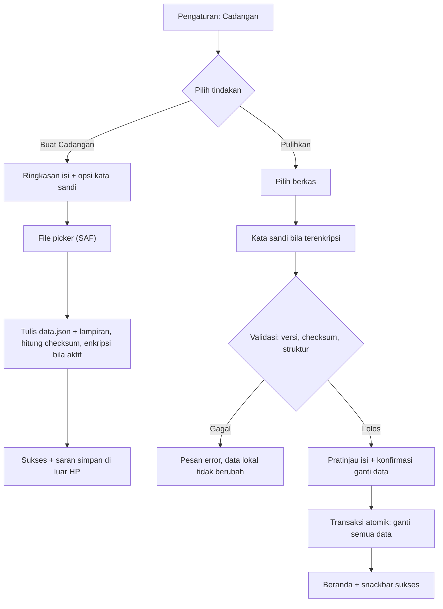

# PRD Revisi Fitur — Teman Kontrol (Umpan Balik Klien)

| Field | Value |
|---|---|
| Produk | Teman Kontrol (`id.temankontrol.app`) |
| Dokumen | `docs/PRD-REVISION-FEATURE.md` — **Change Request** terhadap `docs/PRD.md` v1.0 |
| Versi dokumen | **0.1 (Draft untuk review)** |
| Target versi PRD setelah disetujui | **1.1** (aplikasi 1.1.0 → 1.3.0, lihat §10) |
| Tanggal | 17 November 2026 |
| Status | **MERGED ke `docs/PRD.md` v2.0 (Final)** pada 17 Nov 2026. Dokumen ini dipertahankan sebagai catatan jejak Change Request; **satu-satunya acuan resmi (SSOT) sekarang adalah [PRD.md](PRD.md)**. |
| Sumber kebutuhan | 5 masukan klien (§2) |
| Baseline kondisi aplikasi | `docs/implementation-status.md` (diperbarui 17 Nov 2026) |

> [!IMPORTANT]
> Beberapa masukan klien **bertentangan dengan keputusan PRD v1.0** (backup dimatikan, tanpa INTERNET, tanpa notifikasi, tanpa login). Dokumen ini tidak diam-diam menimpa keputusan tersebut, tetapi mencatat konfliknya (§4), mengusulkan keputusan baru (DEC-022 s/d DEC-029), dan meminta persetujuan eksplisit.

---

## 1. Ringkasan Eksekutif

**Konteks.** Aplikasi v1.0 (MVP) sudah selesai secara fungsional: pasien dapat menyiapkan pertanyaan, mencatat hasil, dan melacak tindak lanjut — **offline, tanpa akun, data hanya di satu HP**. Klien menilai aplikasi perlu (a) perlindungan data bila HP rusak, (b) bukti visual/audio, (c) pertanyaan yang memancing penjelasan tenaga kesehatan, (d) fitur yang lebih menarik, dan (e) notifikasi.

**Jawaban singkat untuk tiap masukan:**

| # | Masukan klien | Jawaban singkat | Fitur |
|---|---|---|---|
| 1 | Backup bila HP rusak; bagaimana tanpa login? | **Ya, saat ini data akan hilang** bila HP rusak/hilang/di-reset (risiko R-11 yang sudah dicatat di PRD v1.0). Solusi yang diusulkan: **Cadangan & Pemulihan berbasis berkas** (`.tkbackup`, opsional terenkripsi) yang disimpan pengguna ke Google Drive/WhatsApp/flashdisk **tanpa login dan tanpa izin internet**. Sinkronisasi otomatis lintas-HP (butuh akun + server) **tidak** diusulkan sekarang; lihat §5.1. | F-10 |
| 2 | Fitur foto dan VN | **Lampiran foto** (kamera/galeri) dan **catatan suara** (rekam & putar) per kunjungan, disimpan privat di HP dan ikut dicadangkan. | F-13 (+ F-14 Kunci Aplikasi) |
| 3 | Pertanyaan terbuka (bukan ya/tidak) | Katalog saran **ditulis ulang agar semuanya pertanyaan terbuka** (apa/mengapa/bagaimana/jelaskan), ada **pembantu penulisan** dan **petunjuk lembut** bila pertanyaan bisa dijawab ya/tidak, serta kolom **"Jawaban yang Anda catat"** per pertanyaan. | F-11 |
| 4 | Fitur lain yang lebih menarik | Usulan 3 fitur bernilai tinggi yang selaras alur "sebelum–saat–sesudah kontrol": **Mode Konsultasi**, **Bawa Pertanyaan ke Kunjungan Berikutnya**, **Ringkasan & Bagikan**. Ide lain dicatat di backlog (§11). | F-15, F-16, F-17 |
| 5 | Ada notifikasi | **Pengingat lokal** (kunjungan, tenggat tindak lanjut, siapkan pertanyaan, cadangan) — bukan push online; isi notifikasi **privat di layar kunci** secara default. | F-12 |

**Rekomendasi urutan rilis:** R0 (menutup celah teknis) → **R1** Pertanyaan Terbuka + Cadangan + Pengingat → **R2** Foto/Suara + Kunci Aplikasi → **R3** Mode Konsultasi + Bawa Pertanyaan + Ringkasan (§10).

---

## 2. Umpan Balik Klien (Voice of Customer) & Interpretasi

Teks asli dicatat apa adanya, lalu diterjemahkan menjadi masalah yang dapat diuji. Bagian yang masih ambigu dikumpulkan sebagai pertanyaan terbuka di §14.

| ID | Kutipan klien (asli) | Interpretasi | Masalah yang diselesaikan | Asumsi / yang perlu dikonfirmasi |
|---|---|---|---|---|
| VOC-01 | "apakah bisa back up jika hp rusak … kalo tidak ada fitur login apakah ketika hp rusak dll datanya akan hilang jadi bagaimana solusinya?" | Klien khawatir kehilangan data dan mengira backup hanya mungkin lewat login. Ia meminta **solusi**, bukan harus login. | P-05: data tunggal di satu perangkat (R-11) | Klien menerima solusi tanpa akun? (OQ-12) |
| VOC-02 | "ada fitur foto dan vn" | Pengguna ingin melampirkan **foto** dan **voice note** pada kunjungan. Tujuan foto & VN belum disebut. | P-06: catatan teks tidak cukup (hasil pemeriksaan, kondisi fisik, penjelasan lisan sulit ditulis cepat) | Foto untuk apa? VN merekam percakapan atau dikte catatan? (OQ-13, OQ-14) |
| VOC-03 | "sediakan pertanyaan terbuka (… jawaban dr atau tenaga kesehatan tidak iya/tidak tetapi … membuat dr atau tenaga kesehatan itu menjelaskan)" | Katalog & penulisan pertanyaan harus mendorong **penjelasan**, bukan jawaban ya/tidak. Implisit: harus ada tempat mencatat penjelasan tersebut. | P-07: pertanyaan tertutup menghasilkan informasi minim | Final copy ditinjau tenaga kesehatan (OQ-17) |
| VOC-04 | "tambahkan fitur lain yang lebih menarik agar tidak terlalu simpel" | Klien menilai aplikasi **terlalu sederhana**. Permintaan terbuka; perlu kurasi agar tidak melanggar prinsip produk (ringan, privat, sederhana). | P-08: nilai pengguna kurang terasa | Prioritas fitur dipilih klien (OQ-16) |
| VOC-05 | "adaa notifikasi bangg" | Pengguna ingin diingatkan. Jenis notifikasi tidak disebut. | P-09: pengguna lupa jadwal & tenggat | Jenis & jam pengingat (OQ-15) |

### 2.1 Masalah baru (melengkapi PRD §5)

| ID | Problem | Root cause | Dampak |
|---|---|---|---|
| P-05 | Data hilang bila HP rusak/hilang/ganti | Offline, tanpa akun, backup OS dimatikan (DEC-006) | Seluruh riwayat hilang; kepercayaan pengguna turun |
| P-06 | Informasi penting tidak bisa dicatat sebagai teks | Hanya input teks | Detail hasil pemeriksaan/penjelasan lisan terlewat |
| P-07 | Pertanyaan tertutup (ya/tidak) menghasilkan jawaban singkat | Saran & kebiasaan menulis pertanyaan | Pengguna pulang tanpa pemahaman cukup |
| P-08 | Aplikasi terasa "hanya daftar" | Fitur v1.0 sengaja minimal | Daya tarik & retensi rendah |
| P-09 | Jadwal & tenggat terlewat | Aplikasi pasif (tidak mengingatkan) | Kunjungan/tindak lanjut terlewat (memperparah P-03) |

---

## 3. Goals, Non-Goals & Metrik Keberhasilan

### 3.1 Goals

| Jenis | Goal |
|---|---|
| Produk | Data pengguna dapat dipulihkan setelah HP rusak **tanpa akun**; pengguna dapat melampirkan foto/suara; pertanyaan mendorong penjelasan; pengguna diingatkan tepat waktu. |
| Pengguna | Tidak kehilangan riwayat; paham penjelasan tenaga kesehatan; tidak melewatkan kunjungan/tindak lanjut. |
| Proyek | Tetap **offline-first & privat**; APK ≤ 10 MB (NFR-028); tanpa SDK pihak ketiga yang mengirim data (NFR-035); tanpa regresi pada fitur v1.0. |

### 3.2 Non-Goals (tidak dikerjakan di revisi ini)

- Login/akun, server, sinkronisasi cloud real-time, berbagi data antar-pengguna (lihat §5.1 opsi C).
- Diagnosis, rekomendasi klinis, pengingat minum obat/dosis (risiko R-06 & kata terlarang "resep", lihat §11).
- Rekaman latar belakang saat layar mati (butuh *foreground service*; backlog).
- Transkripsi suara-ke-teks, ringkasan AI, OCR foto (butuh model/jaringan; backlog).
- iOS (tetap di luar scope, NFR-023).

### 3.3 Metrik (diukur lewat UAT & uji perangkat; tanpa analytics, NFR-035)

| Metrik | Target | Cara ukur |
|---|---|---|
| Ekspor → pulihkan di perangkat/emulator lain | **100%** data identik (jumlah & isi semua tabel + lampiran) | Uji otomatis (hash/hitung) + manual TC-029 |
| Task success "buat cadangan lalu pulihkan" | ≥ 4 dari 5 peserta UAT tanpa bantuan | UAT |
| Ketepatan pengingat | ≥ 95% pengingat muncul dalam ±15 menit dari jadwal pada Redmi Note 10S (pengaturan baterai default) | TC-035 (uji manual terjadwal) |
| Pertanyaan terbuka | **100%** template katalog lolos audit "bukan ya/tidak"; ≥ 70% pertanyaan yang dibuat dari saran/pembantu berformat terbuka pada UAT | Audit katalog (unit test) + observasi UAT |
| Lampiran | 0 crash/OOM saat membuka 10 foto + 5 suara per kunjungan di perangkat uji | TC-032 |
| Regresi | Seluruh test v1.0 (40 unit test) tetap hijau; AC-01..AC-22 tetap lulus | CI lokal |

---

## 4. Change Request (format PRD §28.3) & Konflik dengan PRD v1.0

### 4.1 Rekaman Change Request

| Kolom | Isi |
|---|---|
| Alasan | 5 masukan klien (§2); R-11 sudah memprediksi kehilangan data saat ganti HP |
| Nilai bagi pengguna | Data aman, informasi lebih kaya, diingatkan, pemahaman lebih baik |
| ID terdampak | DEC-006, DEC-011, DEC-014 (G-06), DEC-015, §3, §7, §9, §10, §11.2 #10, NFR-013, NFR-014, NFR-034, NFR-036, §12–§15, §20, §21, §23, §25, §28 butir 4, §29, §31 |
| Estimasi | Kasar, lihat §10 (R0–R3 ≈ 39–53 hari-orang; ±40%) |
| Risiko | §12 (R-12 s/d R-21) |
| Keputusan | **Belum diputuskan.** Usulan: setujui R1 sekarang; R2/R3 setelah R1 diuji klien |

### 4.2 Konflik dengan keputusan/aturan yang ada

| Aturan PRD v1.0 | Konflik dengan masukan | Penyelesaian yang diusulkan |
|---|---|---|
| **DEC-006** `allowBackup=false`; catatan kesehatan tidak keluar perangkat | Masukan 1 | **Dipertahankan.** Backup bersifat **inisiatif pengguna** (ekspor berkas), bukan Auto Backup Google. Data keluar perangkat hanya atas tindakan eksplisit pengguna. (DEC-022) |
| **DEC-011 / NFR-034** tanpa `INTERNET` & `ACCESS_NETWORK_STATE` | Masukan 1 (cloud) | **Dipertahankan.** Seluruh fitur revisi bekerja tanpa izin internet. Berkas dibagikan lewat Storage Access Framework / share sheet milik sistem. |
| **NFR-013** tidak ada field wajib berisi nama lengkap/NIK/BPJS/diagnosis/**foto dokumen** | Masukan 2 | **Diperjelas:** lampiran **opsional**, tidak pernah wajib; ditampilkan peringatan privasi saat pertama menambah foto (DEC-024). |
| **NFR-036** tanpa ContentProvider publik | Tangkapan kamera & berbagi PDF/berkas | Memakai `FileProvider` **tidak diekspor** (`exported=false`, izin sementara per-URI). Aturan diubah menjadi "tidak ada provider yang diekspor". |
| **§11.2 butir 10** gambar hanya vector drawable, tanpa image-loading library | Masukan 2 (foto pengguna) | Dikecualikan untuk **lampiran pengguna**: dekode bitmap dengan `ImageDecoder` + *downsample* + cache LRU buatan sendiri; tanpa library tambahan (DEC-024). |
| **§28 butir 4** login, backend, cloud, **notifikasi**, ekspor tidak boleh masuk P0 tanpa pengurangan scope | Masukan 1 & 5 | Diperlakukan sebagai **Change Request** ini; fitur diberi prioritas P1 (bukan P0) dan dirilis bertahap. Aturan tidak dilanggar: tidak ada P0 baru. |
| **§7 Out of scope: login/admin** | Masukan 1 | **Tetap di luar scope.** Opsi akun/cloud hanya dicatat sebagai alternatif (§5.1 opsi C) dan memerlukan PRD tersendiri. (DEC-023) |
| **DEC-014** `material-icons-extended` dilarang | — (temuan audit G-06) | Tidak terkait masukan klien, tetapi harus diselesaikan di R0 agar ikon baru konsisten. |

---

## 5. Keputusan Desain yang Diusulkan (menambah §2 Decision Log)

| ID | Keputusan | Alasan | Status |
|---|---|---|---|
| DEC-022 | Strategi cadangan = **ekspor/impor berkas `.tkbackup` oleh pengguna** via Storage Access Framework; Auto Backup OS tetap **mati** | Tanpa akun, tanpa izin internet, pengguna mengontrol lokasi; konsisten dengan DEC-006/011 | **Proposed** |
| DEC-023 | **Tidak ada login/akun** pada seri 1.x. Sinkronisasi cloud menjadi proyek terpisah bila klien tetap menginginkannya | Login+server mengubah model privasi, biaya, dan kepatuhan (data kesehatan = data pribadi spesifik menurut UU PDP No. 27/2022); PRD A-003/A-006 | **Proposed** |
| DEC-024 | Lampiran disimpan di **app-private storage** (`filesDir/attachments/`), foto dikompres & EXIF dibuang, suara AAC mono; metadata di Room | Privasi (NFR-014), ukuran terkendali, tanpa izin penyimpanan | **Proposed** |
| DEC-025 | Notifikasi = **notifikasi lokal terjadwal** (`AlarmManager.setAndAllowWhileIdle`, *inexact*), **bukan** push/FCM, tanpa `SCHEDULE_EXACT_ALARM` | Tanpa internet; menghindari izin alarm presisi yang ditolak default pada Android 14+ | **Proposed** |
| DEC-026 | Notifikasi **privat secara default**: layar kunci hanya menampilkan teks generik; judul kunjungan hanya bila pengguna mengaktifkan | Judul kunjungan bisa berisi info sensitif | **Proposed** |
| DEC-027 | "Pertanyaan terbuka" ditegakkan dengan **katalog terkurasi + pembantu + petunjuk lembut (tidak memblokir)** | Pertanyaan tertutup kadang sah ("Apakah saya boleh makan sebelum tes?"); memblokir mengurangi kontrol pengguna | **Proposed** |
| DEC-028 | **Kunci Aplikasi** memakai `BiometricPrompt` dengan `BIOMETRIC_STRONG or DEVICE_CREDENTIAL` (kunci layar perangkat); tidak menyimpan PIN sendiri | Tidak ada PIN yang perlu disimpan/di-reset; minSdk 30 mendukung kombinasi ini | **Proposed** |
| DEC-029 | Skema Room naik bertahap: **v2** (jawaban, log pengingat) → **v3** (lampiran), masing-masing dengan `Migration` + `MigrationTestHelper`; destructive migration tetap dilarang | PRD §15.4 | **Proposed** |

### 5.1 Analisis opsi solusi Masukan 1 (data aman saat HP rusak)

| Opsi | Cara kerja | Butuh login/akun app? | Butuh `INTERNET`? | Privasi | Bertahan saat HP rusak? | Usaha | Verdict |
|---|---|---|---|---|---|---|---|
| **A. Ekspor/impor berkas manual** (usulan) | Pengguna menekan "Buat Cadangan", memilih lokasi (Drive, WhatsApp ke diri sendiri, flashdisk); di HP baru "Pulihkan" | Tidak | Tidak | Tinggi (opsional kata sandi AES-256) | **Ya, bila berkas disimpan di luar HP** | Sedang | **Direkomendasikan (R1)** |
| **B. Auto Backup bawaan Android** (`allowBackup=true`) | Google mencadangkan otomatis ke akun Google pengguna | Tidak (akun Google di HP, bukan akun app) | Tidak (dikelola OS) | Sedang: data ke Google Drive pengguna; kontrol terbatas (batas ±25 MB, waktu tidak pasti, tidak bisa opt-in per fitur) | Ya, bila akun Google sama | Rendah | **Tidak direkomendasikan**: membalik DEC-006 dan melewatkan data tanpa persetujuan eksplisit; lampiran foto/suara cepat melebihi batas |
| **C. Akun + cloud sendiri** | Login, data disinkronkan ke server | **Ya** | **Ya** | Rendah–sedang: server menyimpan data kesehatan; wajib kebijakan privasi, keamanan server, kepatuhan UU PDP | Ya | Sangat tinggi (backend, auth, konflik sinkronisasi, biaya operasional) | **Di luar scope** (proyek terpisah) |
| **D. Cadangan otomatis ke folder pilihan** | Pengguna memilih folder sekali (SAF); aplikasi menulis cadangan berkala | Tidak | Tidak | Tinggi | Ya, bila folder ada di Drive/penyimpanan eksternal | Sedang–tinggi (penjadwalan latar belakang) | **Opsional R2+ (P2)**, memperluas opsi A |

> [!NOTE]
> Opsi A hanya melindungi bila pengguna **benar-benar menyimpan berkas di luar HP** dan **rutin memperbaruinya**. Karena itu fitur ini dilengkapi (1) peringatan bila berkas tersimpan di memori HP, (2) pengingat cadangan berkala (F-12), dan (3) indikator "Terakhir dicadangkan". Ini adalah batas jujur dari solusi tanpa akun, dan perlu dikomunikasikan ke klien.

---

## 6. Persona & User Stories Tambahan

Persona v1.0 tetap (Pasien dewasa; Pendamping). Tambahan konteks: **pasien yang berganti/kehilangan HP** dan **pendamping yang butuh ringkasan untuk dibagikan ke keluarga**.

| ID | Story | Pri | Fitur |
|---|---|---:|---|
| US-10 | Sebagai pasien, saya ingin membuat cadangan seluruh data ke satu berkas agar data saya aman bila HP rusak. | P1 | F-10 |
| US-11 | Sebagai pasien, saya ingin memulihkan data dari berkas cadangan di HP baru tanpa membuat akun. | P1 | F-10 |
| US-12 | Sebagai pasien, saya ingin melindungi cadangan dengan kata sandi agar orang lain tidak bisa membukanya. | P1 | F-10 |
| US-13 | Sebagai pasien, saya ingin saran pertanyaan yang meminta penjelasan agar tenaga kesehatan tidak hanya menjawab ya/tidak. | P1 | F-11 |
| US-14 | Sebagai pasien, saya ingin diingatkan bila pertanyaan saya bisa dijawab ya/tidak dan diberi cara mengubahnya. | P1 | F-11 |
| US-15 | Sebagai pasien, saya ingin mencatat penjelasan tenaga kesehatan di bawah setiap pertanyaan agar tidak lupa. | P1 | F-11 |
| US-16 | Sebagai pasien, saya ingin diingatkan sebelum jadwal kunjungan dan saat tenggat tindak lanjut agar tidak terlewat. | P1 | F-12 |
| US-17 | Sebagai pasien, saya ingin notifikasi tidak menampilkan detail sensitif di layar kunci agar privasi terjaga. | P1 | F-12 |
| US-18 | Sebagai pasien, saya ingin melampirkan foto (mis. hasil pemeriksaan) pada kunjungan agar semua tersimpan di satu tempat. | P1 | F-13 |
| US-19 | Sebagai pasien, saya ingin merekam catatan suara agar penjelasan yang sulit ditulis tetap tersimpan. | P1 | F-13 |
| US-20 | Sebagai pasien, saya ingin mengunci aplikasi dengan sidik jari/PIN HP agar foto dan catatan saya tidak dilihat orang lain. | P1 | F-14 |
| US-21 | Sebagai pasien, saya ingin tampilan fokus saat konsultasi (satu pertanyaan besar sekaligus) agar mudah dipakai saat waktu terbatas. | P2 | F-15 |
| US-22 | Sebagai pasien, saya ingin membawa pertanyaan yang belum dibahas ke kunjungan berikutnya agar tidak mengetik ulang. | P2 | F-16 |
| US-23 | Sebagai pendamping, saya ingin mengirim ringkasan kunjungan ke keluarga (teks/PDF). | P2 | F-17 |

---

## 7. Spesifikasi Fitur

Format mengikuti PRD §9 (Screen, Pri, Flow, Alternatif, Error, Aturan, Data). Teks UI memakai istilah di §8.1; copy final ditambahkan ke PRD §14.3 setelah disetujui.

### F-10 — Cadangan & Pemulihan (Backup & Restore)

- **Screen:** SCR-11 Cadangan & Pemulihan (dari SCR-10 Pengaturan). **Pri:** P1. **Rilis:** R1.
- **Tujuan:** pengguna dapat memulihkan seluruh data setelah HP rusak/hilang/di-reset, **tanpa akun dan tanpa internet**.
- **Flow ekspor:**
  1. Pengaturan → Cadangan → "Buat Cadangan".
  2. Layar menampilkan ringkasan isi (jumlah kunjungan, pertanyaan, lampiran) + perkiraan ukuran.
  3. Pengguna memilih **lindungi dengan kata sandi** (disarankan; default aktif) → isi & konfirmasi kata sandi (VR-17).
  4. Sistem membuka *file picker* (`ACTION_CREATE_DOCUMENT`), nama bawaan `TemanKontrol-AAAA-BB-HH.tkbackup`.
  5. Progres + tombol Batal → "Cadangan berhasil dibuat" + tombol **Bagikan** (opsional) + peringatan "Simpan salinan di luar HP ini".
  6. `last_backup_at` & `last_backup_data_version` disimpan di DataStore.
- **Flow pemulihan:**
  1. Pengaturan → Cadangan → "Pulihkan dari Berkas" → pilih berkas (`ACTION_OPEN_DOCUMENT`).
  2. Bila terenkripsi: minta kata sandi (maks. 5 percobaan beruntun, lalu jeda 30 detik pada layar yang sama).
  3. Validasi penuh **sebelum** menyentuh data (versi format, checksum, struktur) → **pratinjau**: tanggal cadangan, versi aplikasi, jumlah tiap entitas, ukuran lampiran.
  4. Bila data lokal tidak kosong: dialog "Data saat ini akan **diganti**. Buat cadangan data saat ini dulu?" (C-84). Pemulihan bersifat **ganti semua** (bukan gabung) pada 1.x; mode gabung masuk backlog karena butuh aturan konflik.
  5. Konfirmasi → pemulihan **atomik** (semua berhasil atau tidak ada yang berubah) → Beranda + snackbar sukses.
- **Format berkas `.tkbackup`** (satu berkas ZIP; seluruh isi dienkripsi bila kata sandi dipakai):

```text
manifest.json     { format_version, app_version, db_schema_version, created_at (epoch ms),
                    counts{consultations,questions,notes,followups,attachments}, sha256_data, encrypted:false }
data.json         { consultations[], questions[], consultation_notes[], follow_up_actions[], attachments[] }
attachments/<id>.<jpg|m4a>   (hanya R2+; di R1 daftar attachments kosong)
```

  - Enkripsi (bila aktif): `PBKDF2WithHmacSHA256` (≥ **600.000 iterasi**, salt acak 16 byte, sesuai OWASP Password Storage Cheat Sheet) → kunci AES-256 → `AES/GCM/NoPadding` (IV acak 12 byte per berkas, tag 128 bit). Header (salt, iterasi, versi) disimpan tidak terenkripsi agar bisa dibaca saat pemulihan. Kata sandi **tidak disimpan** dan **tidak dapat dipulihkan** — pengguna diperingatkan eksplisit.
  - `format_version` dirancang **sejak R1** menyertakan daftar `attachments` agar cadangan R1 tetap dapat dibaca di R2+.
- **Kompatibilitas:** berkas dari versi format **lebih baru** daripada aplikasi → ditolak dengan pesan "Perbarui Teman Kontrol lalu coba lagi" (C-86). Berkas lebih lama → diterima lewat jalur konversi data.
- **Alternatif/Error:**
  - Pengguna membatalkan *picker* → kembali tanpa perubahan, tanpa pesan error.
  - Ruang penyimpanan tujuan tidak cukup / tulis gagal → pesan + coba lagi; berkas parsial dihapus.
  - Berkas rusak / checksum salah / kata sandi salah → pesan spesifik (C-85); data lokal **tidak berubah**.
  - Aplikasi dihentikan saat pemulihan → data lama utuh (transaksi dibatalkan; file lampiran memakai direktori *staging* lalu dipindah setelah commit).
  - Berkas disimpan di penyimpanan lokal HP (heuristik dari authority URI, mis. `com.android.externalstorage.documents`/Downloads) → tampilkan peringatan "Berkas ini ada di HP ini; jika HP rusak, berkas ikut hilang. Salin ke Drive/komputer." (*best effort*, tidak memblokir).
- **Aturan:** I/O di `Dispatchers.IO`; streaming (tidak memuat seluruh lampiran ke memori); ekspor tidak mengubah data; log tidak berisi isi pengguna (NFR-017).
- **Cadangan otomatis ke folder pilihan (opsi D):** *P2, tidak masuk R1*. Pengguna memilih folder (`OpenDocumentTree` + izin persisten); cadangan mingguan via penjadwal latar belakang; menimpa maksimal 3 berkas terakhir. Memerlukan keputusan OQ-12.



### F-11 — Pertanyaan Terbuka & Jawaban

- **Screen:** SCR-05 (form & katalog saran, sudah ada), SCR-04 (Detail). **Pri:** P1. **Rilis:** R1 (mayoritas konten, biaya rendah).
- **Definisi "pertanyaan terbuka" untuk produk ini:** pertanyaan yang tidak dapat dijawab cukup dengan "ya/tidak" atau satu kata, dan **meminta tenaga kesehatan menjelaskan** (diawali *Apa, Apa saja, Mengapa, Bagaimana, Jelaskan/Tolong jelaskan*). Pertanyaan faktual singkat ("Kapan kontrol lagi?") dibedakan sebagai **pertanyaan faktual**, bukan terbuka.
- **Audit katalog v1.0 (PRD §14.4, 16 template):**

| Temuan | Template | Tindakan |
|---|---|---|
| Tertutup (ya/tidak) — 1 | "Apakah ada aktivitas yang sebaiknya saya hindari?" | **Tulis ulang** menjadi terbuka |
| Faktual singkat — 4 | "Berapa lama … membaik?", "Kapan dan bagaimana … hasilnya?", "Kapan saya perlu kontrol lagi?", "Siapa yang dapat saya hubungi …?" | **Perkaya** agar meminta penjelasan, bukan hanya angka/nama |
| Sudah terbuka — 11 | sisanya | Pertahankan / sempurnakan |

- **FR-033 Katalog baru.** Semua template harus lolos audit (§8.3 aturan, diuji unit test). Usulan isi (final ditinjau tenaga kesehatan, OQ-17), **tanpa** kata terlarang PRD §3:

| Kategori | Template usulan |
|---|---|
| Gejala | 1. "Apa kemungkinan penyebab keluhan yang saya alami? Tolong jelaskan." 2. "Keluhan seperti apa yang perlu saya perhatikan, dan apa yang harus saya lakukan jika itu terjadi?" 3. "Bagaimana perkembangan keluhan ini biasanya, dan berapa lama saya perlu menunggu perbaikan?" 4. "Aktivitas atau kebiasaan apa saja yang sebaiknya saya sesuaikan selama masa ini, dan mengapa?" |
| Pemeriksaan | 5. "Pemeriksaan apa yang perlu saya jalani, dan apa tujuannya?" 6. "Bagaimana saya harus mempersiapkan diri sebelum pemeriksaan?" 7. "Bagaimana dan kapan saya akan mendapat hasilnya, dan siapa yang akan menjelaskannya?" 8. "Tolong jelaskan arti hasil pemeriksaan saya dengan bahasa yang mudah saya pahami." |
| Perawatan | 9. "Apa saja pilihan perawatan yang tersedia, beserta manfaat dan risikonya masing-masing?" 10. "Bagaimana cara yang benar menggunakan obat ini, dan apa yang terjadi jika saya salah menggunakannya?" 11. "Efek samping apa yang mungkin muncul, dan bagaimana saya mengenalinya?" 12. "Apa yang terjadi jika saya memilih untuk tidak menjalani perawatan ini?" |
| Langkah Berikutnya | 13. "Bagaimana rencana kontrol saya berikutnya, dan apa yang perlu dipantau sampai saat itu?" 14. "Siapa yang bisa saya hubungi, dan bagaimana caranya, bila saya punya pertanyaan di rumah?" 15. "Tanda-tanda apa yang berarti saya perlu segera kembali, dan ke mana saya harus pergi?" 16. "Apa yang perlu saya siapkan atau bawa pada kunjungan berikutnya?" |
| **Pemahaman** *(kategori baru)* | 17. "Apa masalah utama saya saat ini, menurut tenaga kesehatan?" 18. "Apa yang perlu saya lakukan berikutnya, langkah demi langkah?" 19. "Mengapa langkah tersebut penting untuk saya?" 20. "Bagaimana penjelasan ini bisa saya sampaikan kepada keluarga di rumah?" |

  Kategori "Pemahaman" terinspirasi pola *Ask Me 3* dan *teach-back* (health literacy); kategori Perawatan memuat pola *BRAN* (manfaat, risiko, alternatif, tidak melakukan apa-apa) [REF-10..12]. Panjang template ≤ 250 karakter (VR-06). Disimpan sebagai konstanta Kotlin (DEC-012). `SuggestionCategory` mendapat nilai baru `UNDERSTANDING`.

- **FR-034 Pembantu penulisan.** Pada form pertanyaan, deretan *chip* "Mulai dengan: **Apa…** · **Mengapa…** · **Bagaimana…** · **Jelaskan…** · **Apa saja…**". Tap menyisipkan awalan di awal teks (bila field kosong; bila berisi, tidak menimpa — hanya menambah di awal kalimat setelah konfirmasi seperti F-07).
- **FR-035 Petunjuk pertanyaan tertutup (lembut, tidak memblokir).** Setelah pengguna selesai mengetik (saat fokus berpindah/Simpan ditekan), bila kata pertama (huruf kecil, setelah *trim*) ∈ {`apakah`, `bolehkah`, `bisakah`, `haruskah`, `perlukah`, `benarkah`, `sudahkah`, `adakah`} (daftar dikunci di kode, sama dengan aturan #2 §8.3) **atau** teks diakhiri "ya/tidak?" atau "…, ya?" → tampilkan kartu info C-81: *"Pertanyaan ini bisa dijawab ya/tidak. Coba ubah agar tenaga kesehatan menjelaskan — misalnya mulai dengan 'Mengapa…' atau 'Bagaimana…'."* dengan tombol **Ubah** (fokus kembali ke field) dan **Tetap Gunakan** (menutup; tidak muncul lagi untuk teks yang sama). Penyimpanan **tidak** pernah diblokir (DEC-027). Deteksi memakai fungsi murni di `domain/validation` (VR-18, diuji unit).
- **FR-036 Jawaban yang Anda catat.** Setiap pertanyaan memiliki kolom opsional `answer` (≤ 1.000 karakter, VR-13).
  - Tampil di SCR-04 di bawah pertanyaan (maks. 3 baris, "Lihat selengkapnya"), label tetap **"Jawaban yang Anda catat"** (tidak boleh "Jawaban dokter", PRD §3 butir "catatan pengguna").
  - Saat pengguna mencentang **Sudah dibahas**, muncul *snackbar* aksi "Catat penjelasannya" (tidak memaksa).
  - Pengeditan lewat SCR-05 (bagian baru "Jawaban"). Menghapus pertanyaan menghapus jawabannya; dialog C-30 diperbarui menyebut "beserta jawabannya" bila ada.
  - Cadangan, ringkasan (F-17), dan Mode Konsultasi (F-15) menyertakan jawaban.
- **FR-037** Jawaban dapat dilengkapi catatan suara (bergantung F-13, R2).
- **Data:** `questions.answer TEXT NULL`, `questions.answer_updated_at INTEGER NULL` (migrasi v1→v2). Aturan normalisasi sama dengan field multiline (hanya *trim*; kosong → `null`).
- **Aturan:** `isDiscussed` tetap independen dari `answer` (pertanyaan boleh sudah dibahas tanpa jawaban tercatat, dan sebaliknya).

### F-12 — Pengingat (Notifikasi Lokal)

- **Screen:** SCR-12 Pengingat (dari SCR-10 Pengaturan). **Pri:** P1. **Rilis:** R1.
- **Prinsip:** *notifikasi lokal* yang dihitung dari data di HP. **Bukan** push online (tidak butuh `INTERNET`/FCM). Pengguna mengontrol penuh setiap jenis pengingat.

| Jenis | Kapan muncul (default) | Default | Dibatalkan bila |
|---|---|---|---|
| **R-A Kunjungan** | **H-1 pukul 19.00** dan **2 jam sebelum** jam kunjungan | Aktif | Status ≠ Terjadwal; kunjungan dihapus/diubah (jadwal ulang) |
| **R-B Siapkan pertanyaan** | H-2 pukul 19.00, hanya bila jumlah pertanyaan = 0 | Aktif | Pertanyaan pertama ditambahkan; status ≠ Terjadwal |
| **R-C Tenggat tindak lanjut** | Pada tanggal tenggat pukul **08.00**; satu pengingat "terlambat" pada H+1 pukul 08.00 (sekali, tidak berulang) | Aktif | Tindak lanjut selesai/dihapus/tenggat diubah |
| **R-D Cadangan** | Setiap 30 hari bila ada perubahan data sejak cadangan terakhir | Aktif | Cadangan dibuat |

- **FR-038..FR-040:** jenis R-A, R-B, R-C di atas. Pengguna dapat mengubah jam (R-A/R-B/R-C) dan mematikan tiap jenis.
- **FR-041:** R-D mengikuti `last_backup_at`/`data_changed_since_backup` (F-10).
- **FR-042 Privasi notifikasi (DEC-026).** Default: judul notifikasi "Teman Kontrol"; isi generik, mis. *"Ada kunjungan besok pukul 09.00"*; `setVisibility(VISIBILITY_PRIVATE)` dengan `publicVersion` generik "Pengingat Teman Kontrol". Opsi **"Tampilkan judul kunjungan di notifikasi"** (default **mati**) menambahkan judul setelah perangkat dibuka. Tidak pernah memuat isi pertanyaan/catatan/nama tenaga kesehatan.
- **FR-043 Interaksi.** Tap notifikasi membuka layar terkait (Detail kunjungan / Pengaturan Cadangan) lewat *deep link* type-safe (DEC-016); jika data tidak ada → C-52.
- **FR-044 Penjadwalan ulang otomatis.** Jadwal dihitung ulang saat: kunjungan/tindak lanjut dibuat/diubah/dihapus/ganti status; perangkat *reboot* (`RECEIVE_BOOT_COMPLETED`); aplikasi diperbarui; zona waktu/jam sistem berubah; pemulihan dari cadangan (F-10); pengaturan pengingat diubah.
- **FR-045 Izin.** Android 13+ (`POST_NOTIFICATIONS`): izin diminta **kontekstual** (saat pengguna pertama kali mengaktifkan/menyimpan kunjungan dengan pengingat aktif), bukan saat peluncuran. Ditolak → banner di SCR-12 "Notifikasi dimatikan di pengaturan HP" + tombol **Buka Pengaturan**; aplikasi tetap berfungsi penuh.
- **FR-046 Panduan perangkat agresif baterai.** Pada produsen yang diketahui menghentikan alarm (mis. Xiaomi/MIUI — termasuk perangkat uji Redmi Note 10S), tampilkan sekali info "Agar pengingat tepat waktu, izinkan Teman Kontrol berjalan otomatis / tanpa pembatasan baterai" dengan pintasan ke pengaturan sistem; tidak memblokir.
- **Arsitektur (DEC-025):**
  - `ReminderPlanner` — **fungsi murni** (input: kunjungan, tindak lanjut, pengaturan, `Clock`; output: daftar `Reminder(type, refId, triggerAt)`), dapat di-unit-test penuh.
  - `ReminderScheduler` — memasang **satu alarm** untuk pengingat terdekat dengan `setAndAllowWhileIdle` (*inexact*, tanpa `SCHEDULE_EXACT_ALARM`); `BroadcastReceiver` memposting pengingat yang jatuh tempo lalu menjadwalkan ulang yang berikutnya (pola ini menghindari batas jumlah alarm per aplikasi).
  - Log `reminder_log(key, fired_at)` mencegah notifikasi ganda; entri > 30 hari dibersihkan.
  - **Toleransi keterlambatan:** pengingat kunjungan yang terlewat (HP mati/Doze) tetap diposting bila terlambat ≤ 6 jam dan **sebelum** jam kunjungan; jika kunjungan sudah lewat → dilewati.
  - **Jam hening:** waktu hasil hitung antara 22.00–06.00 digeser ke 06.00 bila masih sebelum jam kunjungan; bila tidak mungkin → dilewati.
  - *Notification channel*: `visit_reminders` (importance tinggi), `followup_reminders` (default), `backup_reminders` (rendah).
- **Izin manifest baru:** `POST_NOTIFICATIONS`, `RECEIVE_BOOT_COMPLETED` (tetap **tanpa** `INTERNET`).
- **Data:** tabel `reminder_log`; pengaturan di DataStore (`reminder_visit_enabled`, `reminder_visit_hour`, `reminder_prepare_enabled`, `reminder_followup_enabled`, `reminder_followup_hour`, `reminder_backup_enabled`, `notif_show_title`).
- **Ditunda (P2):** tombol aksi di notifikasi ("Tandai selesai", "Tunda 1 jam"); jam pengingat per-kunjungan.

### F-13 — Lampiran Foto & Catatan Suara

- **Screen:** SCR-04 (bagian **Lampiran**), SCR-13 Penampil Foto, SCR-14 Perekam Suara (*bottom sheet*), SCR-06 (tombol lampir dari Hasil Konsultasi). **Pri:** P1. **Rilis:** R2 (**dirilis bersama F-14 Kunci Aplikasi**).
- **Tujuan:** menyimpan bukti visual (mis. hasil pemeriksaan, kondisi fisik) dan penjelasan lisan yang sulit ditulis cepat. Lampiran **milik kunjungan**, dan *opsional* ditautkan ke satu pertanyaan sebagai "penjelasan suara".
- **Foto (FR-047, FR-048):**
  - Sumber: **Kamera** (`ActivityResultContracts.TakePicture` → tanpa izin `CAMERA`; menulis ke URI `FileProvider` pada folder *cache* privat) dan **Galeri** (`PickVisualMedia` Photo Picker → tanpa izin penyimpanan).
  - Pemrosesan di `Dispatchers.Default/IO`: dekode dengan `ImageDecoder` (otomatis menerapkan orientasi EXIF) + *downsample* ke sisi terpanjang **≤ 1.600 px**, simpan JPEG kualitas 80 → **metadata EXIF (termasuk lokasi) tidak ikut tersimpan**. File sementara kamera di *cache* dihapus setelah diproses. Target rata-rata ≤ 500 KB/foto.
  - Penampil: *pinch-to-zoom*, keterangan opsional (≤ 100 karakter, VR-14), hapus.
  - Peringatan sekali saat pertama kali (C-87): *"Hindari memotret dokumen berisi NIK, nomor BPJS, atau data pribadi yang tidak diperlukan."*
- **Catatan suara (FR-049, FR-050):**
  - Rekam dengan `MediaRecorder` (AAC-LC, mono, ±32 kbps, 16 kHz → ≈ 240 KB/menit) — **maks. 10 menit** per rekaman (VR-15), pengatur waktu tampil, kontrol Mulai/Jeda/Selesai/Batal.
  - Izin `RECORD_AUDIO` diminta kontekstual saat pertama kali menekan Rekam; ditolak → penjelasan + pintasan ke pengaturan; "tolak permanen" ditangani.
  - **Persetujuan percakapan (C-88):** sebelum rekaman pertama dan sebagai teks tetap di *bottom sheet*: *"Rekam percakapan hanya setelah tenaga kesehatan menyetujui."* (Aplikasi tidak memberi nasihat hukum; ini pengingat etika.)
  - Rekaman otomatis **berhenti & tersimpan** bila aplikasi ke latar belakang, layar mati, atau fokus audio hilang (mis. telepon masuk). **Tidak ada rekaman latar belakang** (butuh *foreground service* microphone; backlog).
  - Pemutaran: `MediaPlayer` (tanpa library), tombol putar/jeda, *seek bar*, kecepatan 1×/1,5×/2×; berhenti saat aplikasi di latar belakang.
  - Keterangan opsional ≤ 100 karakter (VR-14).
- **Batas & penyimpanan (FR-051, FR-052, DEC-024):** lampiran Foto & VN dapat ditambahkan langsung **per pertanyaan** (`AttachmentTarget.QUESTION`) maupun pada bagian **Catatan Tambahan / Hasil Konsultasi** (`AttachmentTarget.ADDITIONAL_NOTE`) untuk penjelasan tambahan tenaga medis. Maks. **10 foto + 5 catatan suara per kunjungan** (konstanta; worst case ≈ 5 MB + 12 MB ≈ 17 MB); peringatan bila total lampiran aplikasi > 500 MB; menolak merekam/menyimpan bila ruang kosong < 50 MB (C-89). File di `filesDir/attachments/<consultationId>/<attachmentId>.<jpg|m4a>`; nama file memakai UUID (bukan nama asli/ judul kunjungan).
- **Integritas (FR-053):** menghapus lampiran → dialog konfirmasi (DEC-017) lalu file fisik dihapus. **Menghapus kunjungan menghapus semua file lampirannya** (FK CASCADE menghapus baris tetapi *tidak* file; repository mengumpulkan path dalam transaksi lalu menghapus file; **pembersih yatim piatu** berjalan saat start untuk file tanpa baris & baris tanpa file). Hal ini menjaga NFR-016 (hapus = benar-benar terhapus).
- **Cadangan (FR-055):** lampiran ikut ekspor/pulihkan (F-10), dengan estimasi ukuran dan streaming.
- **Ketahanan (FR-056):** kamera tidak tersedia/dibatalkan; izin ditolak; penyimpanan penuh; file lampiran hilang atau rusak → *placeholder* "Lampiran tidak dapat dibuka" + opsi **Hapus**; rotasi layar tidak menghentikan rekaman (state di ViewModel) dan tidak menggandakan lampiran.
- **Tampilan:** *thumbnail* didekode di luar *main thread* dengan `inSampleSize`/`ImageDecoder.setTargetSize` + cache LRU (≤ 1/8 *heap*); `LazyVerticalGrid` dengan `key`; tanpa library gambar (DEC-024; bandingkan dengan Coil bila kompleksitas meningkat → OQ-19).
- **Izin manifest baru:** `RECORD_AUDIO`. `FileProvider` (`exported=false`, hanya folder *cache*) dipakai untuk tangkapan kamera dan berbagi (F-17).
- **Data (migrasi v2→v3):** tabel `attachments` (lihat §9).
- **Ditunda (P2):** bagikan satu foto/suara; foto dalam PDF ringkasan; kompresi ulang manual; transkripsi suara.

### F-14 — Kunci Aplikasi (privasi lampiran)

- **Screen:** SCR-10 (setelan), SCR-15 (layar kunci). **Pri:** P1. **Rilis:** R2 (ikut F-13 karena foto/suara meningkatkan sensitivitas data).
- **FR-057:** pengguna dapat mengaktifkan **Kunci Aplikasi**; saat aktif, aplikasi meminta autentikasi (`BiometricPrompt`, `BIOMETRIC_STRONG or DEVICE_CREDENTIAL`) setiap dibuka dan setelah di latar belakang melewati batas waktu (pilihan: langsung / 1 menit / 5 menit; default 1 menit). Tidak ada PIN buatan sendiri (DEC-028).
- **FLAG_SECURE (opsi, default aktif saat Kunci aktif):** menyembunyikan konten di layar *recent apps* dan memblokir tangkapan layar.
- **Edge:** perangkat tanpa kunci layar/biometrik → fitur tidak tersedia + penjelasan "Atur kunci layar HP dulu"; kunci layar HP dihapus setelah Kunci Aplikasi aktif → aplikasi menonaktifkan Kunci secara otomatis dan memberi tahu (hindari terkunci permanen); autentikasi dibatalkan → tetap terkunci; notifikasi tetap privat (F-12).
- **Catatan:** Kunci Aplikasi **bukan enkripsi data** (DEC-015 tetap: andalkan File-Based Encryption). Ini menutup OQ-08 (app lock) sebagai bagian revisi ini.
- **Dependensi baru:** `androidx.biometric` (ukuran dikonfirmasi saat implementasi; masuk anggaran §8.2).

### F-15 — Mode Konsultasi *(fitur "menarik" 1)*

- **Screen:** SCR-16. **Pri:** P2. **Rilis:** R3.
- **Ide:** tampilan fokus untuk fase **saat kontrol**: satu pertanyaan besar pada satu waktu, mudah dibaca di ruang periksa.
- **Flow:** SCR-04 (kunjungan Terjadwal) → tombol **Mulai Konsultasi** → layar menampilkan pertanyaan (prioritas lebih dulu, urutan sama dengan F-03), indikator "2 dari 7", teks ≥ 24 sp. Aksi: **Sudah dibahas** (centang), **Catat jawaban** (kolom teks inline, F-11), **Rekam penjelasan** (F-13, bila R2 tersedia), **Lewati/Nanti**, **Sebelumnya/Berikutnya** (tombol dan geser). Layar tetap menyala (`FLAG_KEEP_SCREEN_ON`, dilepas saat keluar).
- **Selesai:** setelah pertanyaan terakhir → ringkasan "x dari y dibahas" + tombol **Isi Hasil Konsultasi** (SCR-06) dan **Tandai Selesai** (status, DEC-010). Keluar di tengah jalan tanpa kehilangan data (setiap aksi langsung tersimpan seperti F-03).
- **Aturan:** memakai data & repository yang sudah ada (tanpa tabel baru); aksesibel (TalkBack membaca pertanyaan + status), tidak terpotong pada font scale 2,0 (NFR-012/052).

### F-16 — Bawa Pertanyaan ke Kunjungan Berikutnya *(fitur "menarik" 2)*

- **Screen:** dialog di SCR-04/SCR-08, form SCR-03. **Pri:** P2. **Rilis:** R3.
- **Flow:** saat status diubah ke **Selesai** (atau menu ⋮ → "Bawa pertanyaan"), bila ada pertanyaan **belum dibahas** → dialog "Bawa {n} pertanyaan yang belum dibahas ke kunjungan berikutnya?" → pilih kunjungan Terjadwal yang ada **atau** "Buat kunjungan baru" (form SCR-03 terisi judul "Kontrol lanjutan", tanggal kosong).
- **Aturan:** pertanyaan **disalin** (UUID baru, `isDiscussed=false`, tanpa jawaban); prioritas dipertahankan selama total ≤ 3 prioritas di tujuan (sisanya menjadi non-prioritas, dilaporkan); duplikat (VR-08) dilewati dan dihitung dalam ringkasan "Dibawa 5, dilewati 1 (sudah ada)"; kunjungan asal **tidak berubah**. Dilakukan dalam satu transaksi.

### F-17 — Ringkasan & Bagikan *(fitur "menarik" 3; menutup OQ-07)*

- **Screen:** SCR-17 Pratinjau Ringkasan (dari menu ⋮ Detail). **Pri:** P2. **Rilis:** R3.
- **Isi ringkasan:** judul, tanggal, fasilitas & nama tenaga kesehatan (bila ada), pertanyaan + "Jawaban yang Anda catat", Hasil Konsultasi (label "Catatan pengguna"), tindak lanjut + status/tenggat. Catatan kaki: *"Dibuat oleh pengguna dengan Teman Kontrol. Bukan dokumen medis resmi."* Lampiran **tidak** disertakan secara default.
- **Format:** teks biasa (`ACTION_SEND` `text/plain`) dan **PDF** (`android.graphics.pdf.PdfDocument`, A4, tanpa library). PDF dibuat di *cache*, dibagikan via `FileProvider` (tidak diekspor; izin URI sementara), dibersihkan setelah dibagikan/saat start.
- **Aturan:** pratinjau sebelum berbagi; pengguna dapat mematikan bagian tertentu (mis. nama tenaga kesehatan); tidak ada koneksi jaringan oleh aplikasi (berbagi ditangani aplikasi lain atas pilihan pengguna).

---

## 8. Requirements

### 8.1 Glosarium tambahan (menambah PRD §3)

| Istilah UI (ID) | Nama di Kode | Definisi |
|---|---|---|
| Cadangan | `Backup` | Berkas `.tkbackup` berisi seluruh data pengguna. |
| Pulihkan | `Restore` | Mengganti seluruh data lokal dengan isi cadangan. |
| Pengingat | `Reminder` | Notifikasi lokal terjadwal. |
| Lampiran | `Attachment` | Foto atau catatan suara milik satu kunjungan. |
| Foto | `AttachmentKind.PHOTO` | Lampiran gambar. |
| Catatan Suara | `AttachmentKind.VOICE` | Lampiran rekaman suara (istilah populer: *VN*). |
| Jawaban yang Anda catat | `Question.answer` | Penjelasan tenaga kesehatan yang dicatat pengguna untuk satu pertanyaan. |
| Pertanyaan terbuka | — (aturan katalog) | Pertanyaan yang meminta penjelasan, bukan jawaban ya/tidak. |
| Kunci Aplikasi | `AppLock` | Autentikasi sebelum aplikasi dibuka. |
| Mode Konsultasi | `ConsultationMode` | Tampilan fokus satu pertanyaan sekaligus. |

**Kata terlarang tambahan di UI/notifikasi:** "rekam medis" (termasuk untuk foto), "jawaban dokter", "diagnosis", "resep", "darurat" (kecuali disclaimer), "dosis", "minum obat sekarang".

### 8.2 Functional Requirements (melanjutkan FR-025)

| ID | Requirement | Pri | Rilis | Fitur |
|---|---|---:|---|---|
| FR-026 | Mengekspor seluruh data ke satu berkas `.tkbackup` ke lokasi pilihan pengguna (SAF) tanpa izin penyimpanan/internet. | P1 | R1 | F-10 |
| FR-027 | Opsi enkripsi berkas dengan kata sandi (PBKDF2 + AES-256-GCM); kata sandi tidak disimpan. | P1 | R1 | F-10 |
| FR-028 | Memulihkan dari `.tkbackup`: validasi → pratinjau → konfirmasi → ganti seluruh data secara atomik. | P1 | R1 | F-10 |
| FR-029 | Menampilkan "Terakhir dicadangkan" dan memberi peringatan bila berkas tersimpan di HP. | P1 | R1 | F-10 |
| FR-030 | Membagikan berkas cadangan via share sheet setelah ekspor (opsional). | P2 | R1 | F-10 |
| FR-031 | Ekspor/pemulihan: progres, pembatalan, kegagalan tidak merusak data. | P1 | R1 | F-10 |
| FR-032 | Cadangan otomatis ke folder pilihan (mingguan). | P2 | R2+ | F-10 |
| FR-033 | Katalog saran 100% pertanyaan terbuka + kategori Pemahaman (§7 F-11). | P1 | R1 | F-11 |
| FR-034 | Chip pembantu awalan pertanyaan (Apa/Mengapa/Bagaimana/Jelaskan/Apa saja). | P1 | R1 | F-11 |
| FR-035 | Petunjuk lembut (tidak memblokir) untuk pertanyaan yang cenderung ya/tidak. | P1 | R1 | F-11 |
| FR-036 | Kolom "Jawaban yang Anda catat" per pertanyaan (≤ 1.000 karakter). | P1 | R1 | F-11 |
| FR-037 | Catatan suara dapat ditautkan ke pertanyaan sebagai penjelasan suara. | P2 | R2 | F-11/F-13 |
| FR-038 | Pengingat kunjungan (default H-1 19.00 & 2 jam sebelum). | P1 | R1 | F-12 |
| FR-039 | Pengingat siapkan pertanyaan (H-2, hanya bila 0 pertanyaan). | P2 | R1 | F-12 |
| FR-040 | Pengingat tenggat tindak lanjut (hari-H 08.00 & sekali H+1). | P1 | R1 | F-12 |
| FR-041 | Pengingat cadangan berkala (30 hari bila ada perubahan). | P1 | R1 | F-12 |
| FR-042 | Notifikasi privat secara default; judul kunjungan opsional. | P1 | R1 | F-12 |
| FR-043 | Tap notifikasi membuka layar terkait; data hilang → C-52. | P1 | R1 | F-12 |
| FR-044 | Jadwal dihitung ulang pada perubahan data, reboot, update, perubahan zona waktu, pemulihan. | P1 | R1 | F-12 |
| FR-045 | Izin notifikasi diminta kontekstual; penolakan ditangani tanpa memblokir aplikasi. | P1 | R1 | F-12 |
| FR-046 | Panduan sekali untuk perangkat dengan pembatasan baterai agresif. | P2 | R1 | F-12 |
| FR-047 | Menambah foto dari kamera dan galeri (tanpa izin CAMERA/penyimpanan). | P1 | R2 | F-13 |
| FR-048 | Foto dikompres (≤ 1.600 px, JPEG q80) dan EXIF dibuang; disimpan privat. | P1 | R2 | F-13 |
| FR-049 | Merekam & memutar catatan suara (maks. 10 menit). | P1 | R2 | F-13 |
| FR-050 | Rekaman berhenti & tersimpan saat aplikasi ke latar belakang/fokus audio hilang. | P1 | R2 | F-13 |
| FR-051 | Lampiran milik kunjungan, opsional ditautkan ke pertanyaan; tampil di bagian Lampiran. | P1 | R2 | F-13 |
| FR-052 | Batas 10 foto + 5 suara per kunjungan; pemeriksaan ruang kosong ≥ 50 MB. | P1 | R2 | F-13 |
| FR-053 | Hapus lampiran/kunjungan menghapus file fisik; pembersih yatim piatu saat start. | P1 | R2 | F-13 |
| FR-054 | Peringatan privasi foto & persetujuan percakapan sebelum rekaman pertama. | P1 | R2 | F-13 |
| FR-055 | Cadangan/pemulihan menyertakan lampiran. | P1 | R2 | F-13/F-10 |
| FR-056 | Penanganan lampiran hilang/rusak, izin ditolak, penyimpanan penuh. | P1 | R2 | F-13 |
| FR-057 | Kunci Aplikasi via BiometricPrompt + kunci layar perangkat; FLAG_SECURE opsional. | P1 | R2 | F-14 |
| FR-058 | Mode Konsultasi (satu pertanyaan fokus, layar tetap menyala). | P2 | R3 | F-15 |
| FR-059 | Membawa pertanyaan belum dibahas ke kunjungan berikutnya (salin, dedupe, atomik). | P2 | R3 | F-16 |
| FR-060 | Ringkasan kunjungan teks & PDF dengan pratinjau dan berbagi via share sheet. | P2 | R3 | F-17 |

### 8.3 Aturan Katalog "Pertanyaan Terbuka" (diuji unit test, FR-033)

1. Setiap template diawali salah satu: `Apa`, `Apa saja`, `Mengapa`, `Bagaimana`, `Tolong jelaskan`, `Siapa … dan bagaimana`, `Tanda-tanda apa`, `Efek samping apa`, `Pemeriksaan apa`, `Keluhan seperti apa`, `Aktivitas atau kebiasaan apa` (daftar awalan dikunci di kode).
2. **Tidak ada** template yang diawali `Apakah`, `Bisakah`, `Bolehkah`, `Haruskah`, `Perlukah`, `Benarkah`, `Sudahkah`, `Adakah`.
3. Setiap template memuat minimal satu penanda penjelasan (*apa/mengapa/bagaimana/jelaskan/seperti apa*).
4. ≤ 250 karakter; tanpa kata terlarang (§8.1 & PRD §3); bahasa Indonesia baku sederhana; tanpa istilah klinis/nama obat.
5. Total 4–6 template per kategori.

### 8.4 Non-Functional Requirements (melanjutkan NFR-039)

| ID | Requirement | Target | Cara ukur |
|---|---|---|---|
| NFR-040 | Waktu & memori ekspor/pemulihan | Dataset D-100 tanpa lampiran ≤ 5 dtk; dengan 100 MB lampiran ≤ 30 dtk dengan progres; PSS tambahan ≤ 50 MB (streaming) | Log durasi debug + `dumpsys meminfo` |
| NFR-041 | Integritas cadangan | Checksum SHA-256 divalidasi sebelum pemulihan; pemulihan atomik (rollback penuh bila gagal) | Uji unit/instrumented (TC-027, TC-028) |
| NFR-042 | Kriptografi | PBKDF2WithHmacSHA256 ≥ 600.000 iterasi, salt 16 B; AES-256-GCM, IV unik per berkas; hanya API JCA bawaan (tanpa library kripto tambahan) | Code review + unit test vektor |
| NFR-043 | Data lampiran & cadangan hanya keluar perangkat atas tindakan eksplisit pengguna | 0 jalur otomatis keluar | Audit manifest (tanpa `INTERNET`) + review kode |
| NFR-044 | Foto | Rata-rata ≤ 500 KB; dekode *thumbnail* ≤ 100 ms; 0 OOM saat 10 foto | TC-032 |
| NFR-045 | Ketepatan pengingat | ≥ 95% dalam ±15 menit pada Redmi Note 10S (pengaturan baterai default) | TC-035 |
| NFR-046 | Notifikasi privat | Layar kunci tidak pernah menampilkan judul/isi pengguna secara default | TC-036 |
| NFR-047 | Anggaran ukuran APK | Tetap ≤ 10 MB (NFR-028); tambahan revisi ≤ 1,5 MB (saat ini 6,81 MiB) | Ukur `assembleRelease` tiap rilis |
| NFR-048 | Aksesibilitas fitur baru | Target sentuh ≥ 48 dp; perekam mengumumkan status ke TalkBack; timer tidak hanya warna; kontras ≥ 4,5:1 | TC-037 |
| NFR-049 | Migrasi skema | Setiap kenaikan versi punya `Migration` + `MigrationTestHelper`; data v1 tetap utuh; destructive migration dilarang | TC-026 |
| NFR-050 | Tidak ada I/O/kripto/dekode media di *main thread* | 0 pelanggaran StrictMode | StrictMode (G-05) |
| NFR-051 | Ketahanan waktu | Pengingat benar setelah perubahan zona waktu, reboot, dan update aplikasi | TC-035 |
| NFR-052 | Mode Konsultasi | Teks ≥ 24 sp; tidak terpotong pada font scale 2,0 | TC-018 diperluas |

### 8.5 Validation Rules (melanjutkan VR-12)

| ID | Field | Aturan | Jenis |
|---|---|---|---|
| VR-13 | Jawaban pertanyaan | Opsional; ≤ 1.000 karakter | Error |
| VR-14 | Keterangan lampiran | Opsional; ≤ 100 karakter | Error |
| VR-15 | Durasi catatan suara | 1 dtk – 10 menit; berhenti otomatis di 10 menit | Batas |
| VR-16 | Jumlah lampiran per kunjungan | ≤ 10 foto dan ≤ 5 suara | Error (C-89) |
| VR-17 | Kata sandi cadangan | ≥ 8 karakter; konfirmasi harus sama; tidak boleh dikosongkan bila enkripsi dipilih | Error |
| VR-18 | Pertanyaan tertutup | Kata pertama/pola ya-tidak (§7 F-11) | **Petunjuk** (tidak memblokir) |
| VR-19 | Jam pengingat | 06.00–21.59; diluar rentang ditolak | Error |

---

## 9. Spesifikasi Data

### 9.1 Perubahan Model Domain (`domain/model`)

```kotlin
data class Question(
    // ... field v1.0 tetap ...
    val answer: String?,                 // F-11 (v2)
    val answerUpdatedAt: Instant?,       // F-11 (v2)
)

enum class AttachmentKind { PHOTO, VOICE }   // F-13 (v3)

data class Attachment(
    val id: String,                      // UUID
    val consultationId: ConsultationId,
    val questionId: String?,             // opsional: tautan ke pertanyaan
    val kind: AttachmentKind,
    val fileName: String,                // relatif: <consultationId>/<id>.jpg|m4a
    val mimeType: String,                // image/jpeg | audio/mp4
    val sizeBytes: Long,
    val durationMs: Long?,               // hanya VOICE
    val caption: String?,
    val createdAt: Instant,
)

enum class ReminderType { VISIT, PREPARE_QUESTIONS, FOLLOW_UP_DUE, FOLLOW_UP_OVERDUE, BACKUP }
data class Reminder(val type: ReminderType, val refId: String?, val triggerAt: Instant)
```

`SuggestionCategory` ditambah `UNDERSTANDING`. Kontrak repository baru (melengkapi PRD §16.4): `BackupRepository` (`export`, `inspect`, `restore`), `AttachmentRepository` (`observe(consultationId)`, `add`, `updateCaption`, `delete`, `cleanupOrphans`), `ReminderSettingsRepository` (DataStore), `ReminderScheduler`, serta `QuestionRepository.updateAnswer(id, answer)` dan `copyUnansweredQuestions(fromId, toId)`.

### 9.2 Skema Room

**v1 → v2 (R1):**

```sql
ALTER TABLE questions ADD COLUMN answer TEXT;
ALTER TABLE questions ADD COLUMN answer_updated_at INTEGER;

CREATE TABLE reminder_log (
    key      TEXT NOT NULL PRIMARY KEY,   -- "<type>:<refId>:<triggerEpochMs>"
    fired_at INTEGER NOT NULL
);
```

**v2 → v3 (R2):**

```sql
CREATE TABLE attachments (
    id              TEXT NOT NULL PRIMARY KEY,
    consultation_id TEXT NOT NULL,
    question_id     TEXT,
    kind            TEXT NOT NULL,         -- PHOTO | VOICE
    file_name       TEXT NOT NULL,
    mime_type       TEXT NOT NULL,
    size_bytes      INTEGER NOT NULL,
    duration_ms     INTEGER,
    caption         TEXT,
    created_at      INTEGER NOT NULL,
    FOREIGN KEY (consultation_id) REFERENCES consultations(id) ON DELETE CASCADE,
    FOREIGN KEY (question_id)     REFERENCES questions(id)     ON DELETE SET NULL
);
CREATE INDEX index_attachments_consultation_id ON attachments (consultation_id, kind);
CREATE INDEX index_attachments_question_id     ON attachments (question_id);
```

`exportSchema` tetap aktif (JSON v2 & v3 di-commit). Menghapus pertanyaan → lampiran tautan menjadi lampiran kunjungan biasa (`SET NULL`).

### 9.3 DataStore (Preferences) tambahan

`last_backup_at`, `data_changed_since_backup`, `reminder_*` (§7 F-12), `notif_show_title`, `app_lock_enabled`, `app_lock_timeout`, `secure_screen`, `photo_privacy_hint_seen`, `voice_consent_seen`, `oem_battery_hint_seen`.

### 9.4 Dampak ke Dataset Uji (PRD §21.4)

- **D-100** diperluas: **D-100+A** = D-100 + 3 foto & 1 suara per 20 kunjungan (uji ekspor/pulihkan & performa daftar).
- **D-ATT-MAX:** satu kunjungan dengan 10 foto + 5 suara (uji batas & OOM).
- **D-CLOSED-Q:** daftar kalimat uji pendeteksi pertanyaan tertutup (positif & negatif palsu).
- Data pribadi nyata tetap dilarang (A-009); foto/suara uji dibuat fiktif.

---

## 10. Rencana Rilis, Dependensi & Estimasi

> [!NOTE]
> Tanggal belum ditetapkan (batas waktu MVP 6 Nov 2026 telah lewat; jadwal revisi perlu disepakati). Estimasi di bawah **kasar (±40%)**, untuk satu pengembang, dan belum termasuk UAT.

| Rilis | Isi | Syarat masuk | Estimasi (hari-orang) | Exit criteria |
|---|---|---|---|---|
| **R0 — Fondasi** | Menutup celah audit yang menghalangi: G-07 (contract + migration test), G-05 (StrictMode/AppLogger), G-06 (ikon), G-09 (keystore rilis), G-10 (jalankan androidTest) | — | 3–5 | Test hijau, migrasi v1 terbukti aman |
| **R1 — v1.1.0** | F-11 Pertanyaan Terbuka & Jawaban · F-10 Cadangan & Pemulihan · F-12 Pengingat + SCR-10 Pengaturan | R0 | F-11: 3–4 · F-10: 6–8 · F-12: 6–8 | AC-23..AC-36, TC-025..TC-031, TC-035/036 lulus; UAT backup-restore |
| **R2 — v1.2.0** | F-13 Foto & Suara · F-14 Kunci Aplikasi (+ F-10 versi lampiran) | R1 stabil | F-13: 9–12 · F-14: 3–4 | AC-37..AC-48, TC-032..TC-034, TC-037 lulus; 0 OOM |
| **R3 — v1.3.0** | F-15 Mode Konsultasi · F-16 Bawa Pertanyaan · F-17 Ringkasan & Bagikan | R1 (R2 untuk rekam di Mode Konsultasi) | 3–4 · 2–3 · 4–5 | AC-49..AC-56 lulus |
| **Total** | | | **≈ 39–53** | |

**Mengapa urutan ini:** F-11 murah dan langsung menjawab masukan 3; F-10 menutup risiko tertinggi (kehilangan data) **sebelum** media besar masuk (format cadangan sudah siap lampiran); F-14 dirilis bersama F-13 karena foto/suara meningkatkan sensitivitas; fitur "menarik" (R3) memakai data & fondasi yang sudah stabil.

**Dependensi baru (harus dibuktikan kecil & tanpa pengiriman data, NFR-035):**

| Dependensi | Dipakai oleh | Catatan |
|---|---|---|
| `kotlinx-serialization-json` (sudah ada di `libs.versions.toml`) | F-10 | Hanya untuk `data.json`/`manifest.json`; bukan route |
| `androidx.biometric` | F-14 | Ukuran diukur saat implementasi |
| API bawaan (`MediaRecorder`, `MediaPlayer`, `ImageDecoder`, `AlarmManager`, `PdfDocument`, `FileProvider`, JCA) | F-10, F-12, F-13, F-17 | Tanpa tambahan ukuran |

---

## 11. Ide Lain yang Dipertimbangkan (belum masuk scope)

| Ide | Nilai | Alasan ditunda / ditolak | Tempat |
|---|---|---|---|
| Jurnal keluhan harian (tanggal, catatan, skala 1–5, tren) | Tinggi untuk persiapan kontrol | Menambah model & UI; perlu tinjauan wording klinis | Backlog P2 |
| Tambah ke Kalender (`CalendarContract.ACTION_INSERT`, tanpa izin) | Sedang, murah | Bukan kebutuhan utama klien | Backlog P2 |
| Kartu progres tindak lanjut di Beranda | Rendah–sedang | Hindari kesan gamifikasi manipulatif | Backlog P3 |
| Profil ganda untuk pendamping (OQ-09) | Tinggi bagi pendamping | Mengubah model data (A-003) | Backlog P2 |
| Pencarian riwayat (Room FTS4) | Sedang | OQ-06 | Backlog P2 |
| Cadangan otomatis ke folder pilihan (opsi D) | Tinggi | Penjadwalan latar belakang | R2+ (P2) |
| Transkripsi suara → teks | Tinggi | Mutu *offline* tidak pasti; butuh penelitian | Backlog |
| **Pengingat minum obat/dosis** | Tinggi | **Ditolak:** risiko klinis & liabilitas (R-06), kata terlarang "resep/dosis", perlu tinjauan profesional | Tidak dikerjakan |
| Ringkasan/analisis AI | — | Butuh internet/model besar; bertentangan DEC-011 & NFR-035 | Tidak dikerjakan |

---

## 12. Risiko & Mitigasi (melanjutkan R-11)

| ID | Risiko | Impact | Prob. | Mitigasi |
|---|---|---|---|---|
| R-12 | Pengguna tidak menyimpan cadangan di luar HP / jarang memperbarui → tetap kehilangan data | High | High | Peringatan lokasi, pengingat berkala (F-12 R-D), indikator "Terakhir dicadangkan"; komunikasikan batas solusi tanpa akun (§5.1) |
| R-13 | Kata sandi cadangan terlupa → data tak bisa dipulihkan | High | Medium | Peringatan eksplisit saat membuat; enkripsi **opsional**; saran menyimpan di pengelola kata sandi |
| R-14 | Pemulihan menimpa data baru secara tidak sengaja | High | Medium | Pratinjau + dialog "ganti data" + tawaran cadangkan dulu; transaksi atomik |
| R-15 | Berkas cadangan rusak/dari versi tidak kompatibel | Medium | Medium | Checksum, `format_version`, pesan spesifik, uji TC-027/028 |
| R-16 | Pengingat tidak tepat waktu pada Redmi/MIUI & perangkat agresif baterai | High | High | Panduan FR-046, toleransi keterlambatan, uji di perangkat uji utama, ekspektasi ±15 menit dikomunikasikan |
| R-17 | Notifikasi membocorkan informasi sensitif di layar kunci | High | Medium | DEC-026 (generik default), TC-036 |
| R-18 | Foto/suara membengkakkan penyimpanan & ukuran cadangan | Medium | Medium | Kompresi, batas jumlah/durasi, peringatan 500 MB, estimasi ukuran sebelum ekspor |
| R-19 | Isu etika/hukum merekam percakapan tanpa persetujuan | High | Medium | Pengingat persetujuan (C-88), tanpa rekaman latar belakang; konfirmasi kebijakan dengan klien (OQ-14) |
| R-20 | Katalog "terbuka" masih bernada nasihat medis atau tidak akurat | High | Medium | Tinjauan tenaga kesehatan (OQ-17), kata terlarang PRD §3, template generik |
| R-21 | Migrasi skema merusak data v1 | High | Low | `MigrationTestHelper`, R0 contract test, destructive migration dilarang |
| R-22 | Scope creep ("fitur menarik" tak terbatas) | Medium | High | Hanya 3 fitur R3 yang dipilih; sisanya backlog; aturan §28 PRD tetap berlaku |
| R-23 | Kunci Aplikasi membuat pengguna terkunci permanen | Medium | Low | Memakai kunci layar perangkat; auto-nonaktif bila kunci layar dihapus |
| R-24 | Anggaran ukuran APK terlampaui | Low | Low | NFR-047; hanya API bawaan |

---

## 13. Acceptance Criteria & Test Cases

### 13.1 Acceptance Criteria (melanjutkan AC-22)

| AC | Given | When | Then |
|---|---|---|---|
| AC-23 | Ada data (D-SAMPLE) | Buat cadangan **tanpa** kata sandi ke penyimpanan | Berkas `.tkbackup` terbentuk; manifest memuat jumlah entitas yang benar; "Terakhir dicadangkan" terisi |
| AC-24 | Cadangan dengan kata sandi | Dibuka tanpa/dengan kata sandi salah | Ditolak (C-85); data lokal tidak berubah |
| AC-25 | HP baru/emulator bersih | Pulihkan dari cadangan | Semua kunjungan, pertanyaan (+jawaban), catatan, tindak lanjut identik dengan sumber; Beranda menampilkan data |
| AC-26 | Berkas rusak/ber-checksum salah atau format lebih baru | Pulihkan | Pesan sesuai (C-85/C-86); **tidak ada** perubahan data |
| AC-27 | Pemulihan berjalan | Aplikasi dihentikan paksa di tengah proses | Data lama utuh setelah dibuka lagi |
| AC-28 | Pertanyaan baru diketik "Apakah saya boleh makan sebelum tes?" | Simpan | Petunjuk C-81 tampil; pengguna dapat **Tetap Gunakan** dan pertanyaan tersimpan |
| AC-29 | Form pertanyaan kosong | Tap chip "Mengapa…" | Awalan tersisip; kursor di akhir; saran tetap dapat diedit |
| AC-30 | Katalog saran | Dijalankan test audit | 0 template tertutup; semua lolos aturan §8.3 |
| AC-31 | Pertanyaan dengan jawaban | Buka Detail setelah relaunch | Jawaban tampil dengan label "Jawaban yang Anda catat" |
| AC-32 | Pertanyaan dengan jawaban | Hapus pertanyaan | Dialog menyebut jawaban ikut terhapus; jawaban hilang |
| AC-33 | Kunjungan Terjadwal besok 09.00; pengingat aktif; izin diberikan | Waktu mencapai H-1 19.00 | Notifikasi muncul (±15 menit) dengan teks generik |
| AC-34 | Layar terkunci | Notifikasi muncul | Tidak menampilkan judul/isi pengguna (default) |
| AC-35 | Pengingat dijadwalkan | Perangkat di-*reboot* / zona waktu diganti / aplikasi diperbarui | Pengingat tetap terjadwal dengan waktu lokal yang benar; tidak ada notifikasi ganda |
| AC-36 | Izin notifikasi ditolak | Buka SCR-12 | Banner + tombol pengaturan; aplikasi tetap berfungsi |
| AC-37 | Kunjungan tanpa lampiran | Tambah foto dari galeri & kamera | Foto tersimpan terkompresi ≤ 1.600 px; EXIF lokasi tidak ada; bertahan setelah relaunch |
| AC-38 | Izin `RECORD_AUDIO` belum ada | Tap Rekam pertama kali | Persetujuan percakapan (C-88) lalu izin sistem; setelah izin, rekaman dimulai |
| AC-39 | Rekaman berjalan | Aplikasi ke latar belakang / telepon masuk | Rekaman berhenti & tersimpan; tidak ada rekaman latar belakang |
| AC-40 | Rekaman mencapai 10 menit | — | Berhenti otomatis, tersimpan, pesan info |
| AC-41 | Kunjungan memiliki 10 foto | Tambah foto ke-11 | Ditolak dengan C-89 |
| AC-42 | Kunjungan punya lampiran | Hapus kunjungan (dikonfirmasi) | Baris & **file fisik** lampiran terhapus (verifikasi folder) |
| AC-43 | File lampiran dihapus manual dari penyimpanan | Buka Detail | *Placeholder* "tidak dapat dibuka" + opsi hapus; tidak crash |
| AC-44 | Cadangan R2 berisi lampiran | Pulihkan di perangkat lain | Foto & suara tampil dan dapat diputar; ukuran file sama |
| AC-45 | Kunci Aplikasi aktif | Buka aplikasi / kembali setelah > batas waktu | Autentikasi diminta; batal → tetap terkunci |
| AC-46 | Kunci Aplikasi aktif | Buka *recent apps* / tangkap layar | Konten tersembunyi (FLAG_SECURE aktif) |
| AC-47 | Perangkat tanpa kunci layar | Aktifkan Kunci Aplikasi | Tidak tersedia + penjelasan |
| AC-48 | Merged manifest rilis | Audit izin | Hanya `RECORD_AUDIO`, `POST_NOTIFICATIONS`, `RECEIVE_BOOT_COMPLETED` (+ biometrik bila perlu); **tanpa** `INTERNET`; `allowBackup=false` |
| AC-49 | Kunjungan Terjadwal dengan 7 pertanyaan | Mulai Konsultasi | Satu pertanyaan per layar, "x dari 7", layar tetap menyala; centang tersimpan langsung |
| AC-50 | Mode Konsultasi, font scale 2,0 | Buka | Teks tidak terpotong; dapat dipakai |
| AC-51 | Selesai kunjungan dengan 3 pertanyaan belum dibahas | Tandai Selesai | Dialog bawa pertanyaan; pilih tujuan → tersalin tanpa jawaban; kunjungan asal tak berubah |
| AC-52 | Tujuan sudah punya pertanyaan sama / 3 prioritas | Bawa pertanyaan | Duplikat dilewati; kelebihan prioritas jadi non-prioritas; ringkasan hasil ditampilkan |
| AC-53 | Kunjungan dengan data lengkap | Buat Ringkasan | Pratinjau memuat pertanyaan+jawaban, hasil, tindak lanjut, disclaimer |
| AC-54 | Pratinjau ringkasan | Bagikan PDF | Share sheet sistem terbuka; PDF terbaca A4; berkas sementara dibersihkan |
| AC-55 | Airplane mode | Jalankan semua fitur revisi | Semua berfungsi (kecuali pengiriman oleh aplikasi lain) |
| AC-56 | Data v1.0 (database versi 1) di perangkat | Pasang versi baru (v2/v3) | Migrasi sukses; seluruh data v1 utuh |

### 13.2 Test Cases (melanjutkan TC-024)

| TC | Skenario | Linked |
|---|---|---|
| TC-025 | Audit katalog: aturan §8.3, deteksi awalan, kata terlarang | AC-30, FR-033 |
| TC-026 | `MigrationTestHelper` v1→v2 dan v2→v3 dengan data berisi | AC-56, NFR-049 |
| TC-027 | Ekspor → inspeksi manifest/checksum (unit) | AC-23, NFR-041 |
| TC-028 | Pemulihan berkas rusak/format baru/kata sandi salah/dihentikan paksa | AC-24, AC-26, AC-27 |
| TC-029 | Ekspor di perangkat A → pulihkan di B; bandingkan hitungan & hash isi | AC-25, AC-44 |
| TC-030 | Deteksi pertanyaan tertutup (D-CLOSED-Q), termasuk negatif palsu | AC-28, VR-18 |
| TC-031 | `ReminderPlanner` (unit): semua jenis, jam hening, toleransi, dibatalkan saat status berubah | FR-038..044 |
| TC-032 | D-ATT-MAX: 10 foto + 5 suara; scroll; memori; tanpa OOM | NFR-044, AC-41 |
| TC-033 | Rekam/jeda/berhenti, interupsi (telepon, background, rotasi), batas 10 menit | AC-38..40 |
| TC-034 | Hapus kunjungan/lampiran: file fisik terhapus; pembersih yatim piatu | AC-42, AC-43 |
| TC-035 | Pengingat nyata di Redmi Note 10S: ketepatan, reboot, ganti zona waktu, update aplikasi | AC-33, AC-35, NFR-045 |
| TC-036 | Notifikasi di layar kunci (privat default) & opsi judul | AC-34, NFR-046 |
| TC-037 | TalkBack: perekam, centang, Mode Konsultasi; target sentuh | NFR-048 |
| TC-038 | Kunci Aplikasi: biometrik/kunci layar, batas waktu, FLAG_SECURE, tanpa kunci layar | AC-45..47 |
| TC-039 | Bawa pertanyaan: dedupe, batas prioritas, atomik | AC-51, AC-52 |
| TC-040 | Ringkasan teks & PDF: isi, label, disclaimer, pembersihan cache | AC-53, AC-54 |
| TC-041 | Audit merged manifest revisi & airplane mode penuh | AC-48, AC-55 |
| TC-042 | Regresi v1.0: 40 unit test + AC-01..AC-22 | — |

---

## 14. Pertanyaan Terbuka untuk Klien & Project Lead (melanjutkan OQ-11)

| ID | Pertanyaan | Default bila tidak dijawab | Batas |
|---|---|---|---|
| OQ-12 | **Cadangan:** cukup berkas manual (opsi A), atau ingin otomatis ke folder pilihan (opsi D), atau tetap menginginkan akun + sinkronisasi cloud (opsi C, proyek terpisah)? Apakah klien menerima aplikasi tetap tanpa akun? | Opsi A (R1); opsi D ditunda | Sebelum R1 |
| OQ-13 | **Foto** dipakai untuk apa (hasil lab/pemeriksaan, obat, kondisi fisik)? Perlu foto dalam ringkasan PDF? | Hasil pemeriksaan & kondisi fisik; foto tidak masuk PDF | Sebelum R2 |
| OQ-14 | **VN**: merekam percakapan dengan tenaga kesehatan, atau dikte catatan pribadi, atau keduanya? Apakah klien sudah menetapkan kebijakan persetujuan merekam? | Keduanya, dengan pengingat persetujuan (C-88) | Sebelum R2 |
| OQ-15 | **Notifikasi:** jenis apa yang diinginkan dan pada jam berapa? Setuju notifikasi privat di layar kunci? | Tabel F-12 (default aktif A/C/D, B opsional) & privat | Sebelum R1 |
| OQ-16 | **Fitur menarik:** pilih dari F-15/F-16/F-17 dan ide §11 — mana prioritas utama? | R3 sesuai usulan | Setelah R1 |
| OQ-17 | Siapa **tenaga kesehatan** yang meninjau katalog pertanyaan (kebenaran & netralitas bahasa)? | Tim memakai draft §7; ditandai "belum ditinjau" | Sebelum R1 dirilis |
| OQ-18 | Apakah target pengguna masih pasien dewasa umum (A-004), atau meluas (lansia/pendamping) sehingga ukuran huruf & Mode Konsultasi perlu prioritas lebih tinggi? | Tetap A-004 | Setelah UAT R1 |
| OQ-19 | Boleh menambah library gambar (mis. Coil) bila loader buatan sendiri terbukti rumit, dengan dampak ukuran APK? | Tidak; pakai loader sendiri | Selama R2 |
| OQ-20 | Jadwal & anggaran revisi (estimasi §10)? | Tanggal ditetapkan project lead | Sekarang |

## 15. Asumsi Tambahan (melanjutkan A-011)

| ID | Asumsi | Dampak bila salah |
|---|---|---|
| A-012 | Klien menerima cadangan berbasis berkas tanpa akun | Opsi C jadi proyek baru (backend, privasi, biaya) |
| A-013 | Pengguna bersedia menyimpan berkas cadangan di luar HP | Perlindungan data berkurang drastis (R-12) |
| A-014 | Pengingat *inexact* ±15 menit memadai | Perlu `SCHEDULE_EXACT_ALARM` (izin & kebijakan lebih berat) |
| A-015 | Satu rekaman maks. 10 menit & 5 rekaman/kunjungan cukup | Batas & ukuran penyimpanan disesuaikan |
| A-016 | "VN" = rekaman suara, bukan pesan suara dari aplikasi pesan | Bila klien ingin impor VN dari WhatsApp, perlu fitur impor audio |
| A-017 | Tenaga kesehatan dapat meninjau konten katalog | R-20 meningkat |
| A-018 | Perangkat pengguna ≥ Android 11 dengan kunci layar (untuk F-14) | F-14 tidak tersedia pada sebagian pengguna |

---

## 16. Microcopy Baru (draf; numbering C-8x akan disesuaikan dengan PRD §14.3)

| ID | Konteks | Teks (draf) |
|---|---|---|
| C-80 | Tombol cadangan | "Buat Cadangan" / "Pulihkan dari Berkas" |
| C-81 | Petunjuk pertanyaan tertutup | "Pertanyaan ini bisa dijawab ya/tidak. Coba ubah agar tenaga kesehatan menjelaskan — misalnya mulai dengan 'Mengapa…' atau 'Bagaimana…'." Tombol: **Ubah** · **Tetap Gunakan** |
| C-82 | Peringatan lokasi cadangan | "Berkas ini tersimpan di HP ini. Jika HP rusak atau hilang, berkas ikut hilang. Salin ke Google Drive, komputer, atau tempat lain." |
| C-83 | Peringatan kata sandi | "Kata sandi tidak disimpan dan tidak bisa dipulihkan. Jika lupa, cadangan ini tidak dapat dibuka." |
| C-84 | Konfirmasi pulihkan | "Data di HP ini akan **diganti** dengan isi cadangan. Buat cadangan data saat ini dulu?" Tombol: **Cadangkan Dulu** · **Ganti Data** · **Batal** |
| C-85 | Gagal membuka cadangan | "Cadangan tidak bisa dibuka. Periksa kata sandi atau pastikan berkas tidak rusak. Data Anda saat ini tidak berubah." |
| C-86 | Versi baru | "Cadangan ini dibuat oleh versi Teman Kontrol yang lebih baru. Perbarui aplikasi lalu coba lagi." |
| C-87 | Peringatan foto | "Hindari memotret dokumen berisi NIK, nomor BPJS, atau data pribadi yang tidak diperlukan." |
| C-88 | Persetujuan rekaman | "Rekam percakapan hanya setelah tenaga kesehatan menyetujui." |
| C-89 | Batas lampiran / ruang penuh | "Batas lampiran tercapai (10 foto, 5 catatan suara per kunjungan)." / "Ruang penyimpanan HP hampir penuh. Kosongkan ruang untuk menyimpan lampiran." |
| C-90 | Notifikasi kunjungan (privat) | Judul "Teman Kontrol" · isi "Ada kunjungan besok pukul 09.00" |
| C-91 | Notifikasi tenggat (privat) | "Ada tindak lanjut yang jatuh tempo hari ini" |
| C-92 | Notifikasi cadangan | "Sudah 30 hari sejak cadangan terakhir. Buat cadangan baru?" |
| C-93 | Izin notifikasi ditolak | "Notifikasi dimatikan di pengaturan HP. Aktifkan agar pengingat muncul." Tombol: **Buka Pengaturan** |

---

## 17. Dampak ke Dokumen PRD (checklist saat disetujui — PRD §0.3)

- [ ] §2 Decision Log: tambah DEC-022..029 (DEC-006/011/014/015 tetap; tandai penjelasan terkait).
- [ ] §3 Glosarium & kata terlarang: tambah istilah §8.1.
- [ ] §5 Problem: tambah P-05..P-09; §8.2 User Stories: US-10..US-23.
- [ ] §7 Scope & §9 Feature Spec: tambah F-10..F-17; §10: FR-026..FR-060.
- [ ] §11: NFR-040..052; amandemen NFR-013 (lampiran opsional), NFR-036 (tidak ada provider yang diekspor), §11.2 butir 10 (bitmap lampiran pengguna).
- [ ] §12–§13: navigasi & SCR-10..SCR-17; §14.3 & §14.4: microcopy C-80+ dan **katalog baru**.
- [ ] §15: model domain, skema v2/v3, DataStore, VR-13..19, §15.4 (file cleanup).
- [ ] §16: kontrak repository & struktur paket (`backup`, `attachment`, `reminder`).
- [ ] §20–§21: AC-23..56, TC-025..042, dataset D-100+A / D-ATT-MAX / D-CLOSED-Q.
- [ ] §23: R-12..R-24 (R-11 ditandai *mitigated by F-10*); §25: OQ-12..20; §26: A-012..18.
- [ ] §28 butir 4: catat sebagai *superseded* oleh Change Request ini; §29: pindahkan "Pengingat lokal", "Ekspor/share", "App lock" ke scope (OQ-05, OQ-07, OQ-08 ditutup).
- [ ] §30 Referensi: tambah REF-10..REF-17 di bawah; §31 Changelog: v1.1.

## 18. Referensi Tambahan

| ID | Sumber |
|---|---|
| REF-10 | Institute for Healthcare Improvement / National Patient Safety Foundation — *Ask Me 3: Good Questions for Your Good Health* (pola 3 pertanyaan: masalah utama, apa yang harus dilakukan, mengapa penting). URL diverifikasi saat PRD diperbarui. |
| REF-11 | AHRQ — *Health Literacy Universal Precautions Toolkit: Teach-Back Method* (pola *teach-back*). |
| REF-12 | NHS / *Realistic Medicine* — pola *BRAN* (Benefits, Risks, Alternatives, do Nothing) untuk pengambilan keputusan bersama. URL diverifikasi saat PRD diperbarui. |
| REF-13 | Android Developers — *Storage Access Framework* (`ACTION_CREATE_DOCUMENT`, `ACTION_OPEN_DOCUMENT`). https://developer.android.com/guide/topics/providers/document-provider |
| REF-14 | Android Developers — *Photo picker*. https://developer.android.com/training/data-storage/shared/photopicker |
| REF-15 | Android Developers — *Notification runtime permission* & *Schedule alarms*. https://developer.android.com/develop/ui/views/notifications/notification-permission · https://developer.android.com/develop/background-work/services/alarms |
| REF-16 | Android Developers — *Biometric authentication* (`BiometricPrompt`). https://developer.android.com/identity/sign-in/biometric-auth |
| REF-17 | OWASP — *Password Storage Cheat Sheet* (parameter PBKDF2). https://cheatsheetseries.owasp.org/cheatsheets/Password_Storage_Cheat_Sheet.html |
| REF-18 | UU No. 27 Tahun 2022 tentang Pelindungan Data Pribadi (data kesehatan sebagai data pribadi yang bersifat spesifik) — relevan bila opsi C (akun/cloud) dipertimbangkan. |
| REF-19 | *Don't kill my app!* — dokumentasi perilaku pembatasan latar belakang per produsen (mis. Xiaomi). https://dontkillmyapp.com |

---

## 19. Changelog Dokumen

| Versi | Tanggal | Perubahan |
|---|---|---|
| 0.1 | 17 Nov 2026 | Draft awal: jabaran 5 masukan klien menjadi F-10..F-17, FR-026..060, NFR-040..052, VR-13..19, AC-23..56, TC-025..042, DEC-022..029, R-12..24, OQ-12..20; analisis konflik dengan PRD v1.0; rencana rilis R0–R3. |
