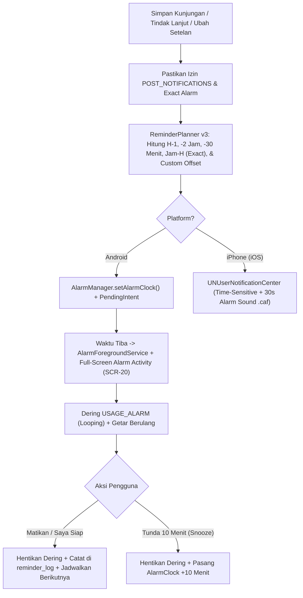
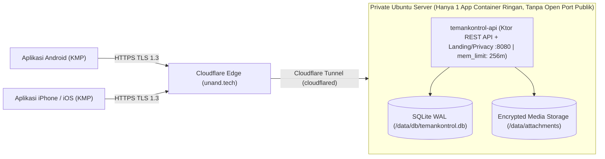

# Product Requirements Document — Teman Kontrol

| Field | Value |
|---|---|
| Produk | Teman Kontrol |
| Dokumen | `docs/PRD.md` (Single Source of Truth Final) |
| Versi | **3.0 (Final Master Plan)** |
| Status | **Approved (v3.0 Master Plan)** — Mencakup v1.0 (MVP) + v2.0 (Revisi Lokal) + **v3.0 (Login & Cloud `unand.tech`, Alarm Berbunyi Nyaring, KMP Android + iPhone/iOS, & Perombakan UI/UX Besar-Besaran)** |
| Tanggal | 26 November 2026 (v1.0: 6 Okt 2026 · v2.0: 17 Nov 2026) |
| Platform | **Android (minSdk 30 / Android 11+) & iPhone / iOS (iOS 16+)** via **Opsi 2A: Kotlin Multiplatform (KMP) + Compose Multiplatform (CMP)** |
| Stack Client | Kotlin Multiplatform + Compose Multiplatform (Material 3 Custom Design System v3) + Room KMP / SQLDelight + DataStore + Koin DI + Ktor Client |
| Stack Backend | Self-Hosted di **Private Ubuntu Server** (Docker 1 Container Ringan: Backend REST API + **SQLite WAL Mode** + Encrypted Media Storage, `mem_limit: 256m`) via **Cloudflare Tunnel (`https://api.temankontrol.unand.tech`)** |
| Application ID | `id.temankontrol.app` (Android `applicationId` & iOS `bundleIdentifier`) |
| Perangkat uji utama | Android Studio AVD / Redmi Note 10S (Android) & Xcode iOS Simulator / iPhone (iOS) |
| Status Implementasi | **v3.0.0 Selesai (Phase 0–16 PASS)** — Android APK Release v3.0.0 (`app-release.apk`), KMP `:composeApp` + `:iosApp`, & Backend Self-Hosted `:server` (Ktor + SQLite WAL) siap deploy ke `unand.tech` |
| Arsip versi lama | `docs/archive/PRD_v0.2.md`, `docs/PRD-REVISION-FEATURE.md` (sudah disatukan) |

---

## 0. Cara Menggunakan Dokumen Ini

### 0.1 Aturan SSOT

1. Dokumen ini adalah **satu-satunya sumber kebenaran** untuk scope, perilaku, data, arsitektur, copy UI, dan standar kualitas Teman Kontrol.
2. Jika kode, desain, atau percakapan bertentangan dengan dokumen ini, **dokumen ini yang benar** sampai dokumen diperbarui melalui change control (§0.3).
3. Hal yang tidak tercantum di sini **tidak dikerjakan**. Ide baru dicatat di §29 (Backlog) dan tidak langsung diimplementasikan.
4. Versi library dikunci di `gradle/libs.versions.toml`. File tersebut adalah SSOT untuk angka versi; dokumen ini adalah SSOT untuk **pilihan** library.
5. Setiap commit/PR yang mengimplementasikan requirement menyebut ID-nya (misal `feat(question): enforce priority limit [FR-008]`).

### 0.2 Urutan Prioritas Jika Ada Konflik Internal

`§2 Decision Log` > `§20 Acceptance Criteria` > `§15–16 Data & Kontrak` > `§10 Functional Requirements` > `§9 Feature Spec` > bagian lain.

Konflik internal yang ditemukan wajib dilaporkan dan diperbaiki di dokumen, bukan diakali di kode.

### 0.3 Change Control

Setiap perubahan pada dokumen ini:

1. Diberi entri baru di §31 Changelog (versi, tanggal, ringkasan, ID yang terdampak).
2. Jika menyangkut keputusan, tambah entri `DEC-xxx` baru di §2 (keputusan lama ditandai *Superseded*, tidak dihapus).
3. Perubahan data model wajib memperbarui §15, §16, §26 (traceability), dan menaikkan versi skema Room bila sudah ada di Phase 2+.
4. Perubahan P0 setelah 8 Oktober wajib persetujuan project lead.

### 0.4 Konvensi ID

| Prefix | Arti | Contoh |
|---|---|---|
| P- | Problem | P-01 |
| US- | User story | US-03 |
| F- | Feature | F-05 |
| FR- | Functional requirement | FR-012 |
| NFR- | Non-functional requirement | NFR-024 |
| SCR- | Screen | SCR-04 |
| VR- | Validation rule | VR-07 |
| AC- | Acceptance criteria | AC-10 |
| TC- | Test case | TC-013 |
| DEC- | Decision | DEC-004 |
| R- | Risk | R-03 |
| OQ- | Open question | OQ-05 |
| A- | Assumption | A-008 |

---

## 1. Executive Summary

**Masalah.** Pasien sering datang ke konsultasi tanpa daftar pertanyaan yang terstruktur, kesulitan mencatat hasil pembicaraan, dan tidak punya satu tempat untuk melacak tindak lanjut. Panduan NHS menyarankan pasien menulis pertanyaan terpenting, mencatat hasil, dan memastikan langkah berikutnya; AHRQ QuestionBuilder membantu pasien menyiapkan pertanyaan sebelum kunjungan [REF-01][REF-02].

**Solusi.** Teman Kontrol adalah aplikasi Android **offline-first, single-user, single-device** untuk:
**sebelum kontrol** (menyiapkan pertanyaan terbuka & memprioritaskan pertanyaan tanpa batas jumlah) → **saat kontrol** (Mode Konsultasi fokus, mencentang pertanyaan yang dibahas, mencatat jawaban, melampirkan foto & catatan suara per pertanyaan) → **setelah kontrol** (mencatat hasil konsultasi beserta lampiran foto/VN di catatan tambahan, melacak tindak lanjut, pengingat lokal, serta ekspor cadangan `.tkbackup` dan ringkasan).

**Bukan:** alat diagnosis, triase, telemedicine, rekam medis resmi, atau pemberi rekomendasi klinis.

**Prinsip produk:**

1. **Ringan dan cepat** — tanpa jaringan, tanpa SDK pihak ketiga yang berat, target performa terukur (§11.1–11.2).
2. **Privat secara default** — data hanya di app-private storage, tanpa izin INTERNET, tanpa backup cloud (§11.4).
3. **Sederhana untuk pengguna awam** — maksimal dua level navigasi dari Beranda, bahasa Indonesia yang jelas.
4. **Konsisten** — satu design system, satu pola arsitektur, satu kamus istilah (§3).

**Urutan pengembangan:** kunci model data & kontrak repository → frontend lengkap dengan mock → persistensi Room → integrasi flow → QA & edge case → UAT → finalisasi.

---

## 2. Decision Log

| ID | Keputusan | Alasan | Status |
|---|---|---|---|
| DEC-001 | Framework: **Kotlin + Jetpack Compose + Material 3** (bukan Flutter) | Proyek sudah tersetup & berhasil compile; native, startup lebih ringan, tanpa runtime tambahan. Menjawab OQ-01. | Active |
| DEC-002 | **minSdk 30 (Android 11)**, targetSdk & compileSdk 37 | Baseline perangkat uji Redmi Note 10S. Menjawab OQ-02. | Active |
| DEC-003 | Persistensi: **Room** (data utama) + **Preferences DataStore** (flag notice) | Room resmi Android, dukungan Flow, migration, foreign key cascade, transaksi atomik. | Active |
| DEC-004 | Dependency Injection: **Hilt** (dengan KSP) | Standar Google, lifecycle-aware, memudahkan swap Mock ↔ Room. Wajib lolos Technical Spike TS-01 (§17.1). | Active |
| DEC-005 | Milestone 8 Okt = **UI lengkap + mock in-memory**; data boleh hilang saat restart. Persistensi di Phase 2. Menjawab OQ-03. | Menjaga milestone realistis; kontrak repository sama sehingga swap tanpa redesign. | Active |
| DEC-006 | **Auto Backup OS dimatikan**: `android:allowBackup="false"`, data extraction rules mengecualikan semua domain | Catatan kesehatan tidak boleh keluar perangkat tanpa izin pengguna (NFR-014); digantikan oleh cadangan manual berbasis berkas atas kendali pengguna (DEC-022). | Active (Amended by DEC-022) |
| DEC-007 | Application ID & namespace: **`id.temankontrol.app`**; tanpa identitas institusi. Menjawab OQ-04. | `com.example` tidak boleh dirilis; identitas netral. | Active |
| DEC-008 | Tema: **Light + Dark mengikuti sistem**, tanpa Dynamic Color | Warna brand & status konsisten di semua perangkat. | Active |
| DEC-009 | Satu file PRD lengkap (produk + spesifikasi teknis) | SSOT tunggal, tidak ada dua dokumen yang bisa saling bertentangan. | Active |
| DEC-010 | Transisi status kunjungan **bebas** antar Terjadwal/Selesai/Dibatalkan; konfirmasi saat ke Dibatalkan | Pengguna dapat mengoreksi kesalahan. | Active |
| DEC-011 | **Tidak mendeklarasikan izin INTERNET**; izin hasil merge dari library dihapus dengan `tools:node="remove"` | Jaminan teknis offline & privasi, bukan sekadar janji. | Active |
| DEC-012 | Saran pertanyaan disimpan sebagai **konstanta Kotlin**, bukan JSON | Nol biaya parsing, nol I/O, type-safe. | Active |
| DEC-013 | Font **sistem (Roboto)**; tanpa font unduhan | Nol ukuran tambahan, nol risiko gagal muat offline. | Active |
| DEC-014 | Ikon: `material-icons-core` + `material-icons-extended` (atau vector drawable XML bila ingin optimasi ukuran lebih jauh); `isShrinkResources = true` + R8 menjaga ukuran APK release tetap ≤ 10 MB | Revisi fitur membutuhkan beragam ikon (kamera, mikrofon, kunci, cadangan, notifikasi, bagikan); release APK terbukti 6,81 MiB (< 10 MB). *Supersedes larangan `material-icons-extended` pada v1.0.* | Active |
| DEC-015 | Enkripsi database at-rest mengandalkan **File-Based Encryption Android**; akses aplikasi dilindungi oleh **Kunci Aplikasi** (`BiometricPrompt` + kunci layar HP, DEC-028); berkas cadangan dilindungi enkripsi **AES-256-GCM + PBKDF2** opsional (DEC-022) | Mengurangi overhead SQLCipher sambil tetap melindungi privasi lampiran foto/VN dan berkas cadangan. | Active (Amended by DEC-022 & DEC-028) |
| DEC-016 | Navigasi: **Navigation Compose type-safe routes** (kotlinx.serialization) | Argumen route ter-validasi compiler. | Active |
| DEC-017 | Semua penghapusan (kunjungan, pertanyaan, tindak lanjut) memakai **dialog konfirmasi**, bukan undo snackbar | Satu pola yang konsisten dan sederhana. | Active |
| DEC-018 | Timeline frontend: **Day 1 = 7 Okt, Day 2 = 8 Okt**; malam 6 Okt dipakai untuk finalisasi PRD & setup | 6 Okt telah terpakai untuk perencanaan. Deadline 8 Okt tidak berubah. | Active |
| DEC-019 | Lokasi PRD dipindah dari `.idea/` ke `docs/PRD.md` | `.idea/` adalah folder IDE dan sebagian di-ignore; dokumen proyek harus berada di folder yang di-versioning. | Active |
| DEC-020 | Waktu disimpan sebagai **epoch millis (UTC)**; tanggal tenggat sebagai **epoch day** (`LocalDate`); tampilan memakai zona waktu perangkat & locale `id-ID` | Menghindari bug zona waktu & DST; tanggal tenggat tidak bergeser. | Active |
| DEC-021 | Perangkat pengujian utama: **Android Studio Virtual Device (Emulator API 30+)** | Pengujian fungsional dan UI dilakukan via AVD Android Studio; acuan ukuran layar tetap mengacu pada rasio smartphone (baseline ~360×640 dp s/d 1080×2400). | Active |
| DEC-022 | Strategi cadangan = **ekspor/impor berkas `.tkbackup` oleh pengguna** via Storage Access Framework (opsional terenkripsi AES-256-GCM + PBKDF2); Auto Backup OS tetap mati | Meminimalkan/menghilangkan kebutuhan internet & tanpa login/server, pengguna memegang kendali penuh lokasi penyimpanan cadangan (Google Drive, komputer, flashdisk). | Active |
| DEC-023 | **Tidak ada login/akun** pada aplikasi Teman Kontrol. Sinkronisasi cloud menjadi proyek terpisah bila diperlukan di masa depan | Menjaga aplikasi tetap offline-first, tanpa biaya server, dan bebas kepatuhan backend UU PDP. | Active |
| DEC-024 | Lampiran foto & VN disimpan di **app-private storage** (`filesDir/attachments/`), foto dikompres (≤ 1.600 px, JPEG q80) & EXIF lokasi dibuang, suara AAC mono; metadata di Room | Privasi data medis (NFR-014), ukuran cadangan terkendali, tanpa izin penyimpanan publik. | Active |
| DEC-025 | Notifikasi = **notifikasi lokal terjadwal** (`AlarmManager.setAndAllowWhileIdle`, *inexact*), **bukan** push/FCM, tanpa `SCHEDULE_EXACT_ALARM` | 100% offline tanpa internet; menghindari penolakan default izin exact alarm pada Android 14+. | Active |
| DEC-026 | Notifikasi **privat secara default**: layar kunci hanya menampilkan teks generik; judul kunjungan tampil hanya bila opsi diaktifkan pengguna | Menjaga privasi agar detail medis tidak terbaca di layar terkunci. | Active |
| DEC-027 | "Pertanyaan terbuka" ditegakkan dengan **katalog terkurasi (20 template, 5 kategori) + chip pembantu + petunjuk lembut (non-blocking)** + kolom **"Jawaban yang Anda catat"** | Mendorong tenaga kesehatan menjelaskan secara lengkap tanpa memblokir pertanyaan faktual/tertutup yang memang dibutuhkan pengguna. | Active |
| DEC-028 | **Kunci Aplikasi** memakai `BiometricPrompt` (`BIOMETRIC_STRONG or DEVICE_CREDENTIAL`) + `FLAG_SECURE` opsional; tidak menyimpan PIN sendiri | Menghindari manajemen lupa PIN dan memanfaatkan keamanan kunci layar bawaan Android 11+. | Active |
| DEC-029 | Skema Room naik bertahap: **v1 (MVP)** → **v2 (jawaban pertanyaan, reminder_log)** → **v3 (attachments)**, wajib `Migration` + `MigrationTestHelper`; destructive migration dilarang | Menjaga integritas data pengguna lama saat update aplikasi (PRD §15.4). | Active |
| DEC-030 | **Tidak ada batas maksimal jumlah pertanyaan prioritas** (menghapus batas 3 prioritas pada v1.0). *Supersedes FR-008 & C-13 v1.0.* | Sesuai masukan klien agar pengguna bebas menandai sebanyak mungkin pertanyaan penting sebagai prioritas. | Active |
| DEC-031 | Lampiran Foto & Catatan Suara (VN) ditempatkan **per pertanyaan** (`AttachmentTarget.QUESTION`) dan di **Catatan Tambahan / Hasil Konsultasi** (`AttachmentTarget.ADDITIONAL_NOTE`) | Sesuai masukan klien agar bukti visual/audio melekat langsung pada konteks pertanyaan maupun penjelasan tambahan tenaga medis. | Active |
| DEC-032 | Platform lintas-OS memakai **Opsi 2A: Kotlin Multiplatform (KMP) + Compose Multiplatform (CMP)** untuk **Android & iPhone (iOS 16+)**. *Supersedes NFR-023 (iOS bukan target) & memperluas DEC-001/DEC-004 (migrasi DI bertahap ke Koin Multiplatform).* | Memaksimalkan penggunaan ulang kode domain, validasi, planner, dan UI Compose yang sudah selesai di v2.0 agar berjalan di Android dan iPhone dari satu basis kode utama. | Active (v3.0) |
| DEC-033 | **Fitur Login & Pemulihan/Sinkronisasi Berbasis Akun** diaktifkan dengan mode **Offline-First + Cloud-Linked Account**. *Supersedes DEC-011 (larangan INTERNET) & DEC-023 (tanpa login).* | Memungkinkan pengguna memulihkan seluruh data dan lampiran foto/VN secara otomatis cukup dengan login akunnya saat ganti/rusak HP atau berpindah antara Android dan iPhone, sambil tetap bisa dipakai 100% offline saat tanpa sinyal. | Active (v3.0) |
| DEC-034 | Backend di-hosting mandiri pada **Private Ubuntu Server** milik tim dalam **1 container Docker super ringan (`temankontrol-api`: Ktor REST API + SQLite WAL Mode + Local Encrypted Media Volume, `mem_limit: 256m`)** tanpa perlu container database terpisah, dan dipublikasikan secara aman melalui **Cloudflare Tunnel (`cloudflared`)** pada subdomain **`https://api.temankontrol.unand.tech`** & **`https://temankontrol.unand.tech`** | Memanfaatkan infrastruktur Ubuntu Server & domain `unand.tech` yang sudah ada tanpa membebani RAM/CPU container lain di server (~30–80 MB RAM idle), skema SQL 100% selaras dengan Room SQLite di HP, backup cukup 1 file `.db`, dengan TLS/HTTPS penuh dan proteksi WAF/DDoS Cloudflare tanpa membuka port publik. | Active (v3.0) |
| DEC-035 | Engine Pengingat dirombak menjadi **Alarm-Grade Reminder Engine** (`AlarmManager.setAlarmClock` + `USAGE_ALARM` + `RingtoneManager.TYPE_ALARM` + Full-Screen Alarm Alert & Snooze di Android; `UNUserNotificationCenter` Time-Sensitive + custom alarm audio `.caf` 30 detik di iOS). *Supersedes DEC-025 (inexact alarm tanpa suara alarm).* | Menyelesaikan bug notifikasi tidak muncul akibat penundaan Doze mode pada `setAndAllowWhileIdle`, race condition izin `POST_NOTIFICATIONS`, serta memenuhi permintaan klien agar pengingat berbunyi nyaring layaknya alarm/weker. | Active (v3.0) |
| DEC-036 | **Perombakan Besar-Besaran UI/UX v3.0 ("Warm Healthcare Companion")**: desain ulang menyeluruh seluruh layar dengan *Hero Countdown & Readiness Card* di Beranda, *3-Step Guided Stepper* (Sebelum → Saat → Sesudah Kontrol) di Detail Kunjungan, *Bento Quick Actions*, *Inline Audio Waveform*, dan *4-Tab Bottom Navigation* (Beranda, Jadwal & Riwayat, Alarm, Profil & Akun). | Menjawab permintaan klien agar tampilan jauh lebih menarik, modern, tidak tampak seperti form kaku, dan sangat mudah digunakan oleh pasien segala usia. | Active (v3.0) |
| DEC-037 | Kepatuhan **UU PDP No. 27/2022** & **Apple App Store Guideline 5.1.1(v)**: wajib menyediakan halaman Kebijakan Privasi (`https://temankontrol.unand.tech/privacy`), persetujuan eksplisit saat registrasi akun, enkripsi TLS 1.3 + enkripsi penyimpanan server, serta fitur **"Hapus Akun & Seluruh Data Permanen"** di dalam aplikasi. | Syarat hukum penyimpanan data kesehatan di server dan syarat mutlak kelulusan review Apple App Store & Google Play Store. | Active (v3.0) |
| DEC-038 | Fitur ekspor/impor berkas `.tkbackup` (DEC-022) **tetap dipertahankan** berdampingan dengan pemulihan akun cloud | Memberi jaminan ganda: pengguna yang belum login atau berada di area tanpa internet tetap bisa mencadangkan data secara lokal. | Active (v3.0) |

---

## 3. Glosarium (Kamus Istilah UI ↔ Kode)

Istilah ini **wajib** dipakai konsisten di UI, kode, test, dan dokumentasi.

| Istilah UI (ID) | Nama di Kode | Definisi |
|---|---|---|
| Kunjungan | `Consultation` | Satu konsultasi/kontrol ke tenaga kesehatan. |
| Status kunjungan | `ConsultationStatus` | `SCHEDULED` (Terjadwal), `COMPLETED` (Selesai), `CANCELLED` (Dibatalkan). |
| Pertanyaan | `Question` | Pertanyaan yang disiapkan pengguna untuk satu kunjungan. |
| Prioritas | `isPriority` | Penanda pertanyaan terpenting; **tidak dibatasi jumlahnya** (DEC-030). |
| Sudah dibahas | `isDiscussed` | Penanda pertanyaan sudah ditanyakan saat konsultasi. |
| Jawaban yang Anda catat | `Question.answer` | Penjelasan tenaga kesehatan yang dicatat pengguna untuk satu pertanyaan. |
| Hasil Konsultasi | `ConsultationNote` | Catatan pengguna tentang hasil konsultasi (0 atau 1 per kunjungan). |
| Tindak Lanjut | `FollowUpAction` | Tindakan yang harus dilakukan setelah konsultasi. |
| Tenggat | `dueDate` | Tanggal target tindak lanjut (opsional). |
| Terlambat | `isOverdue` (derived) | Tindak lanjut belum selesai dan `dueDate` < hari ini. |
| Lewat jadwal | `isPastDue` (derived) | Kunjungan `SCHEDULED` dengan tanggal < hari ini. |
| Saran pertanyaan | `QuestionSuggestion` | Template pertanyaan **terbuka** generik non-klinis (5 kategori). |
| Pemberitahuan awal | `FirstLaunchNotice` | Layar batas penggunaan saat pertama kali dibuka. |
| Cadangan / Pulihkan | `Backup` / `Restore` | Ekspor/impor seluruh data (termasuk lampiran) ke berkas `.tkbackup`. |
| Pengingat | `Reminder` | Notifikasi lokal terjadwal di perangkat (offline, privat di layar kunci). |
| Lampiran (Foto / Catatan Suara) | `Attachment` (`PHOTO` / `VOICE`) | Bukti foto & rekaman suara (VN) per pertanyaan (`QUESTION`) atau catatan tambahan (`ADDITIONAL_NOTE`). |
| Kunci Aplikasi | `AppLock` | Autentikasi biometrik / kunci layar HP sebelum membuka aplikasi. |
| Mode Konsultasi | `ConsultationMode` | Tampilan fokus satu pertanyaan besar sekaligus saat di ruang konsultasi. |

**Kata terlarang di UI/notifikasi:** "diagnosis", "resep", "rekam medis" (termasuk untuk foto), "catatan dokter", "jawaban dokter", "rekomendasi pengobatan", "dosis", "minum obat sekarang", "darurat" (kecuali dalam kalimat disclaimer "bukan layanan darurat").

---

## 4. Product Overview

- **One-liner:** Pendamping offline untuk mempersiapkan, mencatat, dan menindaklanjuti konsultasi kesehatan.
- **Vision:** Pasien datang ke konsultasi lebih siap dan pulang dengan langkah tindak lanjut yang jelas.
- **Mission:** Menyatukan pertanyaan, catatan hasil, dan tindak lanjut dalam alur mobile yang ringan, aman, dan mudah digunakan.

**Nilai pengguna:**

- Satu tempat untuk seluruh catatan satu kunjungan.
- Pertanyaan prioritas tampil paling atas saat waktu konsultasi terbatas.
- Hasil konsultasi terpisah jelas dari rencana tindak lanjut.
- Berfungsi penuh tanpa internet dan tanpa akun.

---

## 5. Background & Problem Statement

| ID | Problem | Root cause | Dampak |
|---|---|---|---|
| P-01 | Lupa pertanyaan penting sebelum/saat konsultasi | Tidak ada struktur prioritas; catatan tercecer | Pertanyaan penting tidak dibahas |
| P-02 | Hasil pembicaraan tidak tersimpan terstruktur | Catatan bebas di media berbeda | Sulit meninjau hasil konsultasi |
| P-03 | Sulit tahu tindakan mana yang belum selesai | Catatan tidak menjadi daftar tindakan | Tindak lanjut terlewat |
| P-04 | Aplikasi berbasis akun & internet terlalu kompleks | Ketergantungan server | Hambatan pemakaian, risiko privasi |
| P-05 | Data hilang bila HP rusak/hilang/ganti | Offline, tanpa akun, Auto Backup OS dimatikan | Seluruh riwayat hilang (risiko R-11) |
| P-06 | Informasi visual/lisan sulit dicatat sebagai teks | Hanya input teks | Detail hasil lab/penjelasan lisan terlewat |
| P-07 | Pertanyaan tertutup (ya/tidak) menghasilkan jawaban singkat | Saran & kebiasaan menulis pertanyaan | Pasien pulang tanpa pemahaman cukup |
| P-08 | Aplikasi terasa terlalu sederhana | Fitur v1.0 sengaja minimal | Daya tarik & nilai guna kurang terasa |
| P-09 | Jadwal kunjungan & tenggat tindak lanjut terlewat | Aplikasi pasif (tanpa pengingat) | Kontrol/tindak lanjut terlewat |

**Problem statement:** Pasien umum dan pendamping membutuhkan cara sederhana untuk mengorganisasi persiapan, hasil, dan tindak lanjut konsultasi pada satu perangkat, karena catatan yang tersebar membuat pertanyaan penting dan tindakan lanjutan terlewat.

---

## 6. Goals & Success Metrics

### 6.1 Goals

| Jenis | Goal |
|---|---|
| Produk | Satu record terstruktur per konsultasi; core journey berjalan tanpa internet; data kesehatan minimal. |
| Pengguna | Menyiapkan pertanyaan; melihat ≤3 prioritas dengan cepat; mencentang yang sudah dibahas; menyimpan hasil & tindak lanjut; meninjau riwayat. |
| Proyek | Frontend demo 8 Okt; MVP end-to-end 6 Nov; berjalan di Redmi Note 10S; tanpa fitur klinis. |

### 6.2 Success Metrics

| Metric | Cara ukur | Target MVP |
|---|---|---|
| Core journey task success | UAT: buat kunjungan → selesaikan 1 tindak lanjut | ≥ 4 dari 5 peserta tanpa bantuan |
| Data persistence | Force-stop lalu buka ulang setelah setiap jenis simpan | 100% skenario lulus |
| Critical defect | Bug yang memblokir core journey | 0 saat rilis |
| Validation coverage | VR-01 s/d VR-12 memiliki pesan error & unit test | 100% |
| Performa | Budget §11.1 diukur di Redmi Note 10S (release build) | 100% budget terpenuhi |
| Crash-free | Eksekusi regression test & UAT | 0 crash |

---

## 7. Scope

| Scope | Fitur | Priority | Deadline |
|---|---|---:|---|
| Day-2 Frontend | Seluruh SCR-01 s/d SCR-09, navigasi, design system | P0 | 8 Okt |
| Day-2 Frontend | Mock repository in-memory (full CRUD + skenario debug) | P0 | 8 Okt |
| Day-2 Frontend | Validasi form (VR-01 s/d VR-12) & unsaved-change dialog | P0 | 8 Okt |
| Day-2 Frontend | Loading, empty, error, success states | P0 | 8 Okt |
| MVP | Persistensi Room + DataStore | P0 | 6 Nov |
| MVP | CRUD & status kunjungan | P0 | 6 Nov |
| MVP | Pertanyaan, checklist dibahas, cek duplikat (prioritas tidak dibatasi, DEC-030) | P0 | 6 Nov ✅ |
| MVP | Hasil konsultasi | P0 | 6 Nov ✅ |
| MVP | CRUD tindak lanjut & status selesai | P0 | 6 Nov ✅ |
| MVP | Riwayat + filter status | P1 | 6 Nov ✅ |
| MVP | Saran pertanyaan statis | P1 | 6 Nov ✅ |
| MVP | Standar performa, privasi, aksesibilitas (§11) | P0 | 6 Nov ✅ |
| v2.0 (Revisi) | **F-10** Cadangan & Pemulihan `.tkbackup` (opsional AES-256) | P1 | UI ✅ · Engine Next |
| v2.0 (Revisi) | **F-11** Pertanyaan Terbuka (katalog 20 template, chip awalan, petunjuk lembut, jawaban dicatat, tanpa batas 3 prioritas) | P1 | UI ✅ · Room v2 Next |
| v2.0 (Revisi) | **F-12** Pengingat & Notifikasi Lokal (kunjungan, siapkan pertanyaan, tindak lanjut, cadangan; privat) | P1 | UI ✅ · Engine Next |
| v2.0 (Revisi) | **F-13** Lampiran Foto & Catatan Suara (VN) per pertanyaan & di Catatan Tambahan | P1 | UI ✅ · Engine/Room v3 Next |
| v2.0 (Revisi) | **F-14** Kunci Aplikasi (`BiometricPrompt` + `FLAG_SECURE`) | P1 | UI ✅ · Engine Next |
| v2.0 (Revisi) | **F-15** Mode Konsultasi · **F-16** Bawa Pertanyaan · **F-17** Ringkasan & Bagikan (Teks/PDF) | P2 | UI ✅ · PDF Engine Next |
| Backlog | Cadangan otomatis ke folder pilihan (SAF), transkripsi offline, pencarian riwayat (FTS4), sinkronisasi cloud (butuh auth & server terpisah) | P3 | — |
| Out of scope | Diagnosis/triase/terapi/pengingat dosis obat, chat dokter, booking, login/admin, rekam medis resmi, integrasi RS, ringkasan AI online, iOS | — | Tidak dikerjakan |

---

## 8. Users & User Stories

### 8.1 Persona

| | Primary: Pasien dewasa | Secondary: Pendamping |
|---|---|---|
| Konteks | Kontrol rutin/sesekali di puskesmas, klinik, RS | Keluarga yang mendampingi, memakai HP yang sama atas izin pasien |
| Goal | Tidak lupa pertanyaan, paham tindak lanjut | Membantu bertanya & mencatat |
| Kebutuhan | Input cepat, tulisan jelas, offline | Struktur ringkas, status jelas |
| Literasi teknis | Dasar–menengah | Dasar–menengah |

### 8.2 User Stories

| ID | Story | Pri |
|---|---|---:|
| US-01 | Sebagai pasien, saya ingin membuat catatan kunjungan agar semua info terkait punya satu konteks. | P0 |
| US-02 | Sebagai pasien, saya ingin menambah pertanyaan dan menandai pertanyaan penting sebagai prioritas tanpa dibatasi 3 item agar semua hal penting tampil paling atas. | P0 |
| US-03 | Sebagai pasien, saya ingin menandai pertanyaan yang sudah dibahas dan mencatat jawaban penjelasannya agar tahu sisanya dan tidak lupa hasil diskusi. | P0 |
| US-04 | Sebagai pasien, saya ingin menyimpan ringkasan hasil konsultasi agar bisa meninjaunya kembali. | P0 |
| US-05 | Sebagai pasien, saya ingin menambah tindak lanjut dengan tenggat opsional agar tahu langkah berikutnya. | P0 |
| US-06 | Sebagai pasien, saya ingin menandai tindak lanjut selesai agar progres terlihat. | P0 |
| US-07 | Sebagai pasien, saya ingin mengedit atau menghapus data agar kesalahan bisa dikoreksi. | P0 |
| US-08 | Sebagai pasien, saya ingin melihat riwayat kunjungan agar bisa bersiap untuk kunjungan berikutnya. | P1 |
| US-09 | Sebagai pasien, saya ingin saran pertanyaan terbuka agar tenaga kesehatan memberi penjelasan lengkap, bukan sekadar ya/tidak. | P1 |
| US-10 | Sebagai pasien, saya ingin membuat cadangan seluruh data ke berkas `.tkbackup` (opsional kata sandi) dan memulihkannya di HP baru tanpa login agar data aman jika HP rusak. | P1 |
| US-11 | Sebagai pasien, saya ingin melampirkan foto dan catatan suara (VN) pada masing-masing pertanyaan maupun di Catatan Tambahan agar bukti pemeriksaan dan penjelasan medis tersimpan utuh. | P1 |
| US-12 | Sebagai pasien, saya ingin diingatkan lewat notifikasi lokal sebelum jadwal kunjungan, tenggat tindak lanjut, dan jadwal cadangan dengan isi tetap privat di layar kunci. | P1 |
| US-13 | Sebagai pasien, saya ingin mengunci aplikasi dengan sidik jari/kunci layar HP agar foto, rekaman suara, dan catatan saya tetap privat. | P1 |
| US-14 | Sebagai pasien, saya ingin Mode Konsultasi (tampilan fokus per pertanyaan), fitur Bawa Pertanyaan ke kunjungan berikutnya, dan Ringkasan & Bagikan (teks/PDF). | P2 |

---

## 9. Feature Specification

### F-01 — Pemberitahuan Awal (First-Launch Notice)

- **Screen:** SCR-01. **Pri:** P0.
- **Flow:** App dibuka pertama kali → splash tetap tampil selama flag dibaca dari DataStore → SCR-01 → "Saya Mengerti" → Beranda (back stack dibersihkan).
- **Alternatif:** Dibuka ulang dari Tentang → tombol "Tutup" (bukan "Saya Mengerti"), kembali ke Tentang.
- **Error:** Gagal menyimpan flag → tetap masuk Beranda; notice muncul lagi di peluncuran berikutnya; tidak ada pesan error ke pengguna.
- **Aturan:** Isi notice memakai copy C-01 (§14.3). Tidak ada checkbox persetujuan medis. Tombol Android back di SCR-01 pertama kali = keluar aplikasi.
- **Data:** `PreferencesRepository.noticeAccepted`.

### F-02 — Manajemen Kunjungan

- **Screen:** SCR-03, SCR-04. **Pri:** P0.
- **Flow buat:** Beranda → FAB "Tambah Kunjungan" → isi form → Simpan → snackbar C-20 → Detail kunjungan baru (form dihapus dari back stack).
- **Flow edit:** Detail → menu ⋮ → Edit → form terisi → Simpan → kembali ke Detail + snackbar C-21.
- **Flow status:** Detail → kontrol status (segmented button) → Selesai langsung tersimpan; Dibatalkan memerlukan dialog C-31. Transisi bebas (DEC-010).
- **Flow hapus:** Detail → ⋮ → Hapus → dialog C-30 (menyebut jumlah pertanyaan & tindak lanjut yang ikut terhapus) → hapus atomik → kembali ke layar sebelumnya + snackbar C-22.
- **Input & validasi:** VR-01 s/d VR-05.
- **Proses:** trim, kolaps whitespace berturut-turut di field satu baris, UUID v4, status awal `SCHEDULED`, `createdAt`/`updatedAt`.
- **Aturan:** UUID tidak berubah. Tanggal lampau **diizinkan** (mencatat kunjungan yang sudah terjadi) dengan info "Tanggal ini sudah lewat" (bukan error).

### F-03 — Pertanyaan, Checklist & Prioritas (Diperbarui DEC-030)

- **Screen:** SCR-04 (daftar & checklist), SCR-05 (form/dialog). **Pri:** P0.
- **Flow:** Detail → "Kelola Pertanyaan" → "Tambah Pertanyaan" → ketik (atau pakai chip awalan terbuka / pilih saran) → toggle Prioritas (tanpa batas jumlah) → opsional catat jawaban & lampiran Foto/VN → Simpan.
- **Checklist:** di Detail dan Daftar Pertanyaan, setiap pertanyaan memiliki checkbox "Sudah dibahas"; tap mengubah status langsung (bila belum ada jawaban, muncul snackbar aksi cepat "Catat Jawaban").
- **Urutan tampil:** prioritas dulu, lalu non-prioritas; masing-masing berdasarkan `createdAt` naik. Item yang sudah dibahas **tidak** pindah posisi.
- **Validasi:** VR-06, VR-07 (tanpa batas jumlah prioritas), VR-08, VR-13 (jawaban ≤ 1.000 karakter), VR-18 (petunjuk lembut pertanyaan ya/tidak).
- **Aturan:** Total pertanyaan maupun jumlah pertanyaan prioritas **tidak dibatasi** (DEC-030). Jika > 5 atau > 15, tampil info C-40. Lampiran Foto & VN dapat ditambahkan langsung **per pertanyaan** (DEC-031).

### F-04 — Hasil Konsultasi & Lampiran Penjelasan Tambahan

- **Screen:** SCR-06. **Pri:** P0.
- **Field:** Ringkasan pembicaraan (`summary`), Arahan dari tenaga kesehatan (`providerInstruction`), Catatan tambahan (`additionalNotes`), serta bagian **Lampiran Penjelasan Tambahan (Foto & VN)** di bawah Catatan Tambahan (DEC-031).
- **Label section:** "Catatan pengguna" (selalu). Tidak boleh "Catatan dokter".
- **Proses:** upsert — satu `ConsultationNote` per kunjungan; lampiran ditautkan dengan `AttachmentTarget.ADDITIONAL_NOTE`.
- **Validasi:** VR-09, VR-10. Jika ketiga field dikosongkan saat edit catatan yang ada → simpan ditolak dengan C-12; untuk menghapus catatan gunakan menu "Hapus catatan" dengan konfirmasi C-33.
- **Detail menampilkan:** preview ringkasan, arahan, catatan tambahan + badge jumlah Foto/VN lampiran penjelasan tambahan.

### F-05 — Tindak Lanjut

- **Screen:** SCR-04 (daftar), SCR-07 (form). **Pri:** P0.
- **Flow:** Detail → "Tambah Tindak Lanjut" → isi tindakan & tenggat opsional (date picker) → Simpan.
- **Status:** checkbox satu tap. Selesai → `completedAt = now`. Dibuka kembali → `completedAt = null`.
- **Urutan tampil:** grup "Belum selesai" (tenggat naik, tanpa tenggat di akhir, lalu `createdAt` naik), kemudian grup "Selesai" (`completedAt` turun).
- **Terlambat:** belum selesai & `dueDate` < hari ini → label teks "Terlambat" + ikon, bukan warna saja.
- **Validasi:** VR-11, VR-12. Tenggat lampau diizinkan dengan peringatan C-41.

### F-06 — Riwayat & Filter

- **Screen:** SCR-08. **Pri:** P1.
- **Isi:** **semua** kunjungan, urut `appointmentAt` turun.
- **Filter chip:** Semua (default) / Terjadwal / Selesai / Dibatalkan. Filter terpilih bertahan selama proses aplikasi hidup (disimpan di `SavedStateHandle`).
- **Kartu:** judul, tanggal, fasilitas (bila ada), status chip, label "Lewat jadwal" bila relevan, ringkasan "x/y pertanyaan · z tindak lanjut terbuka".
- **Empty:** tidak ada data sama sekali → C-60 + CTA "Tambah Kunjungan"; filter tanpa hasil → C-61 + tombol "Tampilkan semua".

### F-07 — Saran Pertanyaan Terbuka Statis

- **Screen:** SCR-05. **Pri:** P1.
- **Kategori (5 kategori, 20 template terbuka):** Gejala, Pemeriksaan, Perawatan, Langkah Berikutnya, dan **Pemahaman** (pola *Ask Me 3* & *teach-back*). Seluruh template wajib lolos aturan pertanyaan terbuka (§14.4).
- **Perilaku:** tap saran → teks disalin ke field → tetap bisa diedit → tersimpan saat Simpan.
- **Data:** konstanta Kotlin (`StaticSuggestionCatalog`, DEC-012). Tidak pernah gagal dimuat.

### F-08 — Beranda

- **Screen:** SCR-02. **Pri:** P0.
- **Section 1 "Kunjungan Mendatang":** status `SCHEDULED` dengan `appointmentAt` ≥ awal hari ini, urut naik, maks. 3, tombol "Lihat semua" → Riwayat (filter Terjadwal).
- **Section 2 "Tindak Lanjut Terbuka":** tindak lanjut belum selesai dari semua kunjungan, urut sama seperti F-05, maks. 5, setiap item menampilkan judul kunjungan; checkbox selesai dapat di-tap langsung.
- **Section 3 (kondisional) "Perlu diperbarui":** jumlah kunjungan "Lewat jadwal" → tap membuka Riwayat (filter Terjadwal).
- **FAB:** "Tambah Kunjungan" (extended FAB dengan teks).
- **Empty total:** ilustrasi vektor ringan + C-62 + CTA.

### F-09 — Tentang

- **Screen:** SCR-09. **Pri:** P1.
- **Isi:** deskripsi singkat, pintasan ke Cadangan & Pemulihan (SCR-11), Pengingat (SCR-12), Pengaturan & Kunci Aplikasi (SCR-10), batas penggunaan (buka ulang SCR-01), penjelasan data (C-70), versi aplikasi (`BuildConfig.VERSION_NAME`).
- **Debug only:** section "Developer" (hanya `BuildConfig.DEBUG`) untuk memilih skenario mock: Normal, Kosong, Error, Lambat (delay 1500 ms).

### F-10 — Cadangan & Pemulihan (`.tkbackup`)

- **Screen:** SCR-10 (Pengaturan), SCR-11 (Cadangan & Pemulihan). **Pri:** P1.
- **Tujuan:** Memungkinkan pemulihan seluruh data (termasuk jawaban & lampiran foto/VN) jika HP rusak/hilang/ganti **tanpa login dan tanpa izin internet** (DEC-022, DEC-023).
- **Flow ekspor:** Ringkasan jumlah data & ukuran → opsi enkripsi kata sandi **AES-256-GCM + PBKDF2WithHmacSHA256** (≥ 600.000 iterasi, VR-17) → `ACTION_CREATE_DOCUMENT` (`TemanKontrol-AAAA-BB-HH.tkbackup`) → tulis ZIP (`manifest.json` + `data.json` + `attachments/*`) → simpan `last_backup_at` + peringatan C-82 bila tersimpan di memori lokal HP.
- **Flow pemulihan:** `ACTION_OPEN_DOCUMENT` → kata sandi bila terenkripsi (maks. 5 percobaan, jeda 30 dtk) → validasi versi format & SHA-256 sebelum menulis → pratinjau isi → dialog konfirmasi ganti data (C-84) → transaksi atomik + *staging* lampiran → kembali ke Beranda.

### F-11 — Pertanyaan Terbuka, Pembantu Penulisan & Jawaban

- **Screen:** SCR-05, SCR-04, SCR-16. **Pri:** P1.
- **Komponen:**
  1. **Chip awalan terbuka:** `Apa…`, `Mengapa…`, `Bagaimana…`, `Jelaskan…`, `Apa saja…`.
  2. **Petunjuk lembut (VR-18, DEC-027):** Mendeteksi kalimat berpotensi ya/tidak (`apakah`, `bolehkah`, `bisakah`, dll.) dan menampilkan info C-81 non-blocking dengan tombol *Tetap Gunakan*.
  3. **Jawaban yang Anda catat (`Question.answer`):** Field opsional ≤ 1.000 karakter (VR-13) per pertanyaan + timestamp `answerUpdatedAt`.

### F-12 — Pengingat & Notifikasi Lokal

- **Screen:** SCR-12 (Pengingat & Notifikasi). **Pri:** P1.
- **Prinsip:** 100% lokal (`AlarmManager.setAndAllowWhileIdle`, tanpa FCM/internet, DEC-025).
- **4 jenis pengingat:** (1) Kunjungan (H-1 jam pilihan default 19.00 & 2 jam sebelum), (2) Siapkan pertanyaan (H-2 jam 19.00 bila pertanyaan = 0), (3) Tenggat tindak lanjut (hari-H default 08.00 & sekali H+1), (4) Cadangan berkala (setiap 30 hari bila ada perubahan).
- **Privasi (DEC-026):** Default generik (`VISIBILITY_PRIVATE`) tanpa detail medis di layar kunci; opsi "Tampilkan judul kunjungan" mati secara default. Live preview tersedia di SCR-12.
- **Ketahanan:** Jadwal ulang otomatis saat CRUD, reboot (`RECEIVE_BOOT_COMPLETED`), ganti zona waktu, update aplikasi, dan pemulihan; deduplikasi via `reminder_log`; panduan baterai OEM/MIUI (FR-046).

### F-13 — Lampiran Foto & Catatan Suara (VN)

- **Screen:** SCR-05 (per pertanyaan), SCR-06 (Catatan Tambahan), SCR-04 (Detail), SCR-13 (Penampil Foto), SCR-14 (Perekam VN). **Pri:** P1.
- **Penempatan (DEC-031):** Terhubung langsung **per pertanyaan** (`AttachmentTarget.QUESTION`) dan di bagian **Catatan Tambahan / Hasil Konsultasi** (`AttachmentTarget.ADDITIONAL_NOTE`).
- **Foto:** Kamera (`TakePicture` via `FileProvider` non-exported) & Galeri (`PickVisualMedia`) tanpa izin `CAMERA`/storage; kompres JPEG q80 sisi terpanjang ≤ 1.600 px; EXIF lokasi dibuang; peringatan privasi C-87.
- **Catatan Suara (VN):** Rekam AAC mono (`MediaRecorder`, maks. 10 menit VR-15) dengan pengingat persetujuan percakapan C-88; auto-stop & simpan saat app ke background/telepon masuk; putar dengan `MediaPlayer` (1x / 1,5x / 2x).
- **Integritas & Batas:** Maks. 10 foto + 5 VN per kunjungan (VR-16), cek ruang kosong ≥ 50 MB (C-89). Hapus pertanyaan/kunjungan/lampiran menghapus file fisik di `filesDir/attachments/` + pembersih yatim piatu saat startup.

### F-14 — Kunci Aplikasi

- **Screen:** SCR-10 (Pengaturan), SCR-15 (Layar Kunci). **Pri:** P1.
- **Perilaku:** `BiometricPrompt` (`BIOMETRIC_STRONG or DEVICE_CREDENTIAL`, DEC-028) saat buka app atau setelah timeout di background (`Langsung` / `1 menit` / `5 menit`). Opsi `FLAG_SECURE` menyembunyikan layar dari *recent apps* & tangkapan layar. Auto-nonaktif bila kunci layar HP dihapus.

### F-15 — Mode Konsultasi

- **Screen:** SCR-16. **Pri:** P2.
- **Perilaku:** Tampilan fokus satu pertanyaan per layar dengan teks ≥ 24 sp, layar tetap menyala (`FLAG_KEEP_SCREEN_ON`), progress bar (`x dari y`), satu tap "Sudah Dibahas", kolom "Jawaban yang Anda catat", tombol cepat "+ Foto" & "+ VN" untuk pertanyaan aktif, navigasi Sebelumnya/Berikutnya, serta layar ringkasan akhir ("Isi Hasil Konsultasi" / "Tandai Selesai").

### F-16 — Bawa Pertanyaan ke Kunjungan Berikutnya

- **Screen:** Dialog di SCR-04. **Pri:** P2.
- **Perilaku:** Dipicu saat kunjungan ditandai **Selesai** (jika masih ada pertanyaan belum dibahas) atau dari menu `⋮`. Memilih pertanyaan untuk disalin (UUID baru, `isDiscussed = false`, `answer = null`) ke kunjungan `SCHEDULED` lain atau membuat kunjungan baru; menolak duplikat secara atomik dan melaporkan jumlah disalin/dilewati.

### F-17 — Ringkasan & Bagikan

- **Screen:** SCR-17. **Pri:** P2.
- **Perilaku:** Pratinjau ala halaman A4 dengan toggle bagian (Tenaga Kesehatan, Pertanyaan & Jawaban, Hasil Konsultasi, Tindak Lanjut) dan disclaimer *"Dibuat oleh pengguna dengan Teman Kontrol. Bukan dokumen medis resmi."* Dapat dibagikan sebagai **Teks** (`ACTION_SEND`) atau **PDF** (`android.graphics.pdf.PdfDocument` via `FileProvider`).

---

## 10. Functional Requirements

| ID | Requirement | Pri | Stage | Feature |
|---|---|---:|---|---|
| FR-001 | Menampilkan pemberitahuan awal saat first launch dan menyimpan acknowledgement. | P0 | Day-2 (mock) / MVP (persisten) | F-01 |
| FR-002 | Beranda menampilkan maks. 3 kunjungan mendatang dan maks. 5 tindak lanjut terbuka sesuai F-08. | P0 | Day-2/MVP | F-08 |
| FR-003 | Membuat kunjungan. | P0 | Day-2/MVP | F-02 |
| FR-004 | Mengedit kunjungan. | P0 | Day-2/MVP | F-02 |
| FR-005 | Menghapus kunjungan beserta seluruh child data secara atomik setelah konfirmasi. | P0 | Day-2 (mock) / MVP | F-02 |
| FR-006 | Mengubah status kunjungan secara bebas antar 3 status. | P0 | Day-2/MVP | F-02 |
| FR-007 | CRUD pertanyaan. | P0 | Day-2/MVP | F-03 |
| FR-008 | *(Superseded by DEC-030)* Pertanyaan prioritas **tidak dibatasi** jumlahnya (sebelumnya maks. 3 pada v1.0). | P0 | v1.0 → v2.0 | F-03 |
| FR-009 | Menolak pertanyaan duplikat (setelah normalisasi) dalam kunjungan yang sama. | P1 | Day-2/MVP | F-03 |
| FR-010 | Menandai pertanyaan sudah/belum dibahas. | P0 | Day-2/MVP | F-03 |
| FR-011 | Upsert & hapus catatan hasil konsultasi. | P0 | Day-2/MVP | F-04 |
| FR-012 | CRUD tindak lanjut. | P0 | Day-2/MVP | F-05 |
| FR-013 | Mengisi/mengosongkan `completedAt` sesuai status tindak lanjut. | P0 | Day-2/MVP | F-05 |
| FR-014 | Riwayat urut tanggal kunjungan terbaru dulu. | P1 | Day-2/MVP | F-06 |
| FR-015 | Filter riwayat berdasarkan status. | P1 | Day-2/MVP | F-06 |
| FR-016 | Saran pertanyaan statis yang dapat diedit sebelum disimpan. | P1 | MVP | F-07 |
| FR-017 | Data bertahan setelah aplikasi ditutup, force-stop, dan reboot. | P0 | MVP | Semua |
| FR-018 | Mencegah aksi ganda akibat multiple tap. | P0 | Day-2/MVP | Semua form |
| FR-019 | Dialog unsaved-change (Tetap di sini / Buang) saat keluar dari form yang berubah, termasuk via gesture back. | P1 | Day-2/MVP | Semua form |
| FR-020 | Loading, empty, error + retry state di semua layar daftar/detail. | P0 | Day-2/MVP | Semua |
| FR-021 | Terpasang & berjalan di Redmi Note 10S. | P0 | Day-2/MVP | — |
| FR-022 | Data hanya disimpan lokal; aplikasi tidak memiliki izin INTERNET. | P0 | Day-2/MVP | — |
| FR-023 | Draft form bertahan saat rotasi, pindah aplikasi, dan process death. | P1 | MVP | Semua form |
| FR-024 | Detail menampilkan "Kunjungan tidak ditemukan" + tombol kembali bila ID tidak ada (mis. terhapus). | P0 | Day-2/MVP | F-02 |
| FR-025 | Menampilkan label "Lewat jadwal" untuk kunjungan Terjadwal bertanggal lampau dan "Terlambat" untuk tindak lanjut lewat tenggat. | P1 | Day-2/MVP | F-02, F-05 |
| FR-026 | Mengekspor seluruh data (termasuk lampiran) ke berkas `.tkbackup` via SAF tanpa izin penyimpanan/internet. | P1 | v2.0 (UI ✅) | F-10 |
| FR-027 | Opsi enkripsi berkas `.tkbackup` dengan kata sandi (PBKDF2 + AES-256-GCM); kata sandi tidak disimpan. | P1 | v2.0 (UI ✅) | F-10 |
| FR-028 | Memulihkan data dari `.tkbackup`: validasi checksum & versi → pratinjau → konfirmasi ganti → transaksi atomik. | P1 | v2.0 (UI ✅) | F-10 |
| FR-029 | Menampilkan "Terakhir dicadangkan" dan memberi peringatan bila berkas tersimpan di memori lokal HP. | P1 | v2.0 (UI ✅) | F-10 |
| FR-030 | Membagikan berkas cadangan via share sheet setelah ekspor (opsional). | P2 | v2.0 | F-10 |
| FR-031 | Ekspor/pemulihan mendukung progres, pembatalan, dan pemulihan aman bila gagal. | P1 | v2.0 (UI ✅) | F-10 |
| FR-033 | Katalog saran 100% pertanyaan terbuka (20 template, 5 kategori termasuk Pemahaman). | P1 | v2.0 (✅) | F-11 |
| FR-034 | Chip pembantu awalan pertanyaan terbuka (`Apa`/`Mengapa`/`Bagaimana`/`Jelaskan`/`Apa saja`). | P1 | v2.0 (✅) | F-11 |
| FR-035 | Petunjuk lembut (non-blocking) untuk pertanyaan yang cenderung ya/tidak. | P1 | v2.0 (✅) | F-11 |
| FR-036 | Kolom "Jawaban yang Anda catat" per pertanyaan (≤ 1.000 karakter) + aksi cepat snackbar. | P1 | v2.0 (UI ✅) | F-11 |
| FR-037 | Lampiran Foto & VN dapat ditambahkan **per pertanyaan** (`AttachmentTarget.QUESTION`). | P1 | v2.0 (UI ✅) | F-11, F-13 |
| FR-038 | Pengingat kunjungan lokal (H-1 jam pilihan & 2 jam sebelum). | P1 | v2.0 (UI ✅) | F-12 |
| FR-039 | Pengingat siapkan pertanyaan lokal (H-2 bila pertanyaan = 0). | P2 | v2.0 (UI ✅) | F-12 |
| FR-040 | Pengingat tenggat tindak lanjut lokal (hari-H jam pilihan & sekali H+1). | P1 | v2.0 (UI ✅) | F-12 |
| FR-041 | Pengingat cadangan berkala lokal (setiap 30 hari bila ada perubahan data). | P1 | v2.0 (UI ✅) | F-12 |
| FR-042 | Notifikasi privat di layar kunci secara default; opsi tampilkan judul kunjungan. | P1 | v2.0 (UI ✅) | F-12 |
| FR-043 | Tap notifikasi membuka layar terkait lewat deep link type-safe. | P1 | v2.0 | F-12 |
| FR-044 | Penjadwalan ulang otomatis saat CRUD, reboot, ganti zona waktu, update app, atau pemulihan. | P1 | v2.0 | F-12 |
| FR-045 | Izin `POST_NOTIFICATIONS` diminta kontekstual; penolakan tidak memblokir aplikasi. | P1 | v2.0 (UI ✅) | F-12 |
| FR-046 | Panduan pengaturan baterai OEM/MIUI pada SCR-12. | P2 | v2.0 (UI ✅) | F-12 |
| FR-047 | Menambah foto dari kamera (`TakePicture`) dan galeri (`PickVisualMedia`) tanpa izin kamera/penyimpanan. | P1 | v2.0 (UI ✅) | F-13 |
| FR-048 | Foto dikompres (≤ 1.600 px, JPEG q80), EXIF lokasi dibuang, dan disimpan di app-private storage. | P1 | v2.0 | F-13 |
| FR-049 | Merekam (maks. 10 menit) & memutar catatan suara (1x/1,5x/2x) per pertanyaan & catatan tambahan. | P1 | v2.0 (UI ✅) | F-13 |
| FR-050 | Rekaman suara otomatis berhenti & tersimpan saat aplikasi ke background/telepon masuk. | P1 | v2.0 | F-13 |
| FR-051 | Lampiran Foto & VN tersedia di **per pertanyaan** dan **Catatan Tambahan / Hasil Konsultasi**. | P1 | v2.0 (UI ✅) | F-13 |
| FR-052 | Batas 10 foto + 5 VN per kunjungan; cek ruang kosong ≥ 50 MB. | P1 | v2.0 | F-13 |
| FR-053 | Hapus pertanyaan/kunjungan/lampiran menghapus file fisik; pembersih yatim piatu saat start. | P1 | v2.0 | F-13 |
| FR-054 | Peringatan privasi foto (C-87) & pengingat persetujuan percakapan sebelum rekam (C-88). | P1 | v2.0 (UI ✅) | F-13 |
| FR-055 | Cadangan & pemulihan `.tkbackup` menyertakan seluruh lampiran foto & VN. | P1 | v2.0 | F-13, F-10 |
| FR-056 | Penanganan aman saat lampiran hilang/rusak, izin ditolak, atau ruang penuh. | P1 | v2.0 | F-13 |
| FR-057 | Kunci Aplikasi via `BiometricPrompt` + kunci layar perangkat + opsi `FLAG_SECURE`. | P1 | v2.0 (UI ✅) | F-14 |
| FR-058 | Mode Konsultasi (fokus satu pertanyaan besar, keep screen on, catat jawaban, lampiran per pertanyaan). | P2 | v2.0 (UI ✅) | F-15 |
| FR-059 | Membawa pertanyaan belum dibahas ke kunjungan berikutnya (salin, dedupe, atomik). | P2 | v2.0 (UI ✅) | F-16 |
| FR-060 | Ringkasan kunjungan (Teks & PDF) dengan pratinjau toggle bagian & share sheet. | P2 | v2.0 (UI ✅) | F-17 |

---

## 11. Non-Functional Requirements

### 11.1 Performa (Budget Terukur)

Semua angka diukur pada **Redmi Note 10S, release build (R8 aktif), dataset uji D-100** (§21.4), kecuali disebut lain.

| ID | Requirement | Target | Cara ukur |
|---|---|---|---|
| NFR-001 | Cold start sampai frame pertama Beranda | ≤ 1.500 ms (median 5 kali) | `adb shell am start -W -n id.temankontrol.app/.MainActivity` → `TotalTime` |
| NFR-002 | Feedback operasi tulis lokal (simpan/centang/hapus) | ≤ 300 ms; bila > 300 ms tampilkan indikator progres | Log durasi debug + observasi |
| NFR-003 | Tombol submit nonaktif selama tulis berlangsung | Wajib | AC-02 |
| NFR-004 | Hapus kunjungan & child data atomik | Wajib (transaksi + FK CASCADE) | TC-013 |
| NFR-005 | Kegagalan storage tidak menutup aplikasi | Pesan + retry | TC-014 |
| NFR-024 | **Tidak ada I/O di main thread.** Room & DataStore hanya diakses via `suspend`/`Flow`; Room tidak boleh `allowMainThreadQueries()` | 0 pelanggaran | StrictMode (debug) `detectDiskReads/Writes().penaltyLog()` tanpa log pelanggaran dari kode aplikasi |
| NFR-025 | Scroll Beranda/Riwayat/Detail bebas jank | Janky frames < 5% saat scroll riwayat D-100 | Android Studio Profiler / `adb shell dumpsys gfxinfo id.temankontrol.app` |
| NFR-026 | Query daftar & detail | ≤ 50 ms per query pada D-100 | Log durasi di debug build |
| NFR-027 | Memori | PSS ≤ 150 MB setelah navigasi seluruh layar | `adb shell dumpsys meminfo id.temankontrol.app` |
| NFR-028 | Ukuran APK release | ≤ 10 MB | Ukuran file APK release |
| NFR-029 | Tidak ada memory leak Activity/ViewModel | 0 leak | LeakCanary (debugImplementation saja) setelah skenario TC-015 |
| NFR-030 | Baseline Profile | Disertakan di release untuk mempercepat startup & scroll | Modul `:baselineprofile` (Phase 6; boleh di-skip bila NFR-001 & NFR-025 sudah lulus tanpa itu) |

### 11.2 Aturan Implementasi Performa (wajib diikuti di kode)

1. **Threading:** Room DAO memakai `suspend fun` & `Flow`. Logika non-trivial (normalisasi teks, sorting besar) di `Dispatchers.Default`; I/O di `Dispatchers.IO` (di-inject via Hilt qualifier agar bisa diganti di test).
2. **State:** setiap ViewModel mengekspos **satu** `StateFlow<XxxUiState>` dibuat dengan `stateIn(viewModelScope, SharingStarted.WhileSubscribed(5_000), initial)`. Composable mengumpulkan dengan `collectAsStateWithLifecycle()`.
3. **Stabilitas Compose:** model UI adalah `data class` dengan `val` saja; koleksi memakai `kotlinx.collections.immutable` (`ImmutableList`) atau kelas ditandai `@Immutable`. Lambda event diteruskan sebagai referensi yang di-`remember` bila perlu.
4. **Lazy list:** semua `LazyColumn` memakai `key = { it.id }` dan `contentType`. Dilarang menaruh `LazyColumn` di dalam `Column` yang `verticalScroll`.
5. **Derived state:** hitungan turunan (jumlah dibahas, overdue) dihitung di ViewModel/mapper, bukan di composable setiap recomposition.
6. **Query:** hanya ambil kolom yang dibutuhkan untuk kartu (projection `ConsultationSummary`), bukan entitas penuh + semua relasi. Agregat (jumlah pertanyaan, tindak lanjut terbuka) dihitung di SQL.
7. **Index:** sesuai §15.3.
8. **Flow:** gunakan `distinctUntilChanged()` pada flow yang di-combine; jangan membuat flow baru di dalam composable.
9. **Tanpa reflection-heavy library**, tanpa Gson; serialisasi (hanya untuk route) memakai kotlinx.serialization.
10. **Gambar:** ikon memakai Material Icons + vector drawable; untuk **lampiran foto pengguna** (F-13), dekode bitmap memakai `ImageDecoder` + *downsample* di `Dispatchers.IO` tanpa library image-loading eksternal.
11. **Splash:** `androidx.core:core-splashscreen` dengan `setKeepOnScreenCondition` sampai start destination diketahui — mencegah kedipan layar notice → beranda.
12. **Release:** `isMinifyEnabled = true`, `isShrinkResources = true`, R8 full mode (default AGP).
13. **Logging:** `android.util.Log` dibungkus `AppLogger`; panggilan `Log.v/d/i` dihapus di release dengan aturan R8 `-assumenosideeffects`.

### 11.3 Usability & Aksesibilitas

| ID | Requirement |
|---|---|
| NFR-006 | Core journey dicapai maks. 2 level navigasi dari Beranda. |
| NFR-007 | Setiap input memiliki label persisten (`OutlinedTextField` dengan `label`), bukan placeholder saja. |
| NFR-008 | Pesan error menyebut field & cara memperbaiki (copy §14.3). |
| NFR-009 | Status tidak dibedakan hanya dengan warna (teks + ikon). |
| NFR-010 | Touch target ≥ 48×48 dp. |
| NFR-011 | Ikon tanpa teks memiliki `contentDescription`; ikon dekoratif `contentDescription = null`. |
| NFR-012 | Tanpa teks/CTA terpotong pada 360×640 dp dengan font scale 1.3; tanpa crash & tetap dapat dipakai (scroll) pada font scale 2.0. |
| NFR-031 | Kontras teks ≥ 4.5:1 (normal) dan ≥ 3:1 (teks besar/ikon) di tema terang & gelap. |
| NFR-032 | Checkbox & toggle memakai `Modifier.toggleable`/`semantics` sehingga TalkBack membaca label + status. |
| NFR-033 | Form tetap dapat discroll dan tombol Simpan terjangkau saat keyboard terbuka (`imePadding()`, edge-to-edge). |

### 11.4 Keamanan & Privasi

| ID | Requirement |
|---|---|
| NFR-013 | Tidak ada field wajib berisi nama lengkap, NIK, nomor BPJS, atau diagnosis; lampiran foto bersifat opsional (disertai peringatan privasi C-87). |
| NFR-014 | Data di app-private storage saja; `allowBackup="false"`; `data_extraction_rules.xml` mengecualikan semua domain untuk cloud-backup dan device-transfer (DEC-006); data hanya keluar via ekspor/bagikan eksplisit pengguna (DEC-022). |
| NFR-015 | Tidak ada secret/credential di kode; keystore release tidak di-commit. |
| NFR-016 | Hapus menghapus record dan relasinya dari database (bukan soft delete). |
| NFR-017 | Log hanya berisi ID teknis & kategori error, **tidak pernah** isi teks pengguna. |
| NFR-018 | Mengikuti prinsip MASVS-STORAGE & MASVS-PRIVACY [REF-05]. |
| NFR-034 | Manifest final tidak mengandung izin `INTERNET` / `ACCESS_NETWORK_STATE` (dicek di merged manifest) (DEC-011). |
| NFR-035 | Tidak ada analytics, crash reporter, atau SDK pihak ketiga yang mengirim data. |
| NFR-036 | Hanya `MainActivity` yang `exported`; tidak ada ContentProvider yang diekspor (`FileProvider` hanya `exported="false"` dengan izin URI sementara untuk kamera & share PDF). |

### 11.5 Kompatibilitas & Ketahanan

| ID | Requirement |
|---|---|
| NFR-019 | Android 11 (API 30) ke atas. |
| NFR-020 | Portrait sebagai target desain; landscape & rotasi tidak crash dan tidak kehilangan draft. |
| NFR-021 | Berfungsi penuh dalam airplane mode. |
| NFR-022 | Lulus smoke test di Redmi Note 10S (MIUI). |
| NFR-023 | iOS bukan target. |
| NFR-037 | Edge-to-edge (wajib untuk targetSdk ≥ 35) dengan insets ditangani; konten tidak tertutup status/navigation bar. |
| NFR-038 | Predictive back didukung; dialog unsaved-change memakai `BackHandler` sehingga tetap bekerja dengan gesture back. |
| NFR-039 | Mendukung tema terang & gelap mengikuti sistem (DEC-008). |

### 11.6 Non-Functional Requirements Revisi v2.0

| ID | Requirement | Target | Cara ukur |
|---|---|---|---|
| NFR-040 | Waktu & memori ekspor/pemulihan `.tkbackup` | D-100 tanpa lampiran ≤ 5 dtk; dengan 100 MB lampiran ≤ 30 dtk; PSS tambahan ≤ 50 MB (streaming) | Log durasi + `dumpsys meminfo` |
| NFR-041 | Integritas cadangan | Checksum SHA-256 divalidasi sebelum pemulihan; pemulihan atomik (rollback penuh bila gagal) | TC-027, TC-028 |
| NFR-042 | Kriptografi cadangan | PBKDF2WithHmacSHA256 ≥ 600.000 iterasi, salt 16 B; AES-256-GCM, IV unik; hanya API JCA bawaan | Review + unit test vektor |
| NFR-043 | Data lampiran & cadangan hanya keluar perangkat atas aksi eksplisit pengguna | 0 jalur otomatis keluar | Audit manifest (tanpa `INTERNET`) |
| NFR-044 | Foto lampiran | Rata-rata ≤ 500 KB; dekode *thumbnail* ≤ 100 ms; 0 OOM saat 10 foto | TC-032 |
| NFR-045 | Ketepatan pengingat | ≥ 95% dalam ±15 menit pada Redmi Note 10S (baterai default) | TC-035 |
| NFR-046 | Notifikasi privat | Layar kunci tidak pernah menampilkan judul/isi pengguna secara default | TC-036 |
| NFR-047 | Anggaran ukuran APK release | Tetap ≤ 10 MB (saat ini 6,81 MiB) | `assembleRelease` |
| NFR-048 | Aksesibilitas fitur baru | Target sentuh ≥ 48 dp; perekam & Mode Konsultasi mendukung TalkBack; kontras ≥ 4,5:1 | TC-037 |
| NFR-049 | Migrasi skema Room | Setiap kenaikan versi (v1→v2→v3) punya `Migration` + `MigrationTestHelper`; destructive migration dilarang | TC-026 |
| NFR-050 | Tidak ada I/O/kripto/dekode media di *main thread* | 0 pelanggaran StrictMode | StrictMode debug |
| NFR-051 | Ketahanan waktu pengingat | Jadwal akurat setelah reboot, ganti zona waktu, dan update app | TC-035 |
| NFR-052 | Mode Konsultasi | Teks pertanyaan ≥ 24 sp; tidak terpotong pada font scale 2,0 | TC-018 diperluas |

---

## 12. Information Architecture & Navigation

```text
Splash (sistem)
└── [AppLock aktif] → SCR-15 Layar Kunci (BiometricPrompt)
└── [noticeAccepted == false] → SCR-01 Pemberitahuan Awal
└── Main Shell (Bottom Navigation)
    ├── SCR-02 Beranda (TopBar → SCR-10 Pengaturan)
    │   ├── SCR-03 Form Kunjungan (buat)
    │   └── SCR-04 Detail Kunjungan
    │       ├── SCR-03 Form Kunjungan (edit)
    │       ├── SCR-05 Daftar & Form Pertanyaan (+ Jawaban, Foto/VN per pertanyaan)
    │       ├── SCR-06 Hasil Konsultasi (+ Foto/VN Catatan Tambahan)
    │       ├── SCR-07 Form Tindak Lanjut (tambah/edit)
    │       ├── SCR-16 Mode Konsultasi (fokus saat kontrol)
    │       └── SCR-17 Ringkasan & Bagikan (Teks / PDF)
    ├── SCR-08 Riwayat → SCR-04
    └── SCR-09 Tentang
        ├── SCR-01 (mode baca)
        ├── SCR-10 Pengaturan
        │   ├── SCR-11 Cadangan & Pemulihan (.tkbackup)
        │   └── SCR-12 Pengingat & Notifikasi Lokal
        └── SCR-13 Penampil Foto / SCR-14 Perekam Suara (modal/sheet di SCR-05, SCR-06, SCR-16)
```

### 12.1 Route (type-safe, DEC-016)

| Route (Kotlin) | Argumen | Screen | Bottom bar tampil? |
|---|---|---|---|
| `NoticeRoute` | — | SCR-01 | Tidak |
| `HomeRoute` | — | SCR-02 | Ya |
| `HistoryRoute` | — | SCR-08 | Ya |
| `AboutRoute` | — | SCR-09 | Ya |
| `SettingsRoute` | — | SCR-10 | Tidak |
| `BackupRoute` | — | SCR-11 | Tidak |
| `ReminderSettingsRoute` | — | SCR-12 | Tidak |
| `ConsultationFormRoute` | `id: String? = null` | SCR-03 | Tidak |
| `ConsultationDetailRoute` | `id: String` | SCR-04 | Tidak |
| `QuestionRoute` | `consultationId: String` | SCR-05 | Tidak |
| `NoteRoute` | `consultationId: String` | SCR-06 | Tidak |
| `FollowUpRoute` | `consultationId: String` | SCR-07 | Tidak |
| `ConsultationModeRoute` | `consultationId: String` | SCR-16 | Tidak |
| `SummaryPreviewRoute` | `consultationId: String` | SCR-17 | Tidak |

**Aturan navigasi:**

- Bottom nav: Beranda, Riwayat, Tentang; pindah tab memakai `launchSingleTop` + `restoreState` + `popUpTo(start){ saveState = true }`.
- Setelah buat kunjungan: navigasi ke Detail dengan `popUpTo<ConsultationFormRoute>{ inclusive = true }`.
- Setelah hapus kunjungan: `popBackStack()` ke layar asal.
- Guard double-navigation: abaikan klik navigasi bila lifecycle entry saat ini bukan `RESUMED`.

---

## 13. Screen Specification

Setiap layar list/detail memiliki state: **Loading** (indikator muncul hanya jika > 300 ms untuk mencegah kedip), **Content**, **Empty**, **Error** (pesan C-51 + tombol "Coba lagi").

| ID | Screen | Komponen utama | Aksi | State khusus |
|---|---|---|---|---|
| SCR-01 | Pemberitahuan Awal | Ikon app, judul, 3 poin batas (C-01), tombol utama | Saya Mengerti / Tutup | — |
| SCR-02 | Beranda | TopAppBar "Teman Kontrol", section F-08, ExtendedFAB | Buka detail, centang tindak lanjut, tambah | Empty total (C-62) |
| SCR-03 | Form Kunjungan | Field: Judul*, Tanggal*, Jam*, Alasan kunjungan*, Fasilitas, Nama tenaga kesehatan; tombol Simpan di bawah (sticky di atas keyboard) | Simpan, Back | Info tanggal lampau; unsaved dialog |
| SCR-04 | Detail Kunjungan | Header, tombol **Mulai Mode Konsultasi**, section **Persiapan Pertanyaan** (dengan jawaban & badge lampiran) → **Hasil Konsultasi** (+ badge lampiran tambahan) → **Tindak Lanjut**, menu ⋮ (Ringkasan & Bagikan, Bawa Pertanyaan, Status, Edit, Hapus) | Semua aksi child & bawa pertanyaan | Not found (FR-024); dialog C-30/C-31/F-16 |
| SCR-05 | Daftar & Form Pertanyaan | Daftar prioritas atas, checklist dibahas, preview jawaban & lampiran Foto/VN per pertanyaan; dialog tambah/edit dengan chip awalan terbuka, petunjuk lembut ya/tidak, switch Prioritas (tanpa batas jumlah), kolom jawaban, lampiran Foto/VN, sheet katalog terbuka | Tambah/edit/hapus, lampir Foto/VN, catat jawaban | Petunjuk VR-18; duplikat |
| SCR-06 | Hasil Konsultasi | 3 field multiline + counter, label "Catatan pengguna", section **Lampiran Penjelasan Tambahan (Foto & VN)** | Simpan, tambah/putar/hapus Foto & VN, Hapus catatan, Back | Semua kosong |
| SCR-07 | Form Tindak Lanjut | Field tindakan, pemilih tanggal tenggat (opsional, bisa dihapus) | Simpan, Hapus (mode edit), Back | Peringatan tenggat lampau |
| SCR-08 | Riwayat | Filter chips, LazyColumn kartu | Buka detail | Empty total vs empty filter |
| SCR-09 | Tentang | Deskripsi, pintasan Pengaturan/Cadangan/Pengingat, batas penggunaan, data & privasi, versi, [Developer – debug only] | Buka SCR-01, SCR-10/11/12 | — |
| SCR-10 | Pengaturan | Kartu navigasi ke Cadangan & Pengingat, toggle Kunci Aplikasi, pilihan timeout, toggle `FLAG_SECURE`, Pratinjau Layar Kunci | Buka SCR-11, SCR-12, SCR-15 | Tanpa kunci layar HP |
| SCR-11 | Cadangan & Pemulihan | Ringkasan data, toggle enkripsi AES-256 + sandi, tombol Buat Cadangan (SAF), Pulihkan dari Berkas + pratinjau + konfirmasi ganti data | Ekspor, Pulihkan | Progres, peringatan lokasi lokal, password salah |
| SCR-12 | Pengingat & Notifikasi | Banner izin & panduan baterai OEM, toggle & jam 4 jenis pengingat, toggle privasi layar kunci + **Pratinjau Notifikasi** | Ubah setelan, buka Pengaturan HP | Izin ditolak (non-blocking) |
| SCR-13 | Penampil Foto | Modal pratinjau foto, field edit keterangan (≤ 100), tombol hapus | Simpan keterangan, Hapus | Placeholder file rusak |
| SCR-14 | Perekam Suara (VN) | Bottom sheet: pengingat persetujuan (C-88), animasi rekam, timer (maks. 10 menit), keterangan, Simpan/Batal | Rekam, Jeda, Simpan | Auto-stop saat background |
| SCR-15 | Layar Kunci | Overlay/layar biometrik & kunci layar HP | Buka Kunci | Autentikasi dibatalkan |
| SCR-16 | Mode Konsultasi | Progress bar, teks pertanyaan ≥ 24 sp, Priority badge, toggle Sudah Dibahas, kolom jawaban inline, lampiran Foto/VN per pertanyaan, Sebelumnya/Berikutnya | Navigasi, catat jawaban/VN/foto, selesai | Layar tetap menyala; ringkasan akhir |
| SCR-17 | Ringkasan & Bagikan | Toggle bagian, kartu pratinjau format A4 + disclaimer, Bagikan Teks & Bagikan PDF | Bagikan | — |

**Catatan perangkat (Redmi Note 10S, 6.43", 1080×2400):** uji keyboard terbuka di semua form, font besar, mode gelap, dan airplane mode di perangkat fisik — bukan emulator saja.

---

## 14. UI/UX & Design System

### 14.1 Prinsip

- Satu primary CTA per layar. Aksi destruktif selalu dialog konfirmasi (DEC-017).
- Detail mengikuti urutan waktu: Persiapan → Hasil → Tindak Lanjut.
- Feedback eksplisit untuk setiap create/update/delete (snackbar) — kecuali toggle checkbox (perubahan visual sudah menjadi feedback).
- Error tidak memakai kode teknis. Empty state selalu menunjukkan langkah berikutnya.
- UI polish tidak boleh mendahului kelengkapan fungsi & state.

### 14.2 Design Tokens

**Warna** — skema dibuat dengan Material Theme Builder dari seed **`#0F7C80`** (teal tenang), hasil di-commit ke `core/designsystem/theme/Color.kt` dan tidak diubah manual per layar.

| Token | Light | Dark | Pemakaian |
|---|---|---|---|
| primary | dari seed | dari seed | CTA, FAB, elemen aktif |
| status.scheduled | `#1E5AA8` | `#A8C8FF` | Chip Terjadwal + ikon jadwal |
| status.completed | `#2E7D32` | `#94D69A` | Chip Selesai + ikon centang |
| status.cancelled | `#5F6368` | `#C4C7C5` | Chip Dibatalkan + ikon silang |
| status.warning | `#B26A00` | `#FFB95C` | Terlambat / Lewat jadwal + ikon peringatan |
| priority | `#8A4FFF` | `#CDB4FF` | Badge "Prioritas" + ikon bintang |

Semua pasangan warna wajib memenuhi NFR-031.

**Tipografi:** Material 3 type scale dengan font sistem (DEC-013). Body minimum `bodyLarge` (16 sp) untuk isi catatan & pertanyaan.

**Spacing (dp):** 4, 8, 12, 16, 24, 32. Padding layar horizontal 16; jarak antar section 24.

**Shape:** kartu 16 dp; tombol & chip mengikuti default M3; dialog 28 dp.

**Komponen reusable (wajib dipakai, dilarang duplikasi ad-hoc):**
`AppScaffold`, `AppTopBar`, `StateView` (loading/empty/error), `ConsultationCard`, `SectionCard`, `LabeledTextField` (dengan counter & error), `DateField`, `TimeField`, `StatusChip`, `PriorityBadge`, `ChecklistItem`, `PrimaryButton`, `ConfirmDialog`, `UnsavedChangesDialog`, `AttachmentSection`, `CompactAttachmentBadges`, `PhotoViewerDialog`, `VoiceRecorderBottomSheet`.

### 14.3 Microcopy (SSOT teks UI)

Semua string berada di `res/values/strings.xml` (tidak di-hardcode) dengan key sesuai ID berikut.

| ID | Konteks | Teks |
|---|---|---|
| C-01 | Notice | Judul: "Sebelum mulai". Poin: (1) "Teman Kontrol membantu Anda menyiapkan pertanyaan, mencatat hasil, dan melacak tindak lanjut konsultasi." (2) "Aplikasi ini bukan alat diagnosis, tidak memberi saran pengobatan, dan bukan layanan darurat. Untuk keadaan darurat, hubungi 119 atau fasilitas kesehatan terdekat." (3) "Semua catatan Anda tulis sendiri dan hanya tersimpan di perangkat ini." Tombol: "Saya Mengerti" |
| C-10 | Field wajib kosong | "{Nama field} wajib diisi." |
| C-11 | Terlalu panjang | "{Nama field} maksimal {n} karakter." |
| C-12 | Catatan kosong | "Isi minimal satu bagian catatan sebelum menyimpan." |
| C-13 | *(Superseded by DEC-030)* | *(Dihapus karena batas 3 prioritas ditiadakan)* |
| C-14 | Duplikat | "Pertanyaan ini sudah ada di kunjungan ini." |
| C-15 | Tanggal tidak valid | "Pilih tanggal yang valid." |
| C-20 | Kunjungan dibuat | "Kunjungan disimpan." |
| C-21 | Diperbarui | "Perubahan disimpan." |
| C-22 | Dihapus | "Kunjungan dihapus." |
| C-23 | Pertanyaan/tindak lanjut/catatan disimpan | "Tersimpan." |
| C-30 | Hapus kunjungan | Judul "Hapus kunjungan?" Isi "{x} pertanyaan, catatan hasil, dan {y} tindak lanjut juga akan terhapus. Tindakan ini tidak dapat dibatalkan." Tombol "Hapus" / "Batal" |
| C-31 | Batalkan kunjungan | "Tandai kunjungan ini sebagai dibatalkan? Anda dapat mengubahnya lagi nanti." Tombol "Tandai Dibatalkan" / "Kembali" |
| C-32 | Hapus pertanyaan/tindak lanjut | "Hapus {pertanyaan/tindak lanjut} ini?" Tombol "Hapus" / "Batal" |
| C-33 | Hapus catatan | "Hapus catatan hasil konsultasi?" Tombol "Hapus" / "Batal" |
| C-34 | Unsaved | Judul "Buang perubahan?" Isi "Perubahan yang belum disimpan akan hilang." Tombol "Buang" / "Tetap di sini" |
| C-40 | Daftar panjang | "Daftar pertanyaan cukup panjang. Tandai pertanyaan terpenting sebagai prioritas agar tampil paling atas." |
| C-41 | Tenggat lampau | "Tanggal ini sudah lewat. Tetap simpan jika memang benar." |
| C-42 | Tanggal kunjungan lampau | "Tanggal ini sudah lewat — cocok untuk mencatat kunjungan yang sudah terjadi." |
| C-50 | Gagal simpan | "Gagal menyimpan. Data Anda masih ada di formulir — coba lagi." Aksi snackbar: "Coba lagi" |
| C-51 | Gagal memuat | "Data tidak dapat dimuat." Tombol "Coba lagi" |
| C-52 | Tidak ditemukan | "Kunjungan tidak ditemukan. Mungkin sudah dihapus." Tombol "Kembali" |
| C-60 | Riwayat kosong | "Belum ada kunjungan tercatat." CTA "Tambah Kunjungan" |
| C-61 | Filter kosong | "Tidak ada kunjungan dengan status ini." Tombol "Tampilkan semua" |
| C-62 | Beranda kosong | "Siapkan kunjungan berikutnya. Tulis pertanyaan Anda sebelum bertemu tenaga kesehatan." CTA "Tambah Kunjungan" |
| C-63 | Section pertanyaan kosong | "Belum ada pertanyaan. Tulis hal yang ingin Anda tanyakan." |
| C-64 | Section hasil kosong | "Belum ada catatan hasil konsultasi." |
| C-65 | Section tindak lanjut kosong | "Belum ada tindak lanjut." |
| C-70 | Tentang – data | "Data hanya tersimpan di perangkat ini, tidak dikirim ke server, dan tidak ikut dicadangkan otomatis oleh OS. Gunakan fitur Cadangan & Pemulihan (.tkbackup) untuk mengamankan data jika ganti/rusak HP." |
| C-80 | Tombol cadangan | "Buat Cadangan (.tkbackup)" / "Pulihkan dari Berkas" |
| C-81 | Petunjuk pertanyaan tertutup | "Pertanyaan ini bisa dijawab ya/tidak. Coba ubah agar tenaga kesehatan menjelaskan — misalnya mulai dengan 'Mengapa…' atau 'Bagaimana…'." Tombol: "Tetap Gunakan" |
| C-82 | Peringatan lokasi cadangan | "Berkas ini tersimpan di HP ini. Jika HP rusak atau hilang, berkas ikut hilang. Salin ke Google Drive, komputer, atau tempat lain." |
| C-83 | Peringatan kata sandi | "Kata sandi tidak disimpan dan tidak bisa dipulihkan. Jika lupa, cadangan ini tidak dapat dibuka." |
| C-84 | Konfirmasi pulihkan | "Data di HP ini akan diganti dengan isi berkas cadangan. Tindakan ini tidak dapat dibatalkan." |
| C-85 | Gagal membuka cadangan | "Cadangan tidak bisa dibuka. Periksa kata sandi atau pastikan berkas tidak rusak. Data Anda saat ini tidak berubah." |
| C-86 | Versi baru | "Cadangan ini dibuat oleh versi Teman Kontrol yang lebih baru. Perbarui aplikasi lalu coba lagi." |
| C-87 | Peringatan foto | "Hindari memotret dokumen berisi NIK, nomor BPJS, atau data pribadi yang tidak diperlukan." |
| C-88 | Persetujuan rekaman | "Rekam percakapan hanya setelah tenaga kesehatan menyetujui." |
| C-89 | Batas lampiran / ruang penuh | "Batas lampiran tercapai (10 foto, 5 catatan suara per kunjungan)." / "Ruang penyimpanan HP hampir penuh." |
| C-90 | Notifikasi kunjungan (privat) | Judul "Teman Kontrol" · isi "Ada jadwal kunjungan besok pukul 09.00" |
| C-91 | Notifikasi tenggat (privat) | "Ada tindak lanjut yang jatuh tempo hari ini" |
| C-92 | Notifikasi cadangan | "Sudah 30 hari sejak cadangan terakhir. Buat cadangan baru?" |
| C-93 | Izin notifikasi ditolak | "Notifikasi dimatikan di pengaturan HP. Aktifkan agar pengingat muncul." Tombol "Buka" |

### 14.4 Katalog Saran Pertanyaan Terbuka (F-07 & F-11)

Disusun **100% pertanyaan terbuka** (diawali Apa/Mengapa/Bagaimana/Jelaskan, tanpa pertanyaan ya/tidak), generik, non-klinis, terinspirasi pola AHRQ QuestionBuilder, *Ask Me 3*, *Teach-Back*, dan *BRAN* [REF-02][REF-10..12].

| Kategori | Template (4 per kategori = 20 total) |
|---|---|
| Gejala (`SYMPTOM`) | "Apa kemungkinan penyebab keluhan yang saya alami? Tolong jelaskan." · "Keluhan seperti apa yang perlu saya perhatikan, dan apa yang harus saya lakukan jika itu terjadi?" · "Bagaimana perkembangan keluhan ini biasanya, dan berapa lama saya perlu menunggu perbaikan?" · "Aktivitas atau kebiasaan apa saja yang sebaiknya saya sesuaikan selama masa ini, dan mengapa?" |
| Pemeriksaan (`EXAM`) | "Pemeriksaan apa yang perlu saya jalani, dan apa tujuannya?" · "Bagaimana saya harus mempersiapkan diri sebelum pemeriksaan?" · "Bagaimana dan kapan saya akan mendapat hasilnya, dan siapa yang akan menjelaskannya?" · "Tolong jelaskan arti hasil pemeriksaan saya dengan bahasa yang mudah saya pahami." |
| Perawatan (`TREATMENT`) | "Apa saja pilihan perawatan yang tersedia, beserta manfaat dan risikonya masing-masing?" · "Bagaimana cara yang benar menggunakan obat ini, dan apa yang terjadi jika saya salah menggunakannya?" · "Efek samping apa yang mungkin muncul, dan bagaimana saya mengenalinya?" · "Apa yang terjadi jika saya memilih untuk tidak menjalani perawatan ini?" |
| Langkah Berikutnya (`NEXT_STEP`) | "Bagaimana rencana kontrol saya berikutnya, dan apa yang perlu dipantau sampai saat itu?" · "Siapa yang bisa saya hubungi, dan bagaimana caranya, bila saya punya pertanyaan di rumah?" · "Tanda-tanda apa yang berarti saya perlu segera kembali, dan ke mana saya harus pergi?" · "Apa yang perlu saya siapkan atau bawa pada kunjungan berikutnya?" |
| Pemahaman (`UNDERSTANDING`) | "Apa masalah utama saya saat ini, menurut tenaga kesehatan?" · "Apa yang perlu saya lakukan berikutnya, langkah demi langkah?" · "Mengapa langkah tersebut penting untuk saya?" · "Bagaimana penjelasan ini bisa saya sampaikan kepada keluarga di rumah?" |

### 14.5 Format Tanggal & Waktu

- Locale `id-ID`, zona waktu perangkat, jam 24 jam.
- Tanggal panjang: `Senin, 12 Okt 2026`. Waktu: `09.30`. Gabungan: `Senin, 12 Okt 2026 · 09.30`.
- Relatif di Beranda: "Hari ini", "Besok", selain itu tanggal panjang.
- Date/Time picker: Material 3 `DatePicker` & `TimePicker`.

---

## 15. Data Specification

### 15.1 Domain Model (Kotlin, `domain/model`)

```kotlin
@JvmInline value class ConsultationId(val value: String)

enum class ConsultationStatus { SCHEDULED, COMPLETED, CANCELLED }
enum class StatusFilter { ALL, SCHEDULED, COMPLETED, CANCELLED }
enum class SuggestionCategory { SYMPTOM, EXAM, TREATMENT, NEXT_STEP, UNDERSTANDING }
enum class AttachmentKind { PHOTO, VOICE }
enum class AttachmentTarget { QUESTION, ADDITIONAL_NOTE }

data class Consultation(
    val id: ConsultationId,
    val title: String,
    val appointmentAt: Instant,
    val reason: String,
    val facilityName: String?,
    val providerName: String?,
    val status: ConsultationStatus,
    val createdAt: Instant,
    val updatedAt: Instant,
)

data class ConsultationSummary(        // projection untuk kartu Beranda/Riwayat
    val id: ConsultationId,
    val title: String,
    val appointmentAt: Instant,
    val facilityName: String?,
    val status: ConsultationStatus,
    val questionCount: Int,
    val discussedCount: Int,
    val openActionCount: Int,
)

data class Question(
    val id: String,
    val consultationId: ConsultationId,
    val text: String,
    val isPriority: Boolean,
    val isDiscussed: Boolean,
    val createdAt: Instant,
    val updatedAt: Instant,
    val answer: String? = null,
    val answerUpdatedAt: Instant? = null,
)

data class Attachment(
    val id: String,
    val consultationId: ConsultationId,
    val questionId: String? = null,
    val target: AttachmentTarget = AttachmentTarget.ADDITIONAL_NOTE,
    val kind: AttachmentKind,
    val fileName: String,
    val mimeType: String,
    val sizeBytes: Long,
    val durationMs: Long? = null,
    val caption: String? = null,
    val uriString: String? = null,
    val createdAt: Instant,
)

data class ConsultationNote(
    val consultationId: ConsultationId,
    val summary: String?,
    val providerInstruction: String?,
    val additionalNotes: String?,
    val updatedAt: Instant,
)

data class FollowUpAction(
    val id: String,
    val consultationId: ConsultationId,
    val text: String,
    val dueDate: LocalDate?,
    val isCompleted: Boolean,
    val completedAt: Instant?,
    val createdAt: Instant,
    val updatedAt: Instant,
)

data class OpenFollowUp(val action: FollowUpAction, val consultationTitle: String)

data class QuestionSuggestion(val id: String, val category: SuggestionCategory, val text: String)
```

Input untuk create/update memakai kelas terpisah (`ConsultationInput`, `QuestionInput`, `NoteInput`, `FollowUpInput`) yang berisi field yang dapat diedit pengguna saja. Waktu (`Instant`, `LocalDate`) dari `java.time` (tersedia native di API 26+). Waktu "sekarang" diambil dari `Clock` yang di-inject (agar dapat diuji).

### 15.2 Skema Room (v1 → v2 → v3)

- **v1 (MVP ✅):** `consultations`, `questions`, `consultation_notes`, `follow_up_actions`.
- **v2 (Target R1):** `ALTER TABLE questions ADD COLUMN answer TEXT`, `ALTER TABLE questions ADD COLUMN answer_updated_at INTEGER`, dan tabel baru `reminder_log (key TEXT PRIMARY KEY, fired_at INTEGER NOT NULL)`.
- **v3 (Target R2):** tabel baru `attachments`:

| Kolom | Tipe | Constraint |
|---|---|---|
| id | TEXT | PK (UUID) |
| consultation_id | TEXT | NOT NULL, FK → consultations.id ON DELETE CASCADE |
| question_id | TEXT | NULL, FK → questions.id ON DELETE CASCADE |
| target | TEXT | NOT NULL (`QUESTION` / `ADDITIONAL_NOTE`) |
| kind | TEXT | NOT NULL (`PHOTO` / `VOICE`) |
| file_name | TEXT | NOT NULL |
| mime_type | TEXT | NOT NULL (`image/jpeg` / `audio/mp4`) |
| size_bytes | INTEGER | NOT NULL |
| duration_ms | INTEGER | NULL (khusus `VOICE`) |
| caption | TEXT | NULL |
| created_at | INTEGER | NOT NULL |

**DataStore (Preferences):** `notice_accepted` (v1), ditambah untuk v2.0: `last_backup_at`, `data_changed_since_backup`, `reminder_visit_enabled`, `reminder_visit_hour`, `reminder_prepare_enabled`, `reminder_followup_enabled`, `reminder_followup_hour`, `reminder_backup_enabled`, `notif_show_title`, `app_lock_enabled`, `app_lock_timeout`, `secure_screen`.

**`consultations`**

| Kolom | Tipe | Constraint |
|---|---|---|
| id | TEXT | PK (UUID) |
| title | TEXT | NOT NULL |
| appointment_at | INTEGER | NOT NULL (epoch millis UTC) |
| reason | TEXT | NOT NULL |
| facility_name | TEXT | NULL |
| provider_name | TEXT | NULL |
| status | TEXT | NOT NULL (`SCHEDULED`/`COMPLETED`/`CANCELLED`) |
| created_at | INTEGER | NOT NULL |
| updated_at | INTEGER | NOT NULL |

**`questions`**

| Kolom | Tipe | Constraint |
|---|---|---|
| id | TEXT | PK |
| consultation_id | TEXT | NOT NULL, FK → consultations.id ON DELETE CASCADE |
| text | TEXT | NOT NULL |
| text_normalized | TEXT | NOT NULL (lowercase, trim, whitespace dikolaps) |
| is_priority | INTEGER | NOT NULL (0/1) |
| is_discussed | INTEGER | NOT NULL (0/1) |
| created_at | INTEGER | NOT NULL |
| updated_at | INTEGER | NOT NULL |

**`consultation_notes`**

| Kolom | Tipe | Constraint |
|---|---|---|
| consultation_id | TEXT | PK, FK → consultations.id ON DELETE CASCADE |
| summary | TEXT | NULL |
| provider_instruction | TEXT | NULL |
| additional_notes | TEXT | NULL |
| updated_at | INTEGER | NOT NULL |

**`follow_up_actions`**

| Kolom | Tipe | Constraint |
|---|---|---|
| id | TEXT | PK |
| consultation_id | TEXT | NOT NULL, FK → consultations.id ON DELETE CASCADE |
| text | TEXT | NOT NULL |
| due_date | INTEGER | NULL (epoch day) |
| is_completed | INTEGER | NOT NULL (0/1) |
| completed_at | INTEGER | NULL |
| created_at | INTEGER | NOT NULL |
| updated_at | INTEGER | NOT NULL |

**DataStore (Preferences):** `notice_accepted: Boolean` (default `false`).

### 15.3 Index

| Tabel | Index | Tujuan |
|---|---|---|
| consultations | `(status, appointment_at)` | Beranda & filter riwayat |
| consultations | `(appointment_at)` | Riwayat "Semua" |
| questions | `UNIQUE (consultation_id, text_normalized)` | Cek duplikat (FR-009) di level DB |
| questions | `(consultation_id, is_priority)` | Hitung prioritas & daftar per kunjungan |
| follow_up_actions | `(consultation_id)` | Daftar per kunjungan, FK |
| follow_up_actions | `(is_completed, due_date)` | Tindak lanjut terbuka di Beranda |

### 15.4 Integritas & Transaksi

- Hapus kunjungan: satu `DELETE` pada `consultations` dalam `@Transaction`; child terhapus via FK CASCADE (foreign keys aktif default di Room).
- Tambah/edit pertanyaan dengan prioritas: dalam `withTransaction { count prioritas lain; if ≥ 3 → LimitExceeded; else write }`.
- Duplikat: ditangkap dari `SQLiteConstraintException` pada unique index → `AppError.Duplicate`.
- Setiap update kunjungan atau child memperbarui `updated_at` milik record itu sendiri.
- Room `exportSchema = true`; JSON skema di-commit (`app/schemas/`). Perubahan skema setelah rilis demo wajib migration + test migration (`MigrationTestHelper`). `fallbackToDestructiveMigration` **dilarang**.

### 15.5 Validation Rules

Validasi dijalankan di domain layer (`domain/validation`, fungsi murni, di-unit-test). UI menampilkan error inline **setelah** field pernah disentuh atau saat Simpan ditekan.

| ID | Field | Aturan | Copy |
|---|---|---|---|
| VR-01 | Judul kunjungan | Wajib; 1–80 karakter setelah trim | C-10, C-11 |
| VR-02 | Tanggal & jam kunjungan | Wajib; valid | C-10, C-15; info C-42 bila lampau |
| VR-03 | Alasan kunjungan | Wajib; 1–500 | C-10, C-11 |
| VR-04 | Fasilitas | Opsional; ≤ 100 | C-11 |
| VR-05 | Nama tenaga kesehatan | Opsional; ≤ 100 | C-11 |
| VR-06 | Teks pertanyaan | Wajib; 1–250 | C-10, C-11 |
| VR-07 | Prioritas | *(Diperbarui DEC-030)* Tidak dibatasi; bebas menandai berapa pun pertanyaan sebagai prioritas | — |
| VR-08 | Duplikat pertanyaan | `text_normalized` unik per kunjungan (saat edit, dirinya dikecualikan) | C-14 |
| VR-09 | Field catatan | Masing-masing ≤ 2.000 | C-11 |
| VR-10 | Catatan | Minimal satu field terisi | C-12 |
| VR-11 | Teks tindak lanjut | Wajib; 1–250 | C-10, C-11 |
| VR-12 | Tenggat | Opsional; valid; lampau → peringatan C-41 (bukan error) | C-15, C-41 |
| VR-13 | Jawaban pertanyaan | Opsional; ≤ 1.000 karakter | C-11 |
| VR-14 | Keterangan lampiran | Opsional; ≤ 100 karakter | C-11 |
| VR-15 | Durasi catatan suara | 1 dtk – 10 menit; berhenti otomatis di 10 menit | — |
| VR-16 | Batas lampiran per kunjungan | ≤ 10 foto dan ≤ 5 VN per kunjungan | C-89 |
| VR-17 | Kata sandi cadangan | ≥ 8 karakter; konfirmasi harus sama (bila enkripsi aktif) | — |
| VR-18 | Pertanyaan tertutup | Deteksi kata awal ya/tidak (`apakah`/`bolehkah`/dll.) → **petunjuk lembut non-blocking** | C-81 |
| VR-19 | Jam pengingat | Rentang 06.00–21.59 | — |

**Character counter** tampil bila panjang ≥ 80% batas. Input yang melebihi batas tetap diterima di field (tidak dipotong diam-diam) tetapi Simpan menampilkan error.

**Normalisasi:** `trim()`; field satu baris: whitespace berturut-turut dikolaps menjadi satu spasi; field multiline: hanya trim. String kosong setelah trim pada field opsional disimpan sebagai `null`.

---

## 16. Architecture & Repository Contract

### 16.1 Arsitektur

- **Pola:** MVVM + Unidirectional Data Flow, mengikuti Android Guide to App Architecture [REF-03]: UI → ViewModel → Repository (interface di `domain`) → DataSource (Mock / Room / DataStore).
- **Source of truth:** database lokal (offline-first) [REF-04].
- **Single module `:app`** (+ opsional `:baselineprofile`). Modularisasi tidak diperlukan untuk skala ini.
- UI **tidak pernah** mengakses DAO/DataStore secara langsung.

### 16.2 Struktur Paket

```text
id.temankontrol.app
├── TemanKontrolApp.kt          (@HiltAndroidApp)
├── MainActivity.kt             (@AndroidEntryPoint, splash, edge-to-edge)
├── core/
│   ├── common/                 (AppResult, AppError, AppLogger, DispatcherQualifiers, Clock)
│   ├── designsystem/           (theme/, component/)
│   └── ui/                     (DateTimeFormatter id-ID, UiText, extensions)
├── domain/
│   ├── model/
│   ├── repository/             (interface)
│   └── validation/
├── data/
│   ├── local/                  (AppDatabase, dao/, entity/, mapper/)
│   ├── preferences/            (DataStore)
│   ├── repository/             (Room*Repository implementasi)
│   ├── mock/                   (InMemory*Repository, MockScenario, SampleData)
│   ├── suggestion/             (StaticSuggestionCatalog)
│   └── di/                     (Hilt modules: DatabaseModule, RepositoryModule)
├── feature/
│   ├── notice/  home/  history/  about/
│   ├── settings/  backup/  reminder/  lock/  summary/
│   ├── consultation/ (form/, detail/, mode/)
│   ├── question/  note/  followup/
│   (tiap feature: XxxScreen.kt, XxxViewModel.kt, XxxUiState.kt)
└── navigation/                 (NavRoutes.kt, AppNavHost.kt)
```

### 16.3 Error & Result

```kotlin
sealed interface AppResult<out T> {
    data class Success<T>(val data: T) : AppResult<T>
    data class Failure(val error: AppError) : AppResult<Nothing>
}

sealed interface AppError {
    data class Validation(val field: String, val rule: String) : AppError
    data object PriorityLimitExceeded : AppError
    data object Duplicate : AppError
    data object NotFound : AppError
    data object Storage : AppError        // semua exception I/O / SQLite lain
}
```

Repository **tidak melempar exception** ke ViewModel untuk operasi tulis; selalu `AppResult`. Flow baca boleh error; ViewModel menangkap dengan `.catch {}` → state Error; tombol "Coba lagi" memicu ulang pengumpulan flow (retry trigger `MutableSharedFlow`).

### 16.4 Kontrak Repository (`domain/repository`)

```kotlin
interface ConsultationRepository {
    fun observeUpcoming(limit: Int = 3): Flow<List<ConsultationSummary>>
    fun observePastDueCount(): Flow<Int>
    fun observeHistory(filter: StatusFilter): Flow<List<ConsultationSummary>>
    fun observe(id: ConsultationId): Flow<Consultation?>
    suspend fun create(input: ConsultationInput): AppResult<ConsultationId>
    suspend fun update(id: ConsultationId, input: ConsultationInput): AppResult<Unit>
    suspend fun setStatus(id: ConsultationId, status: ConsultationStatus): AppResult<Unit>
    suspend fun delete(id: ConsultationId): AppResult<Unit>
    suspend fun childCounts(id: ConsultationId): AppResult<ChildCounts> // untuk dialog C-30
}

interface QuestionRepository {
    fun observeByConsultation(id: ConsultationId): Flow<List<Question>>
    suspend fun get(questionId: String): AppResult<Question>
    suspend fun create(id: ConsultationId, input: QuestionInput): AppResult<String>
    suspend fun update(questionId: String, input: QuestionInput): AppResult<Unit>
    suspend fun updateAnswer(questionId: String, answer: String?): AppResult<Unit>
    suspend fun setDiscussed(questionId: String, discussed: Boolean): AppResult<Unit>
    suspend fun delete(questionId: String): AppResult<Unit>
    suspend fun priorityCount(id: ConsultationId, excludeQuestionId: String? = null): AppResult<Int>
    suspend fun copyUnansweredQuestions(
        fromConsultationId: ConsultationId,
        toConsultationId: ConsultationId,
        questionIds: Set<String>? = null
    ): AppResult<CopyQuestionsResult>
}

interface AttachmentRepository {
    fun observeByConsultation(id: ConsultationId): Flow<List<Attachment>>
    fun observeAll(): Flow<List<Attachment>>
    suspend fun addAttachment(
        consultationId: ConsultationId,
        questionId: String?,
        target: AttachmentTarget,
        kind: AttachmentKind,
        fileName: String,
        mimeType: String,
        sizeBytes: Long,
        durationMs: Long? = null,
        caption: String? = null,
        uriString: String? = null
    ): AppResult<String>
    suspend fun updateCaption(attachmentId: String, caption: String?): AppResult<Unit>
    suspend fun delete(attachmentId: String): AppResult<Unit>
}

interface NoteRepository {
    fun observe(id: ConsultationId): Flow<ConsultationNote?>
    suspend fun upsert(id: ConsultationId, input: NoteInput): AppResult<Unit>
    suspend fun delete(id: ConsultationId): AppResult<Unit>
}

interface FollowUpRepository {
    fun observeByConsultation(id: ConsultationId): Flow<List<FollowUpAction>> // terurut sesuai F-05
    fun observeOpen(limit: Int = 5): Flow<List<OpenFollowUp>>
    suspend fun get(actionId: String): AppResult<FollowUpAction>
    suspend fun create(id: ConsultationId, input: FollowUpInput): AppResult<String>
    suspend fun update(actionId: String, input: FollowUpInput): AppResult<Unit>
    suspend fun setCompleted(actionId: String, completed: Boolean): AppResult<Unit>
    suspend fun delete(actionId: String): AppResult<Unit>
}

interface PreferencesRepository {
    val noticeAccepted: Flow<Boolean>
    suspend fun setNoticeAccepted(): AppResult<Unit>
}

interface SuggestionCatalog {
    fun byCategory(category: SuggestionCategory): List<QuestionSuggestion>
}
```

**Aturan kontrak:**

- Mock (`data/mock`) dan Room (`data/repository`) mengimplementasikan interface yang **sama persis**, termasuk validasi bisnis (limit prioritas, duplikat, not found). Perilaku mock = perilaku Room.
- Mock memakai `MutableStateFlow` in-memory dan mendukung `MockScenario` (Normal/Kosong/Error/Lambat).
- Swap Mock → Room hanya mengubah binding di `RepositoryModule` (Hilt). Tidak ada perubahan di `feature/`.
- Tidak ada HTTP/network call di mana pun.

### 16.5 Pola ViewModel Form (standar untuk SCR-03, 05, 06, 07)

- State: field values, field errors, `isDirty`, `isSubmitting`, `canSubmit`.
- Draft disimpan di `SavedStateHandle` (FR-023).
- `submit()`: return segera jika `isSubmitting`; set `isSubmitting = true`; validasi; panggil repository; hasil sukses → one-shot event `NavigateBack`/`NavigateToDetail` + snackbar via `Channel`; gagal → map `AppError` ke copy, `isSubmitting = false`, draft tetap.
- Back ditekan & `isDirty` → dialog C-34.

---

## 17. Technology Stack & Project Configuration

| Area | Pilihan |
|---|---|
| Bahasa | Kotlin (versi di `libs.versions.toml`, saat ini 2.2.10) |
| Build | Gradle wrapper 9.6 + AGP 9.4.1, Kotlin DSL, version catalog |
| JDK | JBR bawaan Android Studio (Java 21+); `compileOptions` Java 17 |
| UI | Jetpack Compose (BOM), Material 3, `material-icons-core`, `material-icons-extended` (DEC-014) |
| Navigasi | `androidx.navigation:navigation-compose` + `kotlinx-serialization-json` plugin |
| Lifecycle | `lifecycle-runtime-compose`, `lifecycle-viewmodel-compose` |
| DI | Hilt + `hilt-navigation-compose`, via **KSP** |
| Database | Room (`room-runtime`, `room-ktx`, `room-compiler` via KSP, `room-testing`) |
| Preferences | `datastore-preferences` |
| Koleksi | `kotlinx-collections-immutable` |
| Keamanan & Media (v2.0) | `androidx.biometric` (Kunci Aplikasi), API bawaan Android (`MediaRecorder`, `MediaPlayer`, `ImageDecoder`, `AlarmManager`, `PdfDocument`, `FileProvider`, JCA AES-256-GCM) |
| Splash | `core-splashscreen` |
| Test | JUnit4, `kotlinx-coroutines-test`, Turbine, Compose UI Test, Room in-memory, Hilt testing |
| Debug only | LeakCanary |
| Dilarang | Gson, RxJava, Retrofit/OkHttp, Firebase/analytics, library image loading eksternal, izin `INTERNET` |

**Izin Manifest v2.0:** `POST_NOTIFICATIONS` (pengingat lokal), `RECEIVE_BOOT_COMPLETED` (reschedule setelah reboot), `RECORD_AUDIO` (rekam catatan suara, diminta kontekstual); **tanpa** `INTERNET` (`tools:node="remove"`), `CAMERA` (pakai `TakePicture`), maupun `READ_EXTERNAL_STORAGE`/`READ_MEDIA_*` (pakai `PickVisualMedia`). `FileProvider` (`exported="false"`) dipakai untuk tangkapan kamera & share PDF.

**Konfigurasi wajib (dilakukan Day 1):**

1. `namespace` & `applicationId` → `id.temankontrol.app`; pindahkan paket dari `com.example.temankontrol`.
2. `allowBackup="false"`; perbarui `data_extraction_rules.xml` & `backup_rules.xml` agar mengecualikan semua (DEC-006).
3. Release: `isMinifyEnabled = true`, `isShrinkResources = true`.
4. Perbarui library lama di catalog (`coreKtx 1.10.1`, `lifecycle 2.6.1`, `activityCompose 1.8.0`) ke versi stabil terbaru yang kompatibel.
5. `buildConfig = true` (untuk `DEBUG`, `VERSION_NAME`).
6. Aktifkan StrictMode di `TemanKontrolApp` saat debug.
7. Room `ksp { arg("room.schemaLocation", "$projectDir/schemas") }`.

### 17.1 Technical Spike TS-01 (gate Day 1, maks. 2 jam)

Tujuan: memastikan **Hilt + Room + KSP + kotlinx.serialization** bekerja dengan AGP 9.4.1 & Kotlin bawaan AGP.

- **Lulus:** `./gradlew assembleDebug` sukses dengan satu `@HiltViewModel`, satu entity Room dummy, dan satu route serializable; app terbuka di Redmi Note 10S/emulator.
- **Gagal:** berhenti, catat error, eskalasi ke project lead dengan opsi: (a) sesuaikan versi AGP/Kotlin/KSP ke kombinasi kompatibel terbaru, (b) ganti DI ke manual DI dengan interface yang sama. Keputusan dicatat sebagai DEC baru.

---

## 18. Delivery Plan

### 18.1 Day 0 — 6 Okt (malam) ✅

PRD v1.0 difinalisasi; toolchain diverifikasi (Android SDK, JBR, Gradle, `compileDebugKotlin` sukses).

### 18.2 Day 1 — 7 Okt

| Urutan | Workstream | Deliverable | Exit criteria |
|---|---|---|---|
| 1 | Setup | Konfigurasi wajib §17 (1–7), TS-01 | `assembleDebug` sukses; spike lulus |
| 2 | Device | USB debugging Redmi Note 10S (MIUI: aktifkan *USB debugging* dan *Install via USB*) + emulator API 30 cadangan | `adb devices` menampilkan perangkat; app terpasang |
| 3 | Contract | Domain model, `AppResult`, interface repository, validasi + unit test VR | `./gradlew test` hijau |
| 4 | Mock | InMemory repositories + SampleData + MockScenario | Data tampil di UI |
| 5 | Design system | Theme (light/dark), token, komponen §14.2 | Dipakai ≥ 2 layar |
| 6 | Navigation | Routes, NavHost, bottom bar, splash + notice gate | Semua route dapat dibuka |
| 7 | Screens | SCR-01, 02, 04, 08, 09 | State loading/empty/error/content dapat dipicu via Developer menu |

### 18.3 Day 2 — 8 Okt

| Workstream | Deliverable | Exit criteria |
|---|---|---|
| Forms | SCR-03, 05, 06, 07 dengan validasi, counter, date/time picker | VR-01–12 tampil benar |
| Aksi | Status, checklist, hapus + dialog, prioritas, duplikat, saran | Semua aksi bekerja dalam satu sesi |
| UX | Unsaved dialog, snackbar, keyboard/insets, dark mode | Tidak ada overflow di Redmi Note 10S |
| QA | Smoke test TC-001–013 versi mock | Tidak ada blocker |
| Handoff | Changelog PRD bila ada temuan | Room dapat dimulai tanpa redesign |

### 18.4 Day-2 Definition of Done

- [ ] SCR-01 s/d SCR-09 tersedia dan dapat dinavigasi.
- [ ] Beranda, Detail, Riwayat memiliki state loading/empty/error/content yang dapat dipicu.
- [ ] Semua form memvalidasi VR terkait dan mencegah double submit.
- [ ] Mock mendukung seluruh kontrak §16.4 dalam satu sesi.
- [ ] Tema terang & gelap; copy sesuai §14.3 (di `strings.xml`).
- [ ] Tidak ada backend, login, notifikasi, ekspor, izin INTERNET.
- [ ] Berjalan di Redmi Note 10S.

### 18.5 One-Month Plan

| Phase | Tanggal | Fokus | Exit criteria |
|---|---|---|---|
| 1 — Frontend | 6–8 Okt | §18.2–18.4 | Day-2 DoD |
| 2 — Data layer | 9–14 Okt | Room entity/DAO/index, DataStore, Room repositories, repository test | Repository test hijau; FR-017 lulus |
| 3 — Integrasi | 15–21 Okt | Swap binding ke Room, process-death draft, happy path end-to-end | Happy path §19.1 lulus di perangkat |
| 4 — Edge case & QA | 22–28 Okt | Error/duplikat/cascade/aksesibilitas/performa §11.1 | Regression suite hijau; budget performa terukur |
| 5 — UAT | 29 Okt–2 Nov | UAT 5 peserta, perbaikan | 0 critical defect |
| 6 — Finalisasi v1.0 | 3–6 Nov | Release build tersign, Baseline Profile (opsional), data demo fiktif, dokumentasi | MVP v1.0 selesai secara fungsional (PARTIAL di UAT & pengukuran perangkat) |
| 7 — Revisi UI (v2.0) | 17 Nov ✅ | Implementasi penuh tampilan F-10 s/d F-17, katalog 20 pertanyaan terbuka, tanpa batas 3 prioritas, lampiran Foto & VN per pertanyaan & catatan tambahan | `assembleDebug`, 42 unit test, `lintDebug` hijau |
| 8 — Engine & Room v2/v3 | Tahap berikutnya | Migrasi Room v1→v2→v3 (`MigrationTestHelper`), `.tkbackup` ZIP+AES-256 SAF, `AlarmManager` pengingat lokal, `MediaRecorder`/`MediaPlayer` + kompresi JPEG, `BiometricPrompt`, `PdfDocument`, contract test & UAT | Seluruh AC-01..56 lulus; release keystore |

---

## 19. User Flows & MVP Definition

### 19.1 Happy Path

```text
Buka app → Pemberitahuan Awal → Saya Mengerti → Beranda
→ Tambah Kunjungan → isi valid → Simpan → Detail
→ Tambah 4 pertanyaan (3 prioritas) → saat kontrol centang "Sudah dibahas"
→ Isi Hasil Konsultasi → Tambah Tindak Lanjut (tenggat besok)
→ Ubah status ke Selesai → Riwayat (filter Selesai) → buka Detail
→ Centang tindak lanjut selesai → tutup paksa app → buka lagi → semua data ada
```

### 19.2 Error Path

```text
Submit → Validasi
  ├── Invalid → error inline → koreksi → submit ulang
  ├── Tap berulang → diabaikan selama isSubmitting
  └── Storage gagal → draft tetap → snackbar C-50 + Coba lagi
```

### 19.3 MVP Checklist

**MVP selesai bila pengguna dapat menjalankan §19.1 dalam airplane mode dan data tetap ada setelah aplikasi ditutup paksa.**

- [ ] FR-001 s/d FR-025 terpenuhi sesuai stage MVP.
- [ ] AC-01 s/d AC-22 lulus.
- [ ] Budget performa NFR-001, 025–028 terpenuhi di Redmi Note 10S.
- [ ] NFR-014 & NFR-034 diverifikasi (merged manifest, backup off).
- [ ] 0 critical defect, 0 crash pada regression & UAT.
- [ ] Disclaimer & istilah konsisten dengan §3 dan §14.3.

---

## 20. Acceptance Criteria

| AC | Given | When | Then |
|---|---|---|---|
| AC-01 | First launch | Pengguna tap "Saya Mengerti" | Beranda terbuka; notice tidak muncul di peluncuran berikutnya |
| AC-02 | Form kunjungan valid | Tap Simpan berulang cepat | Tepat satu record dibuat; Detail terbuka |
| AC-03 | Field wajib kosong | Tap Simpan | Tidak ada tulis; error inline C-10 |
| AC-04 | *(Diperbarui DEC-030)* Sudah ada 3 pertanyaan prioritas | Pertanyaan ke-4 ditandai prioritas | Tersimpan sebagai prioritas tanpa pembatasan |
| AC-05 | Pertanyaan "Kapan kontrol lagi?" ada | Simpan "  kapan KONTROL   lagi? " | Ditolak dengan C-14 |
| AC-06 | Pertanyaan belum dibahas | Dicentang | Status bertahan setelah relaunch; posisi item tidak berubah |
| AC-07 | Minimal satu field catatan valid | Simpan | Preview & waktu diperbarui tampil di Detail, bertahan setelah relaunch |
| AC-08 | Semua field catatan kosong | Simpan | Ditolak dengan C-12 |
| AC-09 | Tindak lanjut terbuka | Dicentang selesai | `completedAt` terisi; item pindah ke grup Selesai; bertahan setelah relaunch |
| AC-10 | Kunjungan punya pertanyaan, catatan, tindak lanjut | Hapus dikonfirmasi | Parent & seluruh child terhapus atomik; tidak muncul di Beranda/Riwayat |
| AC-11 | Penulisan storage gagal (skenario Error) | Submit | Draft tetap; snackbar C-50 dengan "Coba lagi" |
| AC-12 | Filter Selesai | Buka Riwayat | Hanya kunjungan Selesai tampil |
| AC-13 | Tidak ada data | Buka Beranda/Riwayat | Empty state C-62/C-60 dengan CTA |
| AC-14 | Airplane mode | Jalankan §19.1 | Tidak ada error jaringan; semua fitur P0 bekerja |
| AC-15 | Form berubah | Back (tombol/gesture) | Dialog C-34 tampil |
| AC-16 | Redmi Note 10S via USB | Developer menjalankan app | Terpasang & terbuka |
| AC-17 | Form setengah terisi | Rotasi layar / app dibunuh di background lalu dibuka kembali | Draft masih ada |
| AC-18 | Detail kunjungan terbuka di Riwayat | Kunjungan tidak ada (ID invalid) | C-52 tampil dengan tombol Kembali |
| AC-19 | Release build terpasang | Cek merged manifest & `adb shell dumpsys package` | Tidak ada izin INTERNET; `allowBackup=false` |
| AC-20 | Release build, dataset D-100 | Cold start 5 kali | Median `TotalTime` ≤ 1.500 ms |
| AC-21 | Kunjungan Terjadwal kemarin | Buka Riwayat/Beranda | Label "Lewat jadwal" tampil; Beranda menampilkan section "Perlu diperbarui" |
| AC-22 | Tema gelap sistem | Buka semua layar | Teks terbaca (NFR-031), tidak ada warna hardcode terang |
| AC-23 | Ada data & lampiran | Buat cadangan `.tkbackup` (tanpa/dengan kata sandi AES-256) | Berkas valid terbentuk; peringatan C-82 tampil bila tersimpan lokal |
| AC-24 | Cadangan terenkripsi | Dibuka dengan kata sandi salah | Ditolak (C-85); data lokal tidak berubah |
| AC-25 | HP baru / data kosong | Pulihkan dari `.tkbackup` | Seluruh kunjungan, pertanyaan+jawaban, catatan, tindak lanjut, lampiran identik |
| AC-26 | Berkas rusak / format lebih baru | Pulihkan | Pesan spesifik (C-85/C-86); tidak ada perubahan data |
| AC-27 | Pemulihan dihentikan paksa | Buka kembali aplikasi | Data lama tetap utuh (transaksi atomik) |
| AC-28 | Pertanyaan ya/tidak diketik | Ketik "Apakah boleh makan?" | Petunjuk lembut C-81 tampil; "Tetap Gunakan" mengizinkan simpan |
| AC-29 | Katalog saran | Buka sheet saran | 20 template terbuka di 5 kategori (termasuk Pemahaman), tanpa pertanyaan ya/tidak |
| AC-30 | Pertanyaan dengan jawaban & Foto/VN | Buka Daftar/Detail setelah simpan | Jawaban dicatat dan lampiran Foto/VN tampil langsung di pertanyaan tersebut |
| AC-31 | Catatan Tambahan | Tambah Foto/VN di Catatan Tambahan | Lampiran tampil di bagian Catatan Tambahan (SCR-06) & ringkasan di SCR-04 |
| AC-32 | Pengingat aktif + izin diberikan | Capai jadwal H-1 / hari-H / 30 hari | Notifikasi muncul (±15 menit) dengan teks generik privat di layar kunci |
| AC-33 | Perangkat reboot / ganti zona waktu | Reboot / ubah zona waktu | Jadwal pengingat terhitung ulang otomatis tanpa duplikasi |
| AC-34 | Izin notifikasi ditolak | Buka SCR-12 | Banner + tombol Pengaturan tampil; aplikasi tetap berfungsi penuh |
| AC-35 | Rekam suara | Tap Rekam VN | Pengingat persetujuan (C-88); auto-stop saat background/10 menit; putar 1x/1,5x/2x |
| AC-36 | Hapus pertanyaan / kunjungan | Konfirmasi hapus | Data & file fisik lampiran terhapus; pembersih yatim piatu menjaga kebersihan |
| AC-37 | Kunci Aplikasi aktif | Buka aplikasi / *recent apps* | `BiometricPrompt` diminta; `FLAG_SECURE` menyembunyikan pratinjau |
| AC-38 | Mode Konsultasi | Mulai Konsultasi | Teks ≥ 24 sp, keep-screen-on, centang dibahas, catat jawaban & Foto/VN per pertanyaan |
| AC-39 | Kunjungan Selesai dengan pertanyaan belum dibahas | Tandai Selesai | Dialog Bawa Pertanyaan muncul; salin tanpa duplikat ke kunjungan tujuan |
| AC-40 | Ringkasan & Bagikan | Buka Ringkasan (SCR-17) | Pratinjau A4 + disclaimer; bagikan Teks & PDF via share sheet; tanpa `INTERNET` |
| AC-41 | Data v1.0 terpasang | Update ke skema Room v2/v3 | Migrasi sukses; seluruh data v1 utuh |

---

## 21. Testing Strategy

### 21.1 Level Pengujian

| Level | Lokasi | Cakupan | Target |
|---|---|---|---|
| Unit | `src/test` | Validasi VR, normalisasi, sorting, overdue/past-due, mapper, ViewModel (dengan fake repository) | Domain & validation ≥ 80% line coverage |
| Repository | `src/androidTest` (Room in-memory) | CRUD, cascade, unique index, limit prioritas dalam transaksi, error mapping | Semua method kontrak §16.4 |
| Contract | `src/androidTest` | Test suite abstrak yang sama dijalankan terhadap InMemory **dan** Room repository | Perilaku identik |
| UI | `src/androidTest` (Compose) | Validasi form, dialog, navigasi, state view | TC-001–013 |
| Manual device | Redmi Note 10S | Keyboard, font besar, dark mode, airplane, performa | TC-014–024 |
| UAT | 5 peserta | Skenario §19.1 | Metric §6.2 |

### 21.2 Test Cases

| TC | Skenario | Linked |
|---|---|---|
| TC-001 | First launch acknowledgement | AC-01 |
| TC-002 | Buat kunjungan valid | FR-003 |
| TC-003 | Tolak kunjungan invalid | AC-03 |
| TC-004 | Cegah duplikat karena tap cepat | AC-02 |
| TC-005 | Tambah/edit/hapus pertanyaan | FR-007 |
| TC-006 | *(Diperbarui DEC-030)* Pertanyaan prioritas > 3 diizinkan | AC-04 |
| TC-007 | Tolak pertanyaan duplikat | AC-05 |
| TC-008 | Status dibahas bertahan | AC-06 |
| TC-009 | Upsert & hapus catatan | AC-07, AC-08 |
| TC-010 | Buat & selesaikan tindak lanjut | AC-09 |
| TC-011 | Tenggat lampau diizinkan dengan peringatan | VR-12 |
| TC-012 | Filter riwayat | AC-12 |
| TC-013 | Cascade delete | AC-10 |
| TC-014 | Pulih dari kegagalan storage | AC-11 |
| TC-015 | Journey penuh di airplane mode | AC-14 |
| TC-016 | Relaunch & force-stop, verifikasi data | FR-017 |
| TC-017 | Merged manifest & backup off; log tanpa isi pengguna | AC-19, NFR-017 |
| TC-018 | 360×640 dp, font scale 1.3 & 2.0 | NFR-012 |
| TC-019 | Install & run di Redmi Note 10S | AC-16 |
| TC-020 | Smoke test emulator API 30 | NFR-019 |
| TC-021 | Rotasi & process death (opsi Developer "Don't keep activities") | AC-17 |
| TC-022 | Budget performa (NFR-001, 025–028) | AC-20 |
| TC-023 | Dark mode semua layar | AC-22 |
| TC-024 | TalkBack membaca checkbox & status | NFR-032 |
| TC-025 | Audit katalog terbuka (20 template, 5 kategori, tanpa ya/tidak) | AC-29, FR-033 |
| TC-026 | `MigrationTestHelper` v1→v2 dan v2→v3 | AC-41, NFR-049 |
| TC-027 | Ekspor & pemulihan `.tkbackup` (enkripsi AES-256, checksum, rollback saat gagal) | AC-23..27, NFR-041..042 |
| TC-028 | Deteksi pertanyaan tertutup non-blocking & jawaban dicatat | AC-28, AC-30, VR-13, VR-18 |
| TC-029 | `ReminderPlanner`, reboot, zona waktu, & notifikasi privat layar kunci | AC-32..34, NFR-045..046 |
| TC-030 | Lampiran Foto (EXIF dihapus, ≤ 1.600 px) & VN (maks. 10 menit, auto-stop) per pertanyaan & Catatan Tambahan | AC-30, AC-31, AC-35, AC-36 |
| TC-031 | Kunci Aplikasi (`BiometricPrompt`, timeout, `FLAG_SECURE`) | AC-37, FR-057 |
| TC-032 | Mode Konsultasi, Bawa Pertanyaan (dedupe), & Ringkasan Teks/PDF | AC-38..40, FR-058..060 |
| TC-033 | Audit merged manifest v2.0 (tanpa `INTERNET`, `allowBackup=false`, `FileProvider` non-exported) | NFR-014, NFR-034, NFR-036 |

### 21.3 Perintah Standar

```powershell
$env:JAVA_HOME = "C:\Program Files\Android\Android Studio1\jbr"
.\gradlew.bat test                    # unit test
.\gradlew.bat connectedDebugAndroidTest  # instrumented test (perangkat terhubung)
.\gradlew.bat lint                    # 0 error
.\gradlew.bat assembleRelease         # release build (R8)
```

### 21.4 Dataset Uji

- **D-0:** kosong.
- **D-SAMPLE:** 6 kunjungan fiktif (variasi status, lewat jadwal, dengan/tanpa catatan).
- **D-100:** 100 kunjungan × 8 pertanyaan × 4 tindak lanjut, teks panjang mendekati batas — untuk uji performa. Dibangkitkan oleh seeder debug-only.
- Dilarang memakai data pasien nyata (A-009).

---

## 22. Engineering Conventions

- **Gaya kode:** Kotlin official code style (formatter Android Studio). `./gradlew lint` tanpa error sebelum merge.
- **Penamaan:** sesuai §3 dan §16.2. Composable layar: `XxxScreen` (stateful, mengambil ViewModel) + `XxxContent` (stateless, untuk preview & test).
- **Preview:** setiap `XxxContent` memiliki `@Preview` light & dark minimal untuk state content dan empty.
- **Git:** branch `main` selalu bisa di-build; fitur di branch `feat/<scope>`; commit Conventional Commits menyertakan ID requirement.
- **Definition of Done per task:** sesuai requirement & AC terkait; test terkait ditulis/diperbarui; lint bersih; dicoba di perangkat/emulator; tidak ada string hardcode; PRD diperbarui bila ada perubahan perilaku.
- **Versi aplikasi:** `versionName` SemVer (`1.0.0` untuk MVP), `versionCode` naik setiap build yang dibagikan.
- **Signing:** keystore release disimpan di luar repo; kredensial via `keystore.properties` (di-gitignore).

---

## 23. Risks & Mitigations

| ID | Risk | Impact | Prob. | Mitigasi | Owner |
|---|---|---|---|---|---|
| R-01 | Scope creep sebelum Day-2 | High | High | Scope freeze §7; ide ke §29 | PM |
| R-02 | Hilt/Room/KSP tidak kompatibel dengan AGP 9.4.1 | High | Medium | TS-01 di awal Day 1 dengan jalur eskalasi | Tech lead |
| R-03 | Mock berperilaku beda dari Room | High | Medium | Kontrak §16.4 + contract test §21.1 | Developer |
| R-04 | Terlalu banyak layar untuk dua hari | High | Medium | Komponen reusable; pola form tunggal §16.5; tanpa eksperimen visual | FE lead |
| R-05 | Data kesehatan bocor (log/backup) | High | Medium | DEC-006, DEC-011, NFR-017, TC-017 | Developer/QA |
| R-06 | Wording terkesan nasihat medis | High | Medium | Glosarium & kata terlarang §3; copy §14.3 | PM |
| R-07 | Kehilangan data saat perubahan skema | High | Low | Schema export + migration test; destructive migration dilarang | Developer |
| R-08 | Redmi Note 10S gagal terdeteksi (MIUI) | Medium | Medium | Aktifkan *Install via USB*; emulator API 30 cadangan; kabel data cadangan | Tech lead |
| R-09 | Performa turun di data besar | Medium | Low | Index §15.3, projection, D-100, budget §11.1 | Developer |
| R-10 | UAT tertunda | Medium | Medium | Rekrut 5 peserta paling lambat 24 Okt | PM/QA |
| R-11 | Pengguna kehilangan data saat ganti/rusak HP (konsekuensi DEC-006) | High | Medium | **Mitigated by F-10** (`.tkbackup` via SAF) + pengingat cadangan berkala (F-12) | PM |
| R-12 | Pengguna tidak menyalin cadangan ke luar HP atau lupa kata sandi enkripsi | High | Medium | Peringatan C-82 & C-83 eksplisit, enkripsi opsional | PM/FE |
| R-13 | Pengingat tertunda pada perangkat dengan pembatasan baterai (MIUI/Xiaomi) | High | High | Panduan pengaturan baterai OEM (FR-046) & toleransi keterlambatan | Tech lead |
| R-14 | Notifikasi membocorkan detail medis di layar kunci | High | Medium | Privasi default generik (DEC-026) | Developer |
| R-15 | Lampiran Foto/VN membengkakkan penyimpanan atau memicu OOM | Medium | Medium | Kompresi JPEG ≤ 1.600 px, batas 10 foto + 5 VN, dekode downsampled | Developer |
| R-16 | Isu persetujuan merekam percakapan tenaga kesehatan | High | Medium | Pengingat etika C-88 sebelum rekam, tanpa rekaman latar belakang | PM |
| R-17 | Migrasi skema Room v1→v2→v3 merusak data pengguna | High | Low | `Migration` eksplisit + `MigrationTestHelper`; destructive migration dilarang | Developer |

---

## 24. Dependencies

| Dependency | Stage | Bottleneck | Status |
|---|---|---|---|
| Keputusan framework, minSdk, Day-2, identitas | Day 0 | High | ✅ DEC-001, 002, 005, 007 |
| TS-01 kompatibilitas toolchain | Day 1 | High | Pending |
| Redmi Note 10S + USB debugging | Day 1 | High | Pending (`adb devices` belum mendeteksi perangkat per 6 Okt) |
| Kontrak repository | Day 1 | High | Terdefinisi §16.4 |
| Copy saran pertanyaan | Day 2 | Low | Terdefinisi §14.4 |
| Peserta UAT | Phase 5 | Medium | Pending |

---

## 25. Open Questions

Semua pertanyaan blocking telah dijawab. Sisa pertanyaan non-blocking:

| ID | Pertanyaan | Default bila tidak dijawab | Batas |
|---|---|---|---|
| OQ-05 | Apakah pengingat lokal masuk? | **Ya — F-12 (DEC-025/026)** | Ditutup (v2.0) |
| OQ-06 | Perlu pencarian teks riwayat? | Tidak (backlog Room FTS4) | Setelah v2.0 |
| OQ-07 | Perlu ekspor PDF/share? | **Ya — F-17 Ringkasan & Bagikan** | Ditutup (v2.0) |
| OQ-08 | Perlu app lock? | **Ya — F-14 (DEC-028)** | Ditutup (v2.0) |
| OQ-09 | Pendamping perlu profil pasien terpisah? | Tidak (backlog) | Setelah v2.0 |
| OQ-10 | Perlu perangkat Android cadangan selain Redmi Note 10S? | Emulator API 30 sebagai cadangan | Ditutup |
| OQ-11 | Desain ikon aplikasi (launcher icon)? | Ikon vektor adaptif tema teal `#0F7C80` | Ditutup |

---

## 26. Assumptions

| ID | Asumsi | Dampak bila salah |
|---|---|---|
| A-001 | Deadline final 6 Nov 2026 | Roadmap bergeser |
| A-003 | Single-user, single-device | Model akun/sync berubah besar |
| A-004 | Pengguna utama pasien umum dewasa | Copy & skenario berubah |
| A-005 | Core flow: prepare → record → follow up | Prioritas fitur berubah |
| A-006 | Tanpa backend di MVP | Auth/API menjadi scope baru |
| A-007 | *(Superseded by DEC-030)* Batas 3 prioritas dihapus; seluruh pertanyaan penting boleh ditandai prioritas | — |
| A-008 | 5 peserta UAT tersedia | Target metric disesuaikan |
| A-009 | Data demo fiktif | Risiko privasi |
| A-010 | Bahasa Indonesia satu-satunya bahasa | Perlu localization |
| A-011 | Redmi Note 10S & AVD Emulator API 30+ tersedia sebagai perangkat uji | Strategi uji disesuaikan |
| A-012 | Pengguna bersedia menyimpan berkas `.tkbackup` ke luar HP (Drive/komputer) | Perlindungan saat HP rusak berkurang (R-12) |
| A-013 | Pengingat *inexact* ±15 menit memadai tanpa `SCHEDULE_EXACT_ALARM` | Perlu izin exact alarm pada Android 14+ |

(A-002 tentang framework telah menjadi DEC-001.)

---

## 27. Requirement Traceability

| Problem | Story | Feature / FR | Screen | Kontrak / Data | AC / TC |
|---|---|---|---|---|---|
| P-01 | US-02, US-03, US-09 | F-03, F-07; FR-007–010, FR-016 | SCR-04, SCR-05 | QuestionRepository, SuggestionCatalog / `questions` | AC-04–06; TC-005–008 |
| P-02 | US-04 | F-04; FR-011 | SCR-04, SCR-06 | NoteRepository / `consultation_notes` | AC-07–08; TC-009 |
| P-03 | US-05, US-06 | F-05, F-08; FR-002, FR-012–013, FR-025 | SCR-02, SCR-04, SCR-07 | FollowUpRepository / `follow_up_actions` | AC-09, AC-21; TC-010–011 |
| P-01–03 | US-01, US-07 | F-02; FR-003–006, FR-024 | SCR-03, SCR-04 | ConsultationRepository / `consultations` | AC-02–03, AC-10, AC-18; TC-002–004, TC-013 |
| P-03 | US-08 | F-06; FR-014–015 | SCR-08 | ConsultationRepository | AC-12–13; TC-012 |
| P-04 | Semua | F-01, F-09, F-14; FR-001, FR-017–023, FR-057; NFR-001–052 | Semua, SCR-10, SCR-15 | Room, DataStore, Biometric | AC-01, AC-11, AC-14–22, AC-37; TC-014–024, TC-031, TC-033 |
| P-05 | US-10 | F-10; FR-026–031 | SCR-11 | BackupRepository / `.tkbackup` | AC-23–27; TC-027 |
| P-06 | US-11 | F-13; FR-047–056 | SCR-04, SCR-05, SCR-06, SCR-13, SCR-14 | AttachmentRepository / `attachments` | AC-30–31, AC-35–36; TC-030 |
| P-07 | US-09 | F-11, F-07; FR-033–037 | SCR-04, SCR-05, SCR-16 | StaticSuggestionCatalog, QuestionRepository | AC-28–30; TC-025, TC-028 |
| P-08 | US-14 | F-15, F-16, F-17; FR-058–060 | SCR-04, SCR-16, SCR-17 | QuestionRepository, PdfDocument | AC-38–40; TC-032 |
| P-09 | US-12 | F-12; FR-038–046 | SCR-12 | ReminderScheduler / `reminder_log` | AC-32–34; TC-029 |

---

## 28. Scope Control Rules

1. P0 tidak boleh dihapus tanpa keputusan project lead + entri DEC.
2. P2/P3 otomatis ditunda bila milestone terancam.
3. Change request memuat: alasan, nilai bagi pengguna, ID terdampak, estimasi, risiko, keputusan.
4. Login, backend, cloud, notifikasi, ekspor tidak boleh masuk P0 tanpa pengurangan scope sebanding.
5. Deadline 8 Okt adalah hard milestone; 6 Nov adalah target delivery (A-001).
6. Fungsi & state handling lebih dulu dari polish visual.
7. Data pasien nyata tidak dipakai untuk demo/testing.
8. iOS tidak masuk scope tanpa perubahan timeline & resource.

---

## 29. Backlog (Pasca v2.0, tidak dikerjakan sekarang)

| Item | Pri | Catatan |
|---|---|---|
| Cadangan otomatis berkala ke folder pilihan (SAF `OpenDocumentTree`) | P2 | Memperluas F-10 |
| Pencarian teks riwayat | P2 | Room FTS4 (OQ-06) |
| Profil pasien terpisah untuk pendamping | P2 | OQ-09 |
| Transkripsi catatan suara offline | P3 | Butuh riset kualitas & ukuran model |
| Sinkronisasi cloud & akun | P3 | Proyek terpisah (auth, server, kepatuhan UU PDP) |

---

## 30. References

| ID | Sumber |
|---|---|
| REF-01 | NHS — *Making the most of your GP appointment / Questions to ask your doctor*. https://www.nhs.uk |
| REF-02 | AHRQ — *Question Builder* (Questions Are the Answer). https://www.ahrq.gov/questions/question-builder/index.html |
| REF-03 | Android Developers — *Guide to app architecture*. https://developer.android.com/topic/architecture |
| REF-04 | Android Developers — *Build an offline-first app*. https://developer.android.com/topic/architecture/data-layer/offline-first |
| REF-05 | OWASP — *Mobile Application Security Verification Standard (MASVS)*. https://mas.owasp.org/MASVS/ |
| REF-06 | Android Developers — *Save data in a local database using Room*. https://developer.android.com/training/data-storage/room |
| REF-07 | Android Developers — *Jetpack Compose performance best practices*. https://developer.android.com/develop/ui/compose/performance/bestpractices |
| REF-08 | Android Developers — *Accessibility: touch target size*. https://developer.android.com/guide/topics/ui/accessibility/apps |
| REF-09 | Android Developers — *Back up user data with Auto Backup*. https://developer.android.com/identity/data/autobackup |
| REF-10 | Institute for Healthcare Improvement — *Ask Me 3: Good Questions for Your Good Health*. |
| REF-11 | AHRQ — *Health Literacy Universal Precautions Toolkit: Teach-Back Method*. |
| REF-12 | NHS / *Realistic Medicine* — pola *BRAN* (Benefits, Risks, Alternatives, do Nothing). |
| REF-13 | Android Developers — *Storage Access Framework*, *Photo Picker*, *Notifications & Alarms*, *BiometricPrompt*. |
| REF-14 | OWASP — *Password Storage Cheat Sheet* (parameter PBKDF2WithHmacSHA256 ≥ 600.000 iterasi). |

---

## 31. Changelog

| Versi | Tanggal | Perubahan |
|---|---|---|
| 0.2 | 6 Okt 2026 | Draft: Android-only, offline, Redmi Note 10S (arsip: `docs/archive/PRD_v0.2.md`) |
| 1.0 | 6 Okt 2026 | **Approved.** OQ-01–04 dijawab (DEC-001, 002, 005, 007). Ditambahkan: Decision Log, Glosarium, kontrak repository Kotlin, skema Room + index, validation rules (VR), microcopy SSOT, design tokens, katalog saran, standar performa terukur (NFR-024–030) & aturan implementasi, privasi teknis (backup off, tanpa INTERNET), aksesibilitas (NFR-031–033), kompatibilitas (edge-to-edge, predictive back, dark mode), F-08 Beranda & F-09 Tentang, FR-023–025, AC-17–22, TC-021–024, technical spike TS-01, engineering conventions, references. Lokasi dipindah ke `docs/PRD.md`. |
| **2.0 (Final)** | **17 Nov 2026** | **Final SSOT Terpadu.** Menggabungkan PRD v1.0 dan seluruh revisi fitur klien (`PRD-REVISION-FEATURE.md`): F-10 Cadangan & Pemulihan `.tkbackup` (AES-256 opsional, tanpa login/internet), F-11 Pertanyaan Terbuka (katalog 20 template / 5 kategori termasuk Pemahaman, chip awalan, petunjuk non-blocking VR-18, jawaban dicatat VR-13), F-12 Pengingat Lokal privat (DEC-025/026), F-13 Lampiran Foto & VN **per pertanyaan** dan di **Catatan Tambahan / Hasil Konsultasi** (DEC-031), F-14 Kunci Aplikasi (DEC-028), F-15 Mode Konsultasi, F-16 Bawa Pertanyaan, F-17 Ringkasan & Bagikan (Teks/PDF); penghapusan batas 3 pertanyaan prioritas (DEC-030); pembaruan skema Room v1→v2→v3, SCR-10..SCR-17, FR-026..060, NFR-040..052, VR-13..19, AC-23..41, dan TC-025..033. |
| **3.0 (Master Plan)** | **26 Nov 2026** | **Ekspansi Multiplatform, Cloud Self-Hosted, Alarm Engine, & UI Overhaul v3.0.** Menambahkan keputusan `DEC-032` s/d `DEC-038` dan spesifikasi lengkap **§32**: (1) **F-18 Login, Akun & Pemulihan/Sinkronisasi Cloud** pada **Private Ubuntu Server + Cloudflare (`api.temankontrol.unand.tech`)**, (2) **Perbaikan Bug Notifikasi & Engine Pengingat Setara Alarm Berbunyi (`F-12 v3` / `SCR-20`)** dengan `setAlarmClock`, stream `USAGE_ALARM`, Full-Screen Alert, Snooze, & tombol Tes Alarm, (3) **Opsi 2A Kotlin Multiplatform (KMP) + Compose Multiplatform (CMP)** untuk **Android & iPhone (iOS 16+)**, (4) **Perombakan Besar-Besaran UI/UX v3.0 ("Warm Healthcare Companion")**, serta `FR-061`..`FR-082`, `NFR-053`..`NFR-062`, `AC-42`..`AC-55`, `TC-034`..`TC-045`, dan Roadmap Eksekusi **Phase 11 s/d Phase 16**. |

---

## 32. Master Plan Ekspansi v3.0 (Login & Cloud `unand.tech`, Perbaikan Bug Alarm, iPhone/iOS KMP, & Perombakan UI/UX)

Bagian ini menjadi **acuan utama pengembangan tahap v3.0** yang memperluas fondasi v2.0 tanpa merusak fitur yang sudah lulus di Phase 0–10.

---

### 32.1 Diagnosis Bug Notifikasi v2.0 & Spesifikasi Engine Alarm Berbunyi (`F-12 v3`)

#### A. Akar Masalah Mengapa Notifikasi v2.0 Kadang Tidak Muncul / Tidak Berbunyi Seperti Alarm

Berdasarkan audit kode `ReminderPlanner.kt`, `ReminderScheduler.kt`, `ReminderNotificationHelper.kt`, dan `ConsultationFormScreen.kt`:

1. **Penundaan *Inexact Alarm* (`AlarmManager.setAndAllowWhileIdle`):**
   Pada Android 12–17 (khususnya Xiaomi/MIUI, Samsung, OPPO/ColorOS), *inexact alarm* ditahan oleh penghemat baterai/Doze mode hingga 15–60 menit atau dibatalkan jika aplikasi tidak sedang dibuka.
2. **Jadwal Hanya H-1 & H-2 Jam (Tidak Ada Alarm Tepat Saat Jam Kunjungan):**
   `ReminderPlanner` v2.0 hanya menjadwalkan pengingat pada **H-1 pukul 19.00** dan **2 jam sebelum** `appointmentAt`. Akibatnya, saat pengguna/klien membuat jadwal kunjungan beberapa menit ke depan untuk menguji notifikasi, waktu H-1 dan H-2 jam sudah terlewat sehingga tidak ada alarm pada jam kunjungan tersebut.
3. **Urutan Izin `POST_NOTIFICATIONS` (*Race Condition*):**
   Pada `ConsultationFormScreen`, `viewModel.submit()` menyimpan kunjungan dan memanggil `reminderScheduler.rescheduleAll()` **sebelum** callback `onSuccess` meminta izin `POST_NOTIFICATIONS`. Selain itu, pada `ReminderScheduler.handleAlarmFired()`, pencatatan ke `reminder_log` perlu memastikan notifikasi benar-benar berhasil diposting (`granted == true`).
4. **Suara Notifikasi Pendek Biasa (`TYPE_NOTIFICATION`):**
   Channel notifikasi v2.0 hanya memakai bunyi notifikasi standar 1 detik, bukan stream audio **Alarm (`USAGE_ALARM` / `RingtoneManager.TYPE_ALARM`)** yang berdering panjang dan membangunkan pengguna.

#### B. Arsitektur Baru Engine Alarm v3.0 ("Mirip Seperti Alarm, Ada Bunyinya")



| Komponen | Spesifikasi Teknis v3.0 |
|---|---|
| **API Penjadwalan Android** | **`AlarmManager.setAlarmClock(AlarmClockInfo, pendingIntent)`** (prioritas tertinggi di OS Android, tidak pernah ditahan Doze mode, menampilkan indikator jam alarm di status bar) dengan fallback `setExactAndAllowWhileIdle()`. |
| **Izin Manifest Baru (Android)** | `USE_EXACT_ALARM`, `SCHEDULE_EXACT_ALARM`, `USE_FULL_SCREEN_INTENT`, `WAKE_LOCK`, `VIBRATE`, `FOREGROUND_SERVICE`, `FOREGROUND_SERVICE_MEDIA_PLAYBACK` (atau `SYSTEM_ALERT_WINDOW` opsional). |
| **Suara & Getar Alarm** | Stream `AudioAttributes.USAGE_ALARM` + `ContentType.SONIFICATION` memakai `RingtoneManager.getDefaultUri(RingtoneManager.TYPE_ALARM)` (atau nada alarm pilihan pengguna), berdering *looping* selama maks. 60 detik disertai getaran berirama (`0, 800, 400, 800, 400, 1000 ms`). |
| **Pilihan Mode Pengingat** | Pengguna dapat memilih gaya pengingat: **(1) Mode Alarm Berbunyi Nyaring (Default untuk Kunjungan)** atau **(2) Mode Notifikasi Standar**. |
| **Waktu Trigger Lengkap** | Untuk setiap kunjungan `SCHEDULED`: **H-1 (jam pilihan)**, **2 jam sebelum**, **30 menit sebelum**, **Tepat pada jam kunjungan (`0 menit`)**, ditambah opsi **Pengingat Kustom per Kunjungan** (*5 menit / 15 menit / 1 jam / 1 hari sebelum*). |
| **Layar Alarm Berbunyi (`SCR-20`)** | Muncul otomatis saat alarm berbunyi (termasuk di atas layar kunci via `setShowWhenLocked(true)` & `setTurnScreenOn(true)`): menampilkan waktu kunjungan, pesan privasi/judul kunjungan, tombol besar **"Matikan Alarm / Saya Siap"** dan **"Tunda 10 Menit (Snooze)"**. |
| **Tombol Uji Langsung** | Pada layar Alarm (`SCR-12`), wajib tersedia tombol **"Tes Bunyi Alarm Sekarang (5 Detik)"** agar pengguna/klien dapat memastikan suara dan layar alarm berfungsi seketika di perangkatnya. |
| **Implementasi iPhone (iOS)** | `UNUserNotificationCenter` dengan `interruptionLevel = .timeSensitive`, file audio alarm kustom 30 detik (`alarm_teman_kontrol.caf` di bundle iOS), serta kategori aksi `SNOOZE_10_MIN` dan `MARK_READY`. |

---

### 32.2 Spesifikasi Fitur Login, Akun & Pemulihan Data Terkait Akun (`F-18`)

- **Prinsip Utama:** **Offline-First + Cloud-Linked Account.**
  - Seluruh fitur aplikasi tetap berjalan cepat secara lokal di database HP (tanpa loading jaringan saat membuka atau mencatat kunjungan).
  - Saat pengguna **Masuk (Login)** ke akunnya, seluruh data lokal otomatis ditautkan dan disinkronkan ke server `api.temankontrol.unand.tech`.
  - Ketika pengguna berganti HP (mis. HP lama rusak, ganti ke HP Android baru, atau pindah ke **iPhone**), pengguna cukup **Login dengan akun yang sama** → seluruh riwayat kunjungan, pertanyaan terbuka, jawaban, catatan hasil, tindak lanjut, setelan alarm, serta **foto & rekaman suara (VN)** langsung pulih otomatis!

| Sub-Fitur | Rincian Perilaku & Alur |
|---|---|
| **Registrasi & Login (`SCR-18`)** | 1. **Email + Kata Sandi** (min. 8 karakter, hash Argon2id di server) + verifikasi/reset kata sandi via kode OTP Email.<br>2. **Mode Tanpa Akun (Tamu / Lokal):** Tombol *"Lewati, gunakan secara lokal dulu"* tetap tersedia; kapan pun pengguna login di kemudian hari, data lokal yang sudah dibuat otomatis digabungkan (*merge*) ke akun tersebut! |
| **Manajemen Sesi & Keamanan** | Menggunakan **JWT Access Token** (berlaku 15 menit) + **Refresh Token** (berlaku 30 hari, disimpan terenkripsi di Android EncryptedSharedPreferences/DataStore & iOS Keychain). |
| **Pemulihan & Sinkronisasi Otomatis (`SCR-19`)** | - **Saat Login di HP Baru:** Menampilkan kartu *"Memulihkan data akun Anda…"* dengan progres unduh metadata & lampiran media.<br>- **Sinkronisasi Latar Belakang & Manual:** Setiap ada perubahan data lokal (buat/ubah/hapus kunjungan, pertanyaan, jawaban, catatan, tindak lanjut, foto, VN), *SyncEngine* mengirim perubahan (`delta push`) saat koneksi tersedia, ditambah tombol **"Sinkronkan Sekarang"** & status *"Tersinkron: Baru saja"*.<br>- **Resolusi Konflik:** *Last-Write-Wins (LWW)* berbasis `updated_at` (epoch millis UTC) per record, serta *soft-delete tombstone* (`deleted_at`) agar item yang dihapus di satu perangkat ikut terhapus di perangkat lain. |
| **Cadangan `.tkbackup` Cloud & Lokal** | Selain sinkronisasi tabel otomatis, pengguna dapat menekan **"Simpan Snapshot `.tkbackup` ke Akun Cloud"** atau tetap mengekspor berkas `.tkbackup` ke penyimpanan lokal/flashdisk. |
| **Hapus Akun & Data (`DEC-037`)** | Di layar Profil & Akun (`SCR-19`), tersedia menu **"Hapus Akun & Data Permanen"** dengan konfirmasi kata sandi: menghapus akun, seluruh record SQLite pengguna, dan seluruh file Foto/VN di server Ubuntu secara permanen (memenuhi UU PDP & syarat wajib Apple App Store). |

---

### 32.3 Arsitektur Backend Self-Hosted di Private Ubuntu Server + Cloudflare (`unand.tech`)

Memanfaatkan infrastruktur yang sudah dimiliki (**Private Ubuntu Server + Akun Cloudflare + Domain `unand.tech`**) dengan desain **1 Container Ultra-Ringan (SQLite WAL Mode)** agar tidak membebani aplikasi Docker lain yang sudah berjalan di Ubuntu Server:



#### A. Konfigurasi Domain & Cloudflare (`unand.tech`)

| Subdomain | Fungsi | Konfigurasi Cloudflare |
|---|---|---|
| **`api.temankontrol.unand.tech`** | Endpoint REST API Autentikasi, Sinkronisasi Data, & Upload/Download Foto/VN | CNAME via **Cloudflare Tunnel (`cloudflared`)** → `http://temankontrol-api:8080`, SSL/TLS **Full (Strict)**, WAF & Rate Limiting aktif pada `/v1/auth/*` |
| **`temankontrol.unand.tech`** | Halaman informasi aplikasi, **Kebijakan Privasi (`/privacy`)**, & halaman bantuan hapus akun (dilayani langsung sebagai static route oleh `temankontrol-api` tanpa perlu container web terpisah) | CNAME via Cloudflare Tunnel → `http://temankontrol-api:8080` |

#### B. Spesifikasi Layanan di Private Ubuntu Server (`docker-compose.yml`)

1. **`cloudflared` (Cloudflare Zero Trust Tunnel):**
   - Dapat memakai `cloudflared` yang sudah ada di Ubuntu Server (cukup tambah 2 *Public Hostname* di dashboard Cloudflare Zero Trust) atau container daemon ringan; mengenkripsi trafik keluar dari Ubuntu Server ke jaringan Cloudflare sehingga **tidak perlu port-forwarding router atau membuka port 80/443 di IP publik Ubuntu Server**.
2. **`temankontrol-api` (Single Container: Kotlin Ktor Server + Embedded SQLite WAL + Static Privacy Page):**
   - **Hemat Resource Server:** Tidak membutuhkan container database terpisah (tanpa daemon PostgreSQL/MySQL). Dibatasi dengan `mem_limit: 256m` dan `cpus: "0.50"` di `docker-compose.yml` (pemakaian RAM nyata saat idle hanya ~40–80 MB) sehingga sangat aman berdampingan dengan container Docker lain di Ubuntu Server.
   - Memakai modul `:shared-dto` yang sama dengan aplikasi mobile sehingga kontrak JSON 100% *type-safe*.
   - **Daftar Endpoint REST API v1:**
     - `POST /v1/auth/register` — Daftar akun baru (`email`, `password`, `displayName`).
     - `POST /v1/auth/login` — Login & dapatkan `accessToken` + `refreshToken`.
     - `POST /v1/auth/refresh` — Perbarui token sesi.
     - `POST /v1/auth/logout` — Cabut `refreshToken`.
     - `POST /v1/auth/forgot-password` & `POST /v1/auth/reset-password` — Pemulihan kata sandi via OTP Email (SMTP).
     - `DELETE /v1/account` — Hapus akun beserta seluruh data SQLite & file media pengguna secara permanen.
     - `POST /v1/sync/push` — Unggah batch perubahan lokal (`consultations`, `questions`, `notes`, `followUps`, `attachmentsMeta`, `reminderSettings`).
     - `GET /v1/sync/pull?since={epochMillis}` — Unduh seluruh perubahan & *tombstone* sejak timestamp terakhir (atau `since=0` saat pemulihan penuh di HP baru).
     - `PUT /v1/attachments/{attachmentId}/file` — Unggah file biner Foto (`.jpg`) atau VN (`.m4a`) (Streaming, maks. 15 MB/file).
     - `GET /v1/attachments/{attachmentId}/file` — Unduh file biner Foto/VN saat pemulihan di perangkat baru.
     - `GET /privacy` & `GET /health` — Halaman Kebijakan Privasi (UU PDP & App Store/Play Store) serta endpoint healthcheck container.
3. **Database Embedded SQLite (WAL Mode — `/data/db/temankontrol.db`):**
   - Dikonfigurasi saat startup dengan:
     - `PRAGMA journal_mode = WAL;` (pembacaan konkuren berkecepatan tinggi tanpa memblokir penulisan)
     - `PRAGMA synchronous = NORMAL;`
     - `PRAGMA foreign_keys = ON;`
     - `PRAGMA busy_timeout = 5000;`
   - **100% Selaras dengan Skema Room di HP:** Tabel `users`, `refresh_tokens`, `consultations`, `questions`, `consultation_notes`, `follow_up_actions`, `attachments`, `user_settings`.
   - Seluruh tabel bisnis memiliki kolom `user_id TEXT NOT NULL REFERENCES users(id) ON DELETE CASCADE`, `updated_at INTEGER NOT NULL`, dan `deleted_at INTEGER NULL` (untuk sinkronisasi penghapusan lintas perangkat).
4. **Backup Server Otomatis (Zero-Downtime Single-File Snapshot):**
   - Karena menggunakan SQLite WAL, backup seluruh server sangat ringan: script backup harian cukup menjalankan `sqlite3 /data/db/temankontrol.db ".backup '/data/backups/temankontrol-$(date +%F).db'"` beserta arsip `/data/attachments`.

---

### 32.4 Arsitektur Opsi 2A — Kotlin Multiplatform (KMP) + Compose Multiplatform (CMP) untuk Android & iPhone

Seluruh kode dimigrasikan dari *single-module Android* (`:app`) menjadi struktur **Kotlin Multiplatform** yang bersih:

```text
TemanKontrol/
├── shared-dto/                      # DTO Kotlinx Serialization yang dipakai bersama oleh Mobile & Backend Server
├── composeApp/                      # Modul Utama KMP + Compose Multiplatform (Android & iOS)
│   └── src/
│       ├── commonMain/              # 100% Shared Kotlin Code ( dipakai Android & iPhone )
│       │   ├── domain/              # Models, Validation (VR-01..VR-25), ReminderPlanner v3, Repositories
│       │   ├── data/
│       │   │   ├── local/           # Room KMP (androidx.room 2.7+ KMP + BundledSQLiteDriver) & DataStore KMP
│       │   │   ├── remote/          # Ktor HTTP Client (AuthApi, SyncApi, MediaApi -> api.temankontrol.unand.tech)
│       │   │   ├── sync/            # OfflineFirstSyncEngine (Merge local <-> cloud, attachment queue)
│       │   │   └── backup/          # Multiplatform .tkbackup archive & crypto
│       │   ├── di/                  # Koin Multiplatform Modules
│       │   ├── ui/                  # Design System v3.0 ("Warm Healthcare Companion")
│       │   ├── feature/             # Seluruh 20 Layar Compose Multiplatform (SCR-01 s/d SCR-20)
│       │   └── navigation/          # JetBrains Navigation Compose Multiplatform (Type-safe routes)
│       ├── androidMain/             # Adapter Spesifik Android
│       │   ├── alarm/               # AndroidAlarmScheduler (setAlarmClock + AlarmForegroundService + FullScreen)
│       │   ├── media/               # AndroidCamera, ImageDecoder, MediaRecorder/MediaPlayer
│       │   ├── security/            # AndroidBiometricAuth (BiometricPrompt)
│       │   └── pdf/                 # AndroidPdfGenerator (PdfDocument)
│       └── iosMain/                 # Adapter Spesifik iPhone (iOS)
│           ├── MainViewController.kt# ComposeUIViewController entry point untuk iOS
│           ├── alarm/               # IosAlarmScheduler (UNUserNotificationCenter Time-Sensitive + .caf sound)
│           ├── media/               # IosPhotoPicker (PHPicker), AVAudioRecorder/AVAudioPlayer
│           ├── security/            # IosBiometricAuth (LAContext FaceID / TouchID / Passcode)
│           └── pdf/                 # IosPdfGenerator (UIGraphicsPDFRenderer)
├── iosApp/                          # Proyek Xcode (SwiftUI wrapper -> memanggil MainViewController)
└── server/                          # Proyek Backend Ktor + Docker Compose untuk Private Ubuntu Server (unand.tech)
```

> [!TIP]
> **Keunggulan Room 2.7+ KMP + DataStore KMP:** Sejak Room 2.7 mendukung Kotlin Multiplatform secara resmi dengan `BundledSQLiteDriver`, seluruh Entity (`ConsultationEntity`, `QuestionEntity`, `AttachmentEntity`, dll.) dan DAO yang sudah kita bangun di v2.0 dapat langsung dipindahkan ke `commonMain` dan berjalan identik di **Android maupun iPhone**!

---

### 32.5 Perombakan Besar-Besaran UI/UX v3.0 ("Warm Healthcare Companion")

Untuk menjawab masukan klien #4 (*"Perombakan tampilan besar-besaran agar jadi lebih menarik dan mudah untuk digunakan"*), antarmuka aplikasi dirombak total dari gaya daftar-formulir menjadi pengalaman visual yang hangat, modern, dan memandu pengguna secara intuitif.

#### A. Pembaruan Design System & Visual Tokens v3.0

| Elemen | Desain Lama (v1.0–v2.0) | Desain Baru v3.0 ("Warm Healthcare Companion") |
|---|---|---|
| **Palet Warna** | Teal datar `#0F7C80` di atas abu-abu `surfaceVariant` | **Hero Gradient Teal-Emerald** (`#0B6E72` → `#14919B`), aksen hangat **Warm Coral/Amber** (`#F97316`) untuk tombol aksi penting & alarm aktif, latar **Soft Porcelain Mint** (`#F3F8F8` Light / `#0D1518` Dark) dengan kartu putih bersih berbayang lembut (*elevated card*). |
| **Navigasi Utama** | 3 tab bawah (`Beranda`, `Riwayat`, `Tentang`) | **4 Tab Bawah Modern + Pill Indicator:**<br>1. **Beranda** (Dashboard)<br>2. **Jadwal** (Kalender & Riwayat)<br>3. **Alarm** (Pusat Pengingat Berbunyi)<br>4. **Akun** (Profil, Sync Cloud `unand.tech`, & Cadangan) |
| **Kartu & Hierarki** | Kartu teks seragam, padat | Kartu berlapis (*layered cards*) dengan **ikon berkontainer warna lembut**, *progress ring/bar*, *badge* status kontras tinggi, dan tombol utama berukuran nyaman (**tinggi 54 dp**, sudut membulat **16–20 dp**). |
| **Animasi & Feedback** | Transisi instan tanpa indikator visual | Animasi transisi antar-tahap yang halus, **visual gelombang suara (*live audio waveform*)** saat merekam/memutar VN, dan indikator sinkronisasi awan yang hidup. |

#### B. Perombakan Layar Utama (Before vs After)

1. **Beranda Baru (`SCR-02` — Personal Health Companion Dashboard):**
   - **Top Greeting & Cloud Sync Pill:** Menampilkan sapaan (*"Selamat Pagi, Budi 👋"*) + lencana status akun (*"☁️ Tersinkron • unand.tech"* atau *"Mode Lokal — Ketuk untuk Login"*).
   - **Hero Card "Kunjungan Terdekat" (Visual Countdown & Readiness):**
     - Menampilkan hitung mundur waktu nyata (*"Besok • 09.00 WIB — 19 Jam Lagi"*), nama dokter & RS, serta **Bar Kesiapan Kontrol** (mis. *"Kesiapan 85%: 4 Pertanyaan Siap • Alarm Aktif"*).
     - Tombol Aksi Langsung di Hero Card: **[▶ Mulai Mode Konsultasi]** dan **[+ Pertanyaan]**.
   - **Bento Quick Actions (Grid 2×2 Berikon Warna):**
     - `Buat Jadwal Kontrol` · `Katalog Pertanyaan Terbuka` · `Tes & Atur Alarm` · `Sinkronisasi & Cadangan`.
   - **Kartu Tindak Lanjut Prioritas:** Checklist interaktif dengan indikator progres penyelesaian (*"2 dari 3 selesai"*).

2. **Detail Kunjungan Baru (`SCR-04` — Guided 3-Step Journey Workspace):**
   - Tidak lagi menumpuk semua bagian dalam satu halaman panjang yang membingungkan. Diganti menjadi **Stepper 3 Tahap Interaktif** di bawah header kunjungan:
     - **Tahap 1: Persiapan (Sebelum Kontrol)** → Daftar pertanyaan terbuka dengan kartu *expandable*, chip awalan (`Apa…`, `Mengapa…`, `Bagaimana…`), dan tombol cepat **+ Foto / + VN** per pertanyaan, ditambah status **Alarm Kunjungan** yang bisa diaktifkan/diubah langsung dari tahap ini.
     - **Tahap 2: Ruang Periksa (Saat Kontrol)** → Kartu fokus **Mode Konsultasi**, pencatatan **"Jawaban yang Anda catat"** secara *inline* di bawah tiap pertanyaan tanpa membuka dialog terpisah, serta **Floating Quick Voice Recorder** (rekam penjelasan dokter 1-ketuk).
     - **Tahap 3: Hasil & Tindak Lanjut (Sesudah Kontrol)** → Ringkasan pembahasan, arahan tenaga kesehatan, **Galeri Foto & Player VN Catatan Tambahan**, daftar checklist tindak lanjut, serta tombol **Bagikan Ringkasan PDF**.

3. **Pusat Alarm & Pengingat Baru (`SCR-12` & `SCR-20`):**
   - Menampilkan daftar alarm kunjungan yang akan berbunyi layaknya aplikasi Jam/Alarm HP (dengan switch ON/OFF besar per jadwal), pilihan nada dering alarm, toggle **"Bunyikan Seperti Alarm (Tetap Berbunyi Saat Silent)"**, dan tombol **"🔊 Tes Bunyi Alarm Sekarang"**.

4. **Layar Profil, Login & Sinkronisasi Cloud (`SCR-18` & `SCR-19`):**
   - Desain bersih untuk Masuk / Daftar Akun, kartu status sinkronisasi ke `api.temankontrol.unand.tech`, tombol **"Pulihkan / Sinkronkan Sekarang"**, ekspor `.tkbackup`, Kunci Aplikasi Biometrik (Sidik Jari / FaceID), dan pengaturan Hapus Akun.

---

### 32.6 Requirements, Acceptance Criteria & Test Cases Baru (v3.0)

#### A. Functional Requirements Baru (`FR-061` s/d `FR-080`)

| ID | Requirement | Pri | Fitur |
|---|---|:---:|---|
| FR-061 | Registrasi akun baru, login, logout, dan refresh token JWT ke `https://api.temankontrol.unand.tech`. | P0 | F-18 |
| FR-062 | Aplikasi tetap dapat digunakan tanpa login (*Guest/Local Mode*); saat pengguna login, data lokal digabungkan (*merge*) ke akun pengguna tanpa hilang. | P0 | F-18 |
| FR-063 | Sinkronisasi dua arah otomatis (*delta push & pull*) untuk kunjungan, pertanyaan, jawaban, catatan, tindak lanjut, dan setelan pengingat. | P0 | F-18 |
| FR-064 | Unggah & unduh otomatis file lampiran Foto (`.jpg`) dan Catatan Suara (`.m4a`) yang terhubung ke akun pengguna. | P1 | F-18, F-13 |
| FR-065 | Pemulihan penuh otomatis (*Full Account Restore*) saat login di perangkat baru (Android maupun iPhone). | P0 | F-18 |
| FR-066 | Fitur "Hapus Akun & Seluruh Data Permanen" dari dalam aplikasi (`DELETE /v1/account`). | P0 | F-18 |
| FR-067 | Penjadwalan pengingat kunjungan di Android wajib memakai **`AlarmManager.setAlarmClock`** (atau `setExactAndAllowWhileIdle`) agar tidak ditunda Doze mode. | P0 | F-12 v3 |
| FR-068 | Pengingat kunjungan mendukung **Mode Alarm Berbunyi Nyaring** menggunakan stream `USAGE_ALARM` (`RingtoneManager.TYPE_ALARM`) + getaran berulang. | P0 | F-12 v3 |
| FR-069 | Menampilkan layar **Full-Screen Alarm Alert (`SCR-20`)** saat waktu pengingat tiba dengan aksi **Matikan Alarm / Saya Siap** dan **Tunda 10 Menit (Snooze)**. | P0 | F-12 v3 |
| FR-070 | Menambahkan waktu trigger pengingat: **H-1**, **2 Jam Sebelum**, **30 Menit Sebelum**, **Tepat Jam Kunjungan**, dan **Offset Kustom per Kunjungan**. | P1 | F-12 v3 |
| FR-071 | Menyediakan tombol **"Tes Bunyi Alarm Sekarang"** di `SCR-12` untuk memverifikasi dering & tampilan alarm secara instan. | P1 | F-12 v3 |
| FR-072 | Memperbaiki urutan permintaan izin `POST_NOTIFICATIONS` & `SCHEDULE_EXACT_ALARM` sebelum jadwal disimpan, serta mencatat `reminder_log` hanya jika alarm/notifikasi benar-benar tampil. | P0 | F-12 v3 |
| FR-073 | Kompilasi & eksekusi lintas platform (**Android & iPhone/iOS**) dari modul bersama `:composeApp` (Opsi 2A KMP + CMP). | P0 | Multiplatform |
| FR-074 | Implementasi adapter native iOS (`iosMain`) untuk Notifikasi Time-Sensitive + audio `.caf`, Photo Picker, `AVAudioRecorder`/`AVAudioPlayer`, FaceID/TouchID, dan PDF generator. | P1 | Multiplatform |
| FR-075 | Implementasi Design System v3.0 ("Warm Healthcare Companion") dengan dukungan tema Terang & Gelap yang konsisten di Android & iPhone. | P0 | UI v3.0 |
| FR-076 | Beranda baru (`SCR-02`) dengan Hero Countdown Card, Bar Kesiapan Kontrol, Cloud Sync Pill, dan Bento Quick Actions. | P0 | UI v3.0 |
| FR-077 | Detail Kunjungan baru (`SCR-04`) dengan navigasi **Stepper 3 Tahap** (Sebelum → Saat → Sesudah Kontrol) & input jawaban/VN *inline*. | P0 | UI v3.0 |
| FR-078 | Navigasi bawah 4 tab (`Beranda`, `Jadwal`, `Alarm`, `Akun`) dengan strip kalender dan pencarian cepat di tab Jadwal. | P1 | UI v3.0 |

#### B. Acceptance Criteria Baru (`AC-42` s/d `AC-55`)

| AC | Given | When | Then |
|---|---|---|---|
| AC-42 | Pengguna belum login dan sudah punya 2 kunjungan lokal | Pengguna mendaftar/login ke akun `unand.tech` | Ke-2 kunjungan lokal tergabung ke akun dan tersinkron ke server tanpa ada data yang hilang |
| AC-43 | Akun memiliki kunjungan, jawaban, foto, dan VN di server | Pengguna login di HP baru (Android atau iPhone) | Seluruh data dan file foto/VN otomatis terunduh dan tampil utuh |
| AC-44 | Pengguna sedang offline (airplane mode) | Buat/edit kunjungan & lampiran lalu kembali online | Operasi lokal berhasil seketika; saat online, *SyncEngine* otomatis mengunggah perubahan ke `api.temankontrol.unand.tech` |
| AC-45 | Pengguna menekan "Hapus Akun" & konfirmasi | Permintaan dikirim ke server | Akun, seluruh baris database, dan seluruh file media pengguna di Ubuntu server terhapus permanen; sesi lokal dibersihkan |
| AC-46 | Kunjungan dijadwalkan 2 menit ke depan dengan Mode Alarm aktif | Waktu mencapai jadwal kunjungan (meski layar HP mati/terkunci) | Alarm berbunyi nyaring (`USAGE_ALARM`), layar `SCR-20` menyala menampilkan tombol **Matikan** & **Tunda 10 Menit** |
| AC-47 | Alarm sedang berdering di `SCR-20` | Pengguna menekan "Tunda 10 Menit (Snooze)" | Dering berhenti dan `setAlarmClock` baru terjadwal tepat +10 menit kemudian |
| AC-48 | Pengguna membuka layar Alarm (`SCR-12`) | Menekan tombol "Tes Bunyi Alarm Sekarang" | Alarm langsung berbunyi dan menampilkan pratinjau `SCR-20` |
| AC-49 | Aplikasi dibuka di Beranda & Detail Kunjungan v3.0 | Pengguna bernavigasi antar-tab & 3 tahap kontrol | Hero Countdown Card, Bar Kesiapan, Bento Quick Actions, dan Stepper 3 Tahap tampil mulus tanpa jank di Light & Dark Mode |
| AC-50 | Proyek KMP dikompilasi untuk Android & iOS | Jalankan build Android & target iOS | Kedua platform memakai `commonMain` yang sama dan lulus seluruh unit & contract test |

---

### 32.7 Roadmap & Fase Eksekusi v3.0 (Dengan Gerbang Testing di Setiap Fase)

Melanjutkan Phase 0–10 yang telah selesai, pengembangan v3.0 dibagi menjadi **6 fase terukur (Phase 11 s/d Phase 16)**:

| Fase | Target Utama | Deliverable Kunci | Gerbang Pengujian (Wajib Lulus Sebelum Lanjut) |
|---|---|---|---|
| **Phase 11** | **Perbaikan Bug Notifikasi & Engine Alarm Berbunyi Nyaring (`F-12 v3`)** | `AlarmManager.setAlarmClock`, `AlarmForegroundService`, stream `USAGE_ALARM`, layar `SCR-20` (Full-Screen Alarm + Snooze 10 menit), jadwal Jam-H & offset kustom, perbaikan *race condition* izin, tombol **Tes Bunyi Alarm Sekarang** | Unit test `ReminderPlannerTest` v3 + uji pemicu alarm nyata & snooze + `lintDebug` |
| **Phase 12** | **Perombakan Besar-Besaran UI/UX v3.0 ("Warm Healthcare Companion")** | Design Tokens v3.0, 4-Tab Bottom Nav, Beranda Dashboard baru (Hero Countdown, Readiness Bar, Bento Actions, Sync Pill), Detail Kunjungan **3-Step Guided Stepper**, inline answer & waveform VN, Kalender & Pencarian di Jadwal | Seluruh unit & UI test hijau + verifikasi Light/Dark mode & font scale 2.0 + `lintDebug` |
| **Phase 13** | **Backend Self-Hosted (`server/`) untuk Ubuntu Server + Cloudflare (`unand.tech`)** | 1 Container ringan (`temankontrol-api` Ktor + **SQLite WAL Mode** `/data/db/temankontrol.db`, `mem_limit: 256m`), Auth JWT + Refresh + OTP, endpoint `/v1/sync/push`, `/v1/sync/pull`, `/v1/attachments`, `DELETE /v1/account`, halaman `/privacy`, serta `docker-compose.yml` + konfigurasi Cloudflare Tunnel `api.temankontrol.unand.tech` | Automated API & SQLite Sync integration tests + healthcheck container |
| **Phase 14** | **Fitur Login, Akun & Offline-First Cloud Sync di Aplikasi (`F-18`)** | Layar Login/Register (`SCR-18`), Profil & Sync (`SCR-19`), Ktor Client, `OfflineFirstSyncEngine` (delta push/pull, merge Guest → Account, upload/download Foto & VN), penyimpanan token aman | Unit test `SyncEngineTest` (konflik LWW, offline queue, merge guest, restore akun) + `lintDebug` |
| **Phase 15** | **Migrasi ke Opsi 2A — Kotlin Multiplatform (KMP) + Compose Multiplatform (Android & iPhone/iOS)** | Restrukturisasi ke `:composeApp` (`commonMain`, `androidMain`, `iosMain`) + `:iosApp`, Room KMP + DataStore KMP + Koin DI, adapter iOS (`UNUserNotificationCenter` `.caf`, `PHPicker`, `AVAudioRecorder`, `LAContext` FaceID, `UIGraphicsPDFRenderer`) | Build & test `commonTest` + `androidUnitTest` + verifikasi kompilasi source set `iosMain` |
| **Phase 16** | **Verifikasi End-to-End v3.0, Deployment `unand.tech`, & Release Build** | Deployment Docker Compose di Ubuntu Server + Cloudflare Tunnel `api.temankontrol.unand.tech`, uji sinkronisasi lintas perangkat, `assembleRelease` v3.0.0 | Seluruh unit test, instrumented test, API sync test, & `assembleRelease` hijau |
